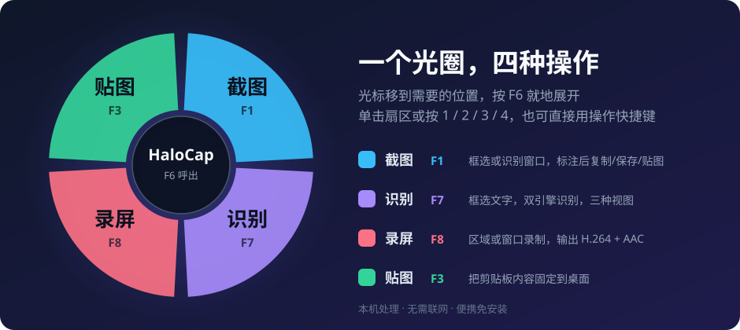

# 🌒 HaloCap · 光圈

[](https://github.com/Joshua-Zion/HaloCap/releases/latest) [](https://www.microsoft.com/windows) [](native/) [](THIRD-PARTY-NOTICES.md)

在光标处展开的 Windows 效率工具——**截图、文字识别、录屏、贴图**收进一个光圈菜单。按一下快捷键,选一项,继续干活。

[下载最新版](https://github.com/Joshua-Zion/HaloCap/releases/latest) · [更新日志](CHANGELOG.md) · [第三方声明](THIRD-PARTY-NOTICES.md) · [Wiki](https://github.com/Joshua-Zion/HaloCap/wiki)



> [!NOTE]
> 🔒 **本机处理,不联网。** 无云服务、无遥测、无上传,不依赖 FFmpeg;除「检查更新」和主动下载高精度模型外,程序不发起网络请求。

## ✨ 亮点

- 🎯 **光标即入口**——菜单在光标位置就地展开,不用切窗口找工具。
- 🔐 **全本地**——识别、截图、录屏、贴图全在本机完成,一个字节都不上传。
- 🪶 **原生轻量**——C++20 / Win32 原生实现,主程序约 1.4 MB,不依赖 .NET。
- 🖥️ **跨屏像素级**——截图与贴图按原始像素处理,支持多显示器与混合 DPI。

## 📑 目录

- [🎯 功能一览](#-功能一览)
- [📥 下载与安装](#-下载与安装)
- [🚀 快速开始](#-快速开始)
- [📖 使用指南](#-使用指南)
  - [⌨️ 快捷键](#-快捷键) · [🌒 光圈菜单](#-光圈菜单) · [✂️ 截图与标注](#-截图与标注) · [📌 贴图](#-贴图) · [📝 文字识别](#-文字识别) · [🎥 录屏](#-录屏)
- [⚙️ 设置与本地数据](#-设置与本地数据)
- [⚠️ 使用限制](#-使用限制)
- [🔧 从源码构建](#-从源码构建)
- [💬 技术说明](#-技术说明)
- [📄 第三方与许可](#-第三方与许可)

---

## 🎯 功能一览

| 功能 | 能做什么 |
| --- | --- |
| **截图** | 框选区域或识别窗口,调整选区,放大查看像素,复制、保存或贴图 |
| **标注** | 画笔、荧光笔、形状、箭头、文字、马赛克、序号、橡皮擦,支持撤销/重做 |
| **文字识别** | 原生 + PP-OCRv6 双引擎,三种视图,可搜索、逐行复制、贴图识别;模型可自选 |
| **录屏** | 区域/窗口录制,可选分辨率、帧率、画质,支持倒计时与暂停,输出 H.264 + AAC MP4 |
| **贴图** | 把剪贴板里的图片、颜色、文字或文件路径固定到桌面,可继续标注 |
| **系统集成** | 自定义全局快捷键、三档尺寸、中心拖动、托盘常驻、单实例、开机自启 |

## 📥 下载与安装

**运行要求**

- Windows 10 1903（build 18362）+ / Windows 11,x64。
- 免安装便携版:原生 `HaloCap.exe`(约 1.4 MB),不依赖 .NET / WPF;包内自带 ONNX Runtime、VC++ 运行库与内置识别模型。
- 原生识别引擎需对应语言的 Windows 识别组件;模型引擎用包内/本地模型,无需额外组件。Windows N / KN 录屏(含 AAC)前需装 Media Feature Pack。

**安装**

1. 从 [Releases](https://github.com/Joshua-Zion/HaloCap/releases) 下载 `HaloCap-<版本>-win-x64.zip`。
2. 解压到固定目录(保持 `HaloCap.exe`、`onnxruntime.dll`、VC 运行库 DLL 与 `models\` 同层),双击运行。程序驻留托盘,无主窗口。
3. 首次启动即可用;「模型识别」直接用包内 `models\ppocrv6-tiny-1`,高精度模型可在设置里一键下载。

> [!TIP]
> 便携应用,删除程序文件夹即可卸载。设置与日志位置见[数据位置](#-设置与本地数据)。

## 🚀 快速开始

1. 按 `F6`,在光标位置打开光圈。
2. 单击扇区,或按 `1` / `2` / `3` / `4` 选截图、识别、录屏、贴图;也可直接用操作快捷键(下表)。
3. 截图时遮罩轻盈并高亮光标下窗口——拖动框选或单击高亮窗口选中,无窗口时自动高亮整屏。
4. 用工具栏标注,`Enter` 完成并复制,`Ctrl + S` 保存,`Ctrl + T` 贴到桌面。
5. 右键托盘图标可截图、识别、录屏(录制中变「停止录制」并多出「暂停/继续」)、贴图、开光圈或进设置。

> [!IMPORTANT]
> 呼出光圈的快捷键只负责开/关光圈,松开不会执行操作;四个操作快捷键直接进入对应功能。

**运行权限(2.4.7 起)**:默认普通权限、不弹 UAC。前台是管理员窗口时普通权限收不到全局快捷键(UIPI 限制);需要覆盖时在「设置 → 通用 → 启动」勾选「以管理员身份启动」(下次生效),或右键托盘 →「以管理员身份重启」临时提权。自启项以 `--no-elevate` 运行,登录不弹 UAC。已有实例时新进程直接退出(单实例)。

## 📖 使用指南

### ⌨️ 快捷键

| 操作 | 默认键 |
| --- | --- |
| 呼出光圈 | `F6` |
| 截图 | `F1` |
| 文字识别 | `F7` |
| 录屏 | `F8` |
| 贴图 | `F3` |

默认值沿用 1.x,都是单功能键:呼出光圈后手不用松开,动作键也不和输入法抢组合键。2.4.9 起新装与从 2.0 早期升级的配置都用这一组(升级只迁移「原样等于旧默认值」的项,自己改过的不动)。

在「设置 → 快捷键」可逐项修改。单键会被系统独占,同一组合键不能分给两个操作,被占用时设置页会提示。单键字母/数字会通过低级键盘钩子优先于输入法拦截,设后该键不能再输入字符(文字工具编辑时仍可用输入法)。

### 🌒 光圈菜单

- 再按快捷键:光标在圈内则关闭,在圈外则移到新位置重开。
- 未选中时中心显示 HaloCap;悬停操作显示中文名与对应颜色的圆点。
- 按住中心圆拖动可移动光圈;`Esc` 或点击圈外关闭。
- 设置里可选小/中/大三档尺寸与单键或组合键快捷键。

### ✂️ 截图与标注

框选后可拖动选区内部移动、拖四角/边缘调整大小,方向键微调(按住 `Shift` 每次 10 像素)。

- **选区**:启动时遮罩轻盈,立即高亮光标下窗口、显示尺寸与放大镜,无可见淡入;开始框选后才压暗外围。自动窗口识别跳过小提示、输入法、阴影窗口,也不选 HaloCap 自身的光圈、遮罩、录制框、托盘菜单;贴图窗口可直接单击选中。
- **跨屏**:截图与识别的选区支持跨显示器框选与移动,复制/保存/贴图/识别按各屏内容拼接,显示器间隙填黑。录屏选区仍限单屏。
- **工具栏**:主栏选工具,子栏调颜色、形状与参数(悬停看提示)。

| 工具 | 键 | 工具 | 键 |
| --- | --- | --- | --- |
| 选择/移动 | `V` | 画笔 | `P` |
| 形状 | `E` | 荧光笔 | `H` |
| 箭头 | `A` | 橡皮擦 | `X` |
| 文字 | `T` | 马赛克 | `M` |
| 序号 | `N` | | |

常用操作:

- 滚轮或 `[` / `]` 调当前工具参数;`F` 切形状填充,`Shift + E` 直接选填充矩形/椭圆;按住 `Shift` 画正方形/正圆或锁定箭头 45°。
- `R` 回到上一次选区——**选区界面一出现就能按**,连按往前翻最多 10 条;选区内已有标注时不回退(换选区会作废标注),需先清空。
- `C` 复制光标下颜色(HEX),`Shift + C` 在 HEX/RGB 间切换并复制(提示条显示色点与结果)。
- `Ctrl + Z` / `Ctrl + Y` 撤销/重做;`Ctrl + B` / `Ctrl + I` 切文字粗/斜(默认常规字重)。
- `空格` 切换选择与标注模式,双击选区直接复制;`Enter` 或工具栏对号完成并复制,一次 `Esc` 关闭整个截图界面。

> [!NOTE]
> 托盘菜单或光圈开着时按截图/识别快捷键,它们**不会被收起来**,画面会合成进底图,拖框盖住即可一起截进去。此时键鼠归选区;选区结束(复制/贴图/`Esc`)后菜单/光圈恢复原交互。

> [!IMPORTANT]
> 标注可画在选区外,但复制/保存/贴图**只输出选区内**。马赛克会把它下面已有的画笔、形状、文字一起像素化。

### 📌 贴图

光圈贴图直接读剪贴板,无需框选;剪贴板无可用内容时扇区与托盘菜单的「贴图」置灰,直接按快捷键静默忽略。截图界面的 `Ctrl + T` 会把选区(含标注)贴到桌面。

| 剪贴板内容 | 贴出结果 |
| --- | --- |
| 图片 | 原图,保留透明度 |
| RGB | 三个 `0–255` 整数或 `0–1` 小数,显示色卡(如 `255, 128, 0`、`rgb(1.0, 0.5, 0)`) |
| HEX | `#RGB` / `#RGBA` / `#RRGGBB` / `#RRGGBBAA`,透明度位在末尾 |
| 文本 / HTML | 文字贴图;HTML 只取可见文字与换行,不执行脚本、不加载外部资源 |
| 图片文件 | 同批首次显示图片,再次贴出文件路径;重新复制后可再贴图 |
| 其他文件 | 显示路径,多个合并 |

- **读取优先级**:文件 > 图片 > 颜色 > HTML 文本 > 纯文本;图片优先 PNG,再 `CF_DIBV5`、`CF_DIB`。无法解码的图片、网络/重解析路径按路径文字显示,不读远程文件。
- **颜色格式**:还支持 `rgb(...)`、`rgba(14, 165, 233, 0.5)` 及 `14 165 233 / 0.5` 写法;带 alpha 的色块真正半透明透出桌面(底部信息条仍白底)。PNG 与 32 位 DIB/DIBV5 的透明区直接显示桌面,复制/另存后 alpha 仍在。
- 「设置 → 截图与贴图 → 图片文件转为图像」默认开;关掉后文件始终按路径贴出。

| 操作 | 行为 |
| --- | --- |
| 拖动 / 滚轮 | 移动(可拖出屏幕)/ 以光标为中心缩放 |
| `Ctrl + 滚轮` / `Ctrl + 0` | 调透明度 / 实际大小 |
| `Ctrl + C` / `Ctrl + S` | 复制 / 保存(含标注) |
| `空格` | 进入/退出标注模式 |
| `Esc` | 标注模式:退出编辑保留贴图;非标注模式:关闭贴图 |

标注模式下滚轮调工具参数、不缩放;标注工具栏固定在图片下方外侧、不挡画面、不随贴图缩放,窗口窄时向两侧扩展,贴底时自动翻到上方。右键菜单可关闭当前/全部贴图,支持多张同时保留。

每张贴图默认带一圈浅蓝外描边便于辨认、不盖图片边缘;右键「外描边」可开关,立即应用到所有贴图并记住,浮层样式与托盘菜单一致。

### 📝 文字识别

框选文字区域,松开即识别,结果在浮窗显示;选区同样支持跨屏框选与移动。

- **结果**:按检测到的文本行输出,不重建排版;文字可直接选择,`Ctrl + F` 搜索高亮。
- **三种视图**:文本区顶部切换「连续 / 逐行 / 排版」(不重新识别,共用结果,切换保留编辑内容)。连续=可编辑纯文本;逐行=带行号,单击选中、双击/`Enter` 复制,可用 `↑↓` / `PageUp` / `PageDown` / `Home` / `End` 移动;排版=按几何位置聚成内容块(块首标「块 N」)。
- **复制**:`Ctrl + Shift + C` 或「复制全部」优先复制选中内容,无选区时复制全部(三种模式格式一致、不含行号)。
- **窗口**:普通层级(不置顶),可随时切回原文对照;原图预览默认收起,点「原图」展开。
- **引擎**(设置 → 文字识别):原生=Windows 离线引擎,快、占用低;模型=PP-OCRv6,对中英混排和小字更稳,深色截图自动反色,稍慢。都完全本机运行。
- **模型**:「模型识别」下可选内置「极速」或目录里其他模型(下载或手工放入),选中保存后下次生效,不可用自动回落内置。点「下载」可获取官方「高精度」模型(约 31 MB)到 `%LOCALAPPDATA%\HaloCap2\models\ppocrv6-small\`,「打开目录」查看模型根目录。模型目录需含 det/rec 的 `.onnx` 与字典 `.txt`,方向分类 `.onnx` 可选。
- **其它**:设置可开「自动复制」;「重试」按当前引擎重识别(无结果/失败也可重试);贴图上右键「识别文字」或非标注模式按 `O` 识别原图(不含标注)。

> [!TIP]
> 原生引擎缺语言组件时,到 Windows 语言设置装「光学字符识别」。截图工具栏的文字识别只处理原始截图,不含后加标注。

### 🎥 录屏

**范围**(设置 → 录制范围):

- **区域**:限定单屏。框选后可移动、调大小、方向键微调,`Enter` 或「开始录制」。
- **窗口**:单击或框选目标窗口,只录可见区域(去掉不可见缩放边框与阴影)。窗口移动跟随,改大小自动重建采集继续录(尺寸不变,比例变化补黑边),关闭或最小化自动停止保存。

**过程**:倒计时(关/3/5 秒)后开始;录制中区域外围红框,浮层显示计时、输出尺寸、已写大小、音源与电平条,及「暂停/继续」「停止」(都不被录进视频)。暂停同时冻结画面与音频时间轴,恢复不跳帧。托盘菜单同样可停止/暂停,录制中再按 `F8` 直接结束。停止后存 MP4,完成通知给出时长、尺寸、体积、音轨与丢帧数。

**输出**(设置里调整):分辨率(原始/2160p/1440p/1080p/720p,只缩不放)、帧率(30/60)、画质(高/均衡/紧凑,按分辨率与帧率算码率)、是否录光标。关光标录制需 Win10 2004+,更早系统只能带光标(设置页标灰说明)。优先硬件 H.264,失败回退软件;开始前检查磁盘至少留约 1 分钟余量。采集帧在 GPU 上裁剪,只把选区大小像素交给编码器,4K 全录不再整帧搬运。默认存到「视频」目录下的 `Captures`,可改。

**声音**(设置 → 声音):系统声音(WASAPI loopback,默认开)与麦克风(默认关)可同开,本机混成 48kHz 立体声 AAC,码率 128/192 kbps;浮层显示电平条,暂停时音频画面一起冻住并对齐。DRM 保护内容拿不到声;设备打不开/被隐私拒绝/中途断开会提示并继续录画面,通知里标「无音轨」。

## ⚙️ 设置与本地数据

右键托盘 →「设置…」。六页,改完按「保存」生效:

| 页面 | 内容 |
| --- | --- |
| 通用 | 开机自启、以管理员启动、光圈大小、复制路径转图片、贴图光晕默认值 |
| 快捷键 | 呼出光圈与截图/识别/录屏/贴图的全局按键 |
| 截图与贴图 | PNG/JPG 格式与质量、贴图开关 |
| 文字识别 | 原生/模型引擎、模型目录、自动复制、选好区域后自动识别 |
| 录屏 | 分辨率、帧率、画质、范围、自动开始、倒计时、系统声音、麦克风、录光标、保存目录(下次录制生效) |
| 关于 | 版本、检查更新、权限与前台诊断、环境摘要、数据位置 |

设置是非模态窗口,期间仍可用托盘菜单与全局快捷键;点菜单外或托盘区域时菜单自动关闭。

- **检查更新**:「关于 → 检查更新」查 GitHub Releases,有更新弹窗确认后下载到 `%LOCALAPPDATA%\HaloCap2\update\v<版本>\`,关闭 HaloCap 解压覆盖即可。`update.url` 可指向镜像 atom 源。
- **环境摘要**:「关于 → 环境摘要 → 复制」把系统版本、显示器与缩放、捕获能力、H.264/AAC 编码器、原生识别语言、内存一次复制到剪贴板(每次启动也写日志);「诊断」显示本进程与前台窗口提权状态。遇到「录屏没声音」「为什么软编」「识别不出中文」先发这份摘要。
- 开机自启也可在托盘菜单切换;启用后别移动程序目录,移动需重开。

**数据位置**

| 数据 | 位置 |
| --- | --- |
| 设置 | `%APPDATA%\HaloCap2\settings.json` |
| 日志 | `%APPDATA%\HaloCap2\logs\`,按天分片,单片 > 8 MB 换新,每天最多 6 片,超 14 天自动删 |
| OCR 模型 | 内置在 `models\ppocrv6-tiny-1`;用户/下载模型在 `%LOCALAPPDATA%\HaloCap2\models\<目录>\` |
| 录屏目录 | 「视频」下 `Captures`(首次启动回显真实路径,可改) |

系统下限 Win10 1903（18362）。低于下限时启动提示一次并写日志,截图/识别/贴图照常用,版本过低导致的功能差异(如无法隐藏光标)在设置页与日志说明,不静默失败。

## ⚠️ 使用限制

- 录屏选区限单屏;截图与识别选区支持跨屏。
- 低于 Win10 1903（18362)不支持:录屏可能失效;隐藏录制光标需 2004+,更早始终带光标并在设置页说明。
- 文字贴图对极长内容省略显示;单图上限 6400 万像素,一批最多 16 张、像素缓存预算 256 MB,超限按路径显示。
- OCR 对极小字、手写、低对比度、复杂混排准确率有限;模型引擎对中英混排更稳但较慢,不保证所有样本。
- 录屏音频:DRM 内容拿不到;4K/60fps 稳定性看编码能力,负载高会丢帧并在通知里报数。4K 体积估算(3840×2160/30fps/硬编):均衡约 184 MB/分,高约 337,紧凑约 103——长时间 4K 建议紧凑档并留意磁盘。
- 窗口录制若系统要求无边框授权(打包应用或未授予 `graphicsCaptureWithoutBorder`),WGC 仍会画彩色边框;程序尝试关闭,失败保留系统默认。
- 快捷键、单实例、开机自启依赖当前 Windows 会话,远程桌面/权限隔离可能影响。
- Windows 捕获提示边框由系统控制,HaloCap 不关闭或修改该隐私指示器。

## 🔧 从源码构建

<details>
<summary>环境、构建、测试、打包与项目结构(点击展开)</summary>

2.0 是 C++20 / Win32 原生实现,源码在 `native/`。1.x 的 WPF 实现已停维,归档在 `legacy/1.x`; `main` 只保留 2.x 原生实现,也是唯一维护线。

**环境**:Windows 10 1903+ / 11 x64;VS 2022 Build Tools(MSVC 14.4x + SDK 10.0.26100);CMake 3.25+ 与 Ninja;ONNX Runtime 二进制在 `native/third_party/onnxruntime`,构建不联网。

**构建与测试**

```bat
cd native
build.cmd
ctest --test-dir native\build --output-on-failure
```

`build.cmd` 进 vcvars64、用 CMake + Ninja 构建全部目标并跑单测;Debug 产物在 `native/build/app/HaloCap.exe`。发布版用同目录 `build-release.cmd`(独立 `native/build-release`,`CMAKE_BUILD_TYPE=Release`)。18 组单测覆盖坐标/选区、标注/马赛克、设置/JSON、热键策略、录制会话/音频策略、托盘菜单模型等。运行时自检(写 `KEY=value` 报告与证明图):

```bat
HaloCap.exe --selftest --report out.txt
HaloCap.exe --screenshot-selftest proof.png
HaloCap.exe --ocr-selftest proof.png
HaloCap.exe --recording-ui-selftest proof.png
HaloCap.exe --tray-menu-selftest proof.png
```

多屏、语言包缺失、真实采集与编码器仍需实际 Windows 环境验证。

**发布打包**:`cd native && build-release.cmd`,把 `native/build-release/app/HaloCap.exe`、`onnxruntime.dll`、四个 VC 运行库(`msvcp140.dll`、`msvcp140_1.dll`、`vcruntime140.dll`、`vcruntime140_1.dll`)、`models\ppocrv6-tiny-1` 与 `README.txt`、`CHANGELOG.md`、`THIRD-PARTY-NOTICES.md` 打包为 ZIP。`tools/logo_icon` 可从同一套渲染重新生成 `app.ico`。

**项目结构**

```text
native/
  core/         纯逻辑:设置/JSON、坐标/选区、标注、录制会话与音视频策略、热键、托盘菜单模型
  platform/     Win32 适配:D3D11/D2D 渲染、WGC 与桌面复制、Media Foundation、WASAPI、输入、托盘、存储
  app/          UI 与组装:选区覆盖层、贴图、OCR 窗口、光圈、录制浮层、托盘菜单、设置窗
  tests/        CTest 单元测试
  tools/        探针与自检小工具(含 logo_icon)
  models/       内置 OCR 模型(PP-OCRv6 tiny:ppocrv6-tiny-1)
```

</details>

## 💬 技术说明

<details>
<summary>原生实现细节(点击展开)</summary>

选区与标注由 Direct2D / DirectComposition 合成;录屏用 `Windows.Graphics.Capture`(窗口)或桌面复制(区域)与 Media Foundation,帧纹理在 D3D11 上按选区裁剪、需要时面积平均下采样,编码优先硬件 H.264 MFT、失败回退软件;音频用 WASAPI 采集,独立线程重采样、混音成 48kHz 立体声 AAC,两条流共用一个时钟。原生识别用 `Windows.Media.Ocr`,模型识别用 PP-OCRv6(tiny/small)+ ONNX Runtime。

</details>

## 📄 第三方与许可

OCR 模型与第三方组件许可见 [第三方声明](THIRD-PARTY-NOTICES.md);历次功能、调整与修复见 [更新日志](CHANGELOG.md)。
