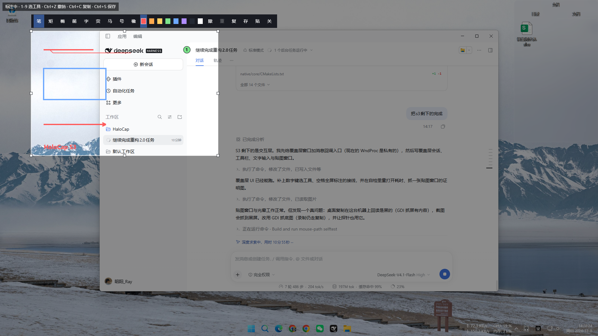
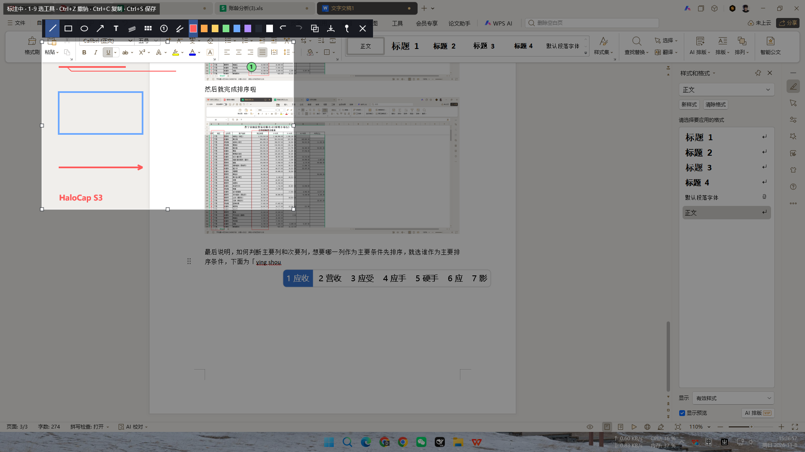
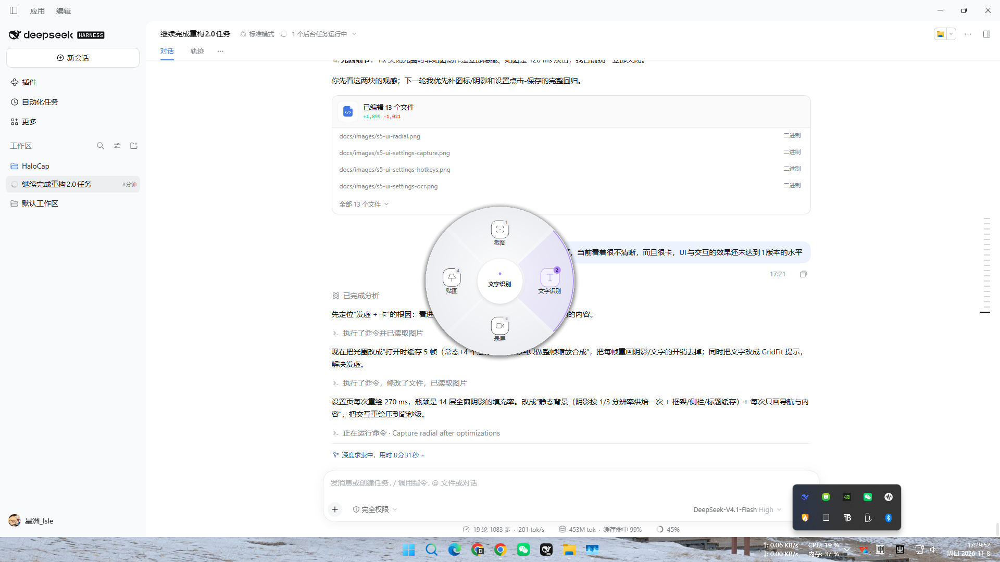
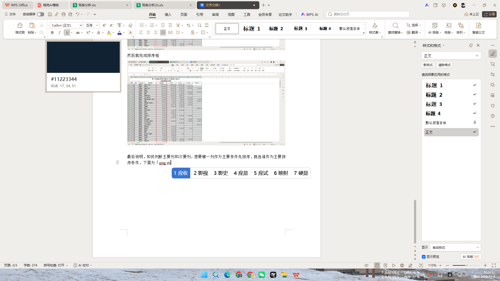
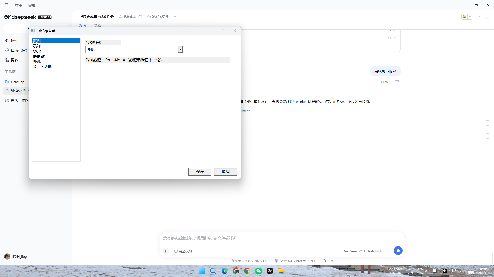
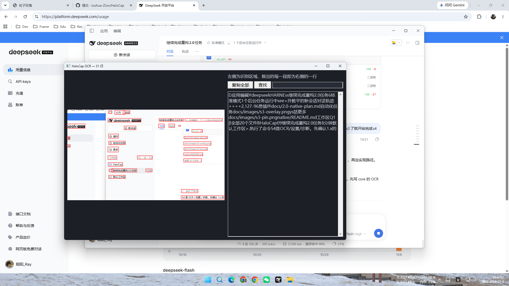
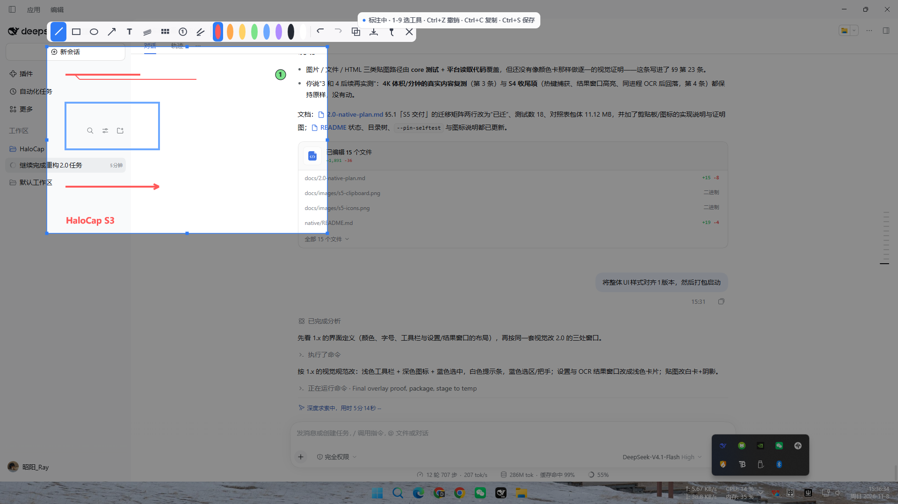
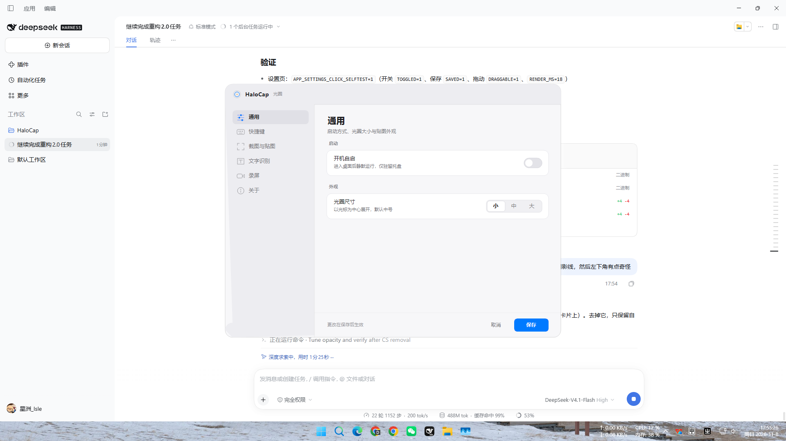
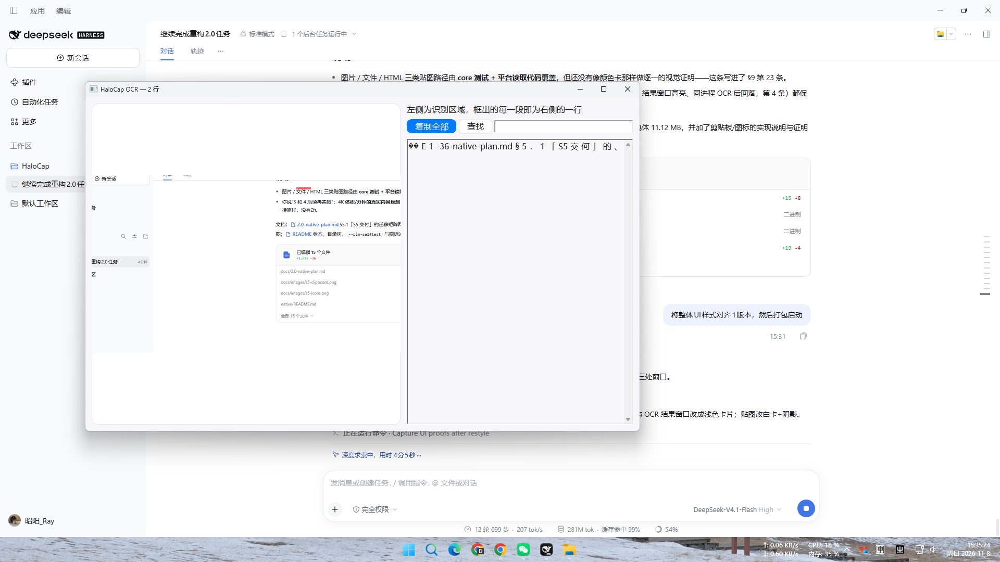

# HaloCap 2.0 原生重构计划

> 状态：计划草案，未开始实现；所有基线数字来自 v1.7.0 在本机的实测  
> 更新时间：2026-11-05  
> 适用范围：HaloCap 2.0，Windows 10 1903+（x64）  
> 不在本文范围：Windows 7/8、macOS 的实现（macOS 只保留架构上的可移植性，见 §6）

## 1. 为什么要重写

### 1.1 1.x 实测基线（本机，v1.7.0）

| 指标 | 实测值 | 口径 |
| --- | --- | --- |
| 启动私有内存 | 194–195 MB（工作集 325 MB） | 启动时环境摘要 |
| 空闲私有内存 | 稳定 249–250 MB | 回收日志 |
| 4K30 录制峰值私有内存 | **841 MB** | 录制中 250 ms 采样峰值 |
| 4K 全屏截图一次 | 726 → 646 MB（回收后仍留几百 MB） | 回收日志前后对比 |
| 选区打开到首帧 | 562 ms | 现有日志埋点 |
| 4K 均衡档体积 | 约 184 MB/分钟（高 337、紧凑 103） | 20.2 s / 62.0 MB 实测 |
| 交付包体积 | 90 MB（自包含 .NET 8 + WPF + ORT） | zip |

### 1.2 根因

- **WPF 渲染面**：.NET + WPF 自身基线约 185 MB，任何功能优化都压不进 40–80 MB 的空闲预算。
- **逐帧 CPU 拷贝**：4K 一帧约 33 MB，在「WGC 纹理 → GPU 裁剪 → staging 映射 → byte[] → 编码器输入 × 队列深度 3」这条链上被复制约 5 次，这就是 841 MB 峰值的全部来源。
- 位图像素不参与托管堆压力统计，回收只能靠显式触发（v1.7.0 已把触发点补全，但机制上限仍在）。

### 1.3 2.0 硬性目标（验收口径）

| 指标 | 1.x 现状 | 2.0 目标 | 怎么量 |
| --- | --- | --- | --- |
| 空闲私有内存 | 249 MB | **≤ 80 MB** | 环境摘要同一字段，空闲 5 分钟取均值。已知地板：原生渲染 + 文本图集 + 窗口 + 合成链，离屏目标与 STAGING 懒建之后实测 **60 MB**（§5.1），留给窗口/托盘/日志与 S4 的 ORT 只有约 20 MB；且 `DetachWindow` + `IDXGIDevice3::Trim()` 之后私有内存不降（61→61），说明这 60 MB 不是我们的引用扣着的 |
| 4K30 录制峰值私有内存 | 841 MB | **≤ 350 MB**，**这条要重新校准**：编码 seam 单独量的 4K 结果是「开一个写入器 + NV12 环 = +92 MB，整段编码过程内存平坦」，但探针进程本身的地板就有 ~400 MB（两张 4K 样图纹理 + 额外的转换器 + 负例写入器），产品里没有这些。口径见 §5.1「S1 的编码 seam」 | 与上表同口径（环境摘要的私有内存字段），可与 1.x 直接对比；seam 侧的分解数字由 `native/tools/encoder_probe` 给 |
| 4K 截图后回落 | 646 MB | **≤ 120 MB** | 分配池 + 释放事件打点 |
| 选区打开到首帧 | 562 ms | **≤ 150 ms** | 沿用日志埋点 |
| 覆盖层帧时间（整面重绘） | 未单测 | **≤ 5 ms** 这条按离屏口径写的，**上屏实测 4K 整面 8.29 ms/帧，所以此数要改**：改成「60 fps 不丢帧 + 整面重绘留得出余量」，见 §5.1「S1 的帧调度与上屏口径」 | 帧计数 + 每帧耗时直方图（由 `core::FrameScheduler` 给目标帧率并数「已提交 / 应有」，Present 自己不受 vsync 节流）。离屏：7 图元 1.72–1.95 ms、603 图元 2.32–2.41 ms、2003 图元 3.39–4.79 ms |
| 覆盖层帧时间（只重绘变化区） | 未单测 | **≤ 2 ms**，**前提是 core 先按脏区裁掉图元**（已实现 `AppendIntersecting`） | 同上，按脏区大小分桶。离屏 600×600：只压 clip 时 2003 图元仍 3.19–3.50 ms（等于没省）；先裁再压 → 102 图元、1.24–1.51 ms。上屏脏区呈现：60 fps 下 120/120、0 超预算 |
| 覆盖层帧时间（只重绘变化区） | 未单测 | **≤ 2 ms**，**前提是 core 先按脏区裁掉图元**（已实现 `AppendIntersecting`） | 同上，按脏区大小分桶。600×600 脏区实测：只压 clip 不裁图元 → 2003 图元仍要 3.19–3.50 ms（等于没省）；先裁再压 → 剩 102 图元、1.24–1.51 ms（达标） |
| 4K 整帧回读 | 1.x 走 GPU 裁剪，不整帧回读 | **禁止每帧整帧回读**：原生一次 `CopyResource` + `Map` 实测 7.74–14.19 ms | 打点统计每帧回读字节数，超预算即失败 |
| 交付包体积 | 90 MB | **≤ 20 MB** | zip |

### 1.4 非目标

- 不支持 Windows 7/8。WGC 需 Win10 1803+、DXGI 桌面复制需 Win8+、ONNX Runtime 官方只测 Win10+，为 Win7/8 要同时维护第二套采集与第二套 OCR（Tesseract），收益与成本不成立。
- 不引入 Qt、Skia、Electron、FFmpeg 或任何重型运行时依赖。
- 不做 macOS 实现；2.0 阶段只保证 macOS 移植是「换后端 + 写平台服务」，而不是「没有路」。
- 不扩功能范围：以 v1.7.0 的功能集为基线做等价重写，任何新交互另立计划。

## 2. 技术选型

| 层 | 选择 | 放弃的选项与原因 |
| --- | --- | --- |
| 窗口 / 覆盖层 | Win32 窗口 + **DirectComposition 合成链**（DXGI composition flip 交换链，预乘 alpha）+ Direct2D 绘制。原文写的「DXGI flip 交换链」在本机被实测否掉了：挂在 HWND 上的 flip 链不接受 alpha，见 §5.1「S1 的上屏路径」 | Qt（自带几十 MB、开源线已停更、许可复杂）；Skia（为「也许做」的 mac 现在就付 25 MB 体积和一层光栅开销）；UpdateLayeredWindow（每帧把脏区从 GPU 搬回 CPU，与 §3.3 规则二对着干） |
| 显示器与区域采集 | **DXGI 桌面复制**，消费 `DIRTY_RECTS / MOVE_RECTS` 元数据，只搬运变化区域 | 继续用 WGC + 整帧拷贝：静态桌面也要全帧搬，内存与带宽双输 |
| 窗口录制 | 保留 WGC（目前唯一能干净按窗口取帧的官方路径） | 两条路各自最优，不为统一牺牲性能 |
| 视频编码 | Media Foundation 硬件 H.264 MFT，优先 D3D11 纹理直入（`MFT_MESSAGE_SET_D3D_MANAGER`）；不支持时回退 CPU 且队列深度压到 2 | 不引 NVENC / AMF / QBEnc SDK：那等于换掉「不引重型依赖」的约束，且收益只在部分机型成立 |
| 音频采集 | 沿用 WASAPI loopback + 麦克风（v1.6.0 已跑通） | 无更优选择 |
| 音频编码与封装 | MF AAC + MP4（`IMFSinkWriter`） | 自写 muxer 成本高且没有收益 |
| OCR | ONNX Runtime + 内置 PP-OCRv6 tiny；原生 `Windows.Media.Ocr` 作为可选第二引擎 | Tesseract（中文准确率明显低于现有模型引擎） |
| UI 逻辑与几何 | 纯 C++ `core`，禁止出现平台头文件 | 直接写在窗口过程里：等于放弃 §3 的全部收益 |
| 文字排版 | **定案：shaping 走平台 API**——Windows 用 DirectWrite，mac 那天用 CoreText，都在 `IFontRasterizer` 这个 seam 后面；core 只保留文本模型（画什么、画在哪、怎么换行、度量缓存键） | 原计划写的「core 内 HarfBuzz + 自带字体」已否决，理由与实测数字见 §5.1「决定：shaping 留在平台侧」 |

## 3. 架构与边界

### 3.1 分层

- **core（纯 C++，可独立编译）**：几何与坐标模型、DPI 映射、选区状态机、标注数据模型与图元生成、圆盘菜单状态机、混音与重采样、码率档位换算、设置 schema、日志规则、OCR 前后处理与按行结果。
- **platform（Windows 实现）**：窗口与交换链、Direct2D/DirectWrite 后端、桌面复制与 WGC、MF 编码器、WASAPI、全局热键与输入拦截、托盘、文件系统与注册表、ORT 会话宿主。

### 3.2 平台边界只有 8 个 seam

| 接口 | 职责 | macOS 对应物（将来） |
| --- | --- | --- |
| `ISurfaceWindow` | 透明全屏覆盖层、逐像素命中、不抢焦点 | NSWindow + 透明 layer |
| `IRenderBackend` | 消费显示列表，落到原生 2D API | Metal / CoreGraphics |
| `IFontRasterizer` | 把 core 的字形 run 栅格进共享图集 | CoreText |
| `ICaptureSource` | 帧以纹理或（映射后的）缓冲交付，含脏矩形 | ScreenCaptureKit |
| `IEncoder` | H.264 + AAC → MP4 | VideoToolbox + AVAssetWriter |
| `IAudioSource` | 系统声音 + 麦克风，48kHz 立体声 | Core Audio taps（14.4+） |
| `IInputHost` | 全局热键、低级拦截、IME 生命周期 | Carbon hotkey + 辅助功能权限 |
| `IStore` + `ICapability` | 设置 / 日志 / 模型路径；系统下限与特性开关 | 同结构，换判据 |

### 3.3 三条硬规则

1. **core 只产显示列表**（顶点、图元、字形 run、图层顺序），不出现任何 D2D 调用。渲染热路径由后端一次提交，不允许 core 逐图元调用 API。
2. **热路径只操作裸缓冲**：放大镜取样、标注合成、导出位图在 core 里只看到 `指针 + stride + 尺寸`，映射与解映射由平台层负责；逻辑可复用，也不允许产生额外拷贝。
3. **可机检的纪律**：CI 增加一个「用 stub 后端编译 core」的目标，core 目录里出现平台头文件即失败。规则靠检查而不是靠自觉。

## 4. 录制管线（性能核心）

> spike 1 已验证（见 §5.1）：纹理直入可用，但**入口是 `IMFSinkWriter`，不是裸 MFT**；下列四条已按实测结论修正。

- 显示器/区域：桌面复制 → 按脏矩形合并更新到一张常驻纹理 → 编码器纹理直入。静态桌面下每帧搬运量应从「整帧 33 MB」降到脏矩形量级。
- **编码入口固定为 `IMFSinkWriter` + `MF_SINK_WRITER_D3D_MANAGER`**：本机两块硬件编码器（Intel QSV、NVENC）都是**异步 MFT**，同步 `IMFTransform` 面（含 `ProcessMessage(SET_D3D_MANAGER)`）一律返回 `MF_E_TRANSFORM_ASYNC_LOCKED`，裸 MFT 路线要么实现异步协议，要么走不通。写入器已经替我们驱动异步编码器，样本侧只需按下面的规矩喂。
- **样本规矩（踩过一次就写死）**：`MFCreateDXGISurfaceBuffer` 出来的缓冲 `GetCurrentLength()` 恒为 0，必须显式 `SetCurrentLength(宽×高×3/2)`，否则每一帧 `WriteSample` 都是 `E_INVALIDARG`，最终 `MF_E_SINK_NO_SAMPLES_PROCESSED`、产出 0 字节文件。输入类型用 NV12；**BGRA 纹理直入不可用**——样本会被接受但 `Finalize` 失败，2.0 里 BGRA→NV12 的转换必须自己留在 GPU 上做完。三条同类的硬规矩由 `tools/encoder_probe` 钉下来（§5.1「S1 的编码 seam」）：**宽高必须都是偶数**（NV12 是 4:2:0 的两个平面，奇数没有合法的色度划分，所以选区要在进编码器之前取整）；**NV12 作为视频处理器的输出必须带 `D3D11_BIND_RENDER_TARGET`**（给 `SHADER_RESOURCE` 或 `DECODER` 一律 `E_INVALIDARG`，两块卡一致；`RT|SRV` 也能过，所以取这一组，纹理除进编码器还能被采样）；**输入类型写全属性即可**（`DefaultStride` + `SampleSize` 被接受，不需要试变体）。
- **节流留着**：`MF_SINK_WRITER_DISABLE_THROTTLING` 打开之后写入器不再按时间轴等帧，`Submit` 的阻塞就没了——720p 硬件那一路实测平均送帧成本从 **5.35 ms/帧（节流）降到 0.88 ms/帧（不节流）**，`submit_max` 从 88 ms 降到 6 ms，也就是说节流确实在 `Submit` 上形成反压，这是产品需要的行为（采集比编码快时应当挡住采集，而不是把帧攒起来）。内存侧则量不出差别，见 §5.1「S1 的编码 seam」的纠正记录：这里一度记过「不节流 4K 软件编码器 2.69 GB」，那是探针自己的 CPU 纹理上传造成的假象，不是写入器攒帧。
- 设备与适配器要配对：注册进 DXGI 管理器的 D3D11 设备决定了写入器选哪一家的编码器（把设备钉到 NVIDIA 适配器与钉到 Intel 适配器产出不同码流，默认走的是 Intel）。采集用的设备与编码用的设备必须是同一块卡上的同一个设备。**新增一条同样只能实测的前提：`SetProcessDpiAwarenessContext(PER_MONITOR_AWARE_V2)` 必须在枚举输出之前调用**——否则 `DXGI_OUTPUT_DESC.DesktopCoordinates` 给的是 DIP 而不是像素，常驻纹理会按 2/3 的尺寸建，坐标全体错位（§5.1「S1 的采集 seam」有本机对照）。
- 窗口：WGC 帧池（深度 2）→ 同一条编码器入口。
- 回退：软件编码器同样能吃纹理（写入器内部插入转换器），因此「无硬件编码器」只影响 CPU 占用，不影响这条管线能不能跑；系统内存路径保留，缓冲全部来自**显式对象池**，队列深度 2，禁止在帧循环里 new。
- 时间轴：直接沿用 v1.6.0 的成果——视频与音频共用一个录制时钟、暂停同时冻结两条流、按 1024 帧块补静音/对齐、环形缓冲写满丢最旧。这部分逻辑属于 core，**已经迁完并可测**（`RecordingClock` / `FrameGate` 在 `encoder_policy.cpp`，`StereoRingBuffer` / `MixInto` / `RemixToStereo` / `SilenceFramesToNextBlock` / 帧↔微秒在 `audio_policy.cpp`，合计 51 + 81 项断言）。接上去要补的一条是本机量出来的：**`GetBuffer` 给的 QPC 是包被采集的时刻，比读到的时刻早 17–21 ms**，所以音频天生比视频晚一个缓冲深度，AAC 流进写入器时要做固定延迟补偿（§5.1「S1 的音频 seam」）。
- 统计口径保持与 1.x 一致（`EncodedFrames`、`DroppedFrames`、体积、时长、是否硬件编码），这样两版的实测可对比。**「是否硬件编码」在 2.0 里是可观测的**，spike 1 那句「问不出来」被本轮推翻：它当时是在 `AddStream` 之后、`SetInputMediaType` 之前调 `GetServiceForStream(GUID_NULL, IID_IMFTransform)`，那时服务还没建起来（`MF_E_UNSUPPORTED_SERVICE`）；等输入/输出类型协商完再问，同一个调用返回 `S_OK`，从返回的 `IMFTransform` 属性表里能读到 `MFT_ENUM_HARDWARE_VENDOR_ID_Attribute`（本机 `"VEN_8086"`）、`MFT_ENUM_HARDWARE_URL_Attribute` 与 `MFT_TRANSFORM_CLSID_Attribute`，软件编码器那一路则连厂商位都没有。所以 `EncoderStats` 里「已请求」与「已观测」是两个分开的字段，而不是只有一个降级为「已请求」。

## 5. 阶段划分与退出条件

| 阶段 | 内容 | 退出条件 |
| --- | --- | --- |
| **S0 Spike** | 见 §5.1，三项并行 | 每项出一份结论；S0 任一失败则重写目标需下调，不进入 S1 |
| S1 骨架 | core 构建、8 个 seam、显示列表 + D2D 后端、窗口/覆盖层、热键与 IME、托盘、设置与日志 | 覆盖层帧时间达标：整面 4K 重绘 ≤ 5 ms、只重绘变化区 ≤ 2 ms（spike 3 实测基线）；空闲内存 ≤ 80 MB（此时还没有 OCR 与编码器）。**已达成（2026-11-08）**：帧时间沿用 `surface_probe` 的 120/120、比值 1.0000；组装后的 app 实测 idle 2.3 MB、预热覆盖层约 62 MB（1080p/1440p/4K 一致），见 §5.1「S1 的组装与空闲内存」 |
| S2 采集与录制 | 桌面复制 + WGC + MF（含纹理直入与回退）、WASAPI 混音 | 4K30 峰值 ≤ 350 MB；有变化样本下不丢帧；音画同步 < 50 ms |
| S3 标注与贴图 | 工具栏、画笔/形状/箭头/文字/荧光笔/马赛克/序号/橡皮、全屏标注、贴图窗口与光晕 | 与 1.x 功能等价；截图后回落 ≤ 120 MB；选区打开 ≤ 150 ms |
| S4 OCR / 设置 / 诊断 | ORT 推理、按行结果与搜索、结果窗口排版、六页设置、环境摘要与 `ICapability` | 双引擎准确率不劣于 1.x；空闲不因为常驻模型破 80 MB（按需加载、空闲卸载） |
| S5 交付 | 打包、签名、更新通道、测试迁移、文档 | 包体 ≤ 20 MB；迁移测试全绿；给出与 1.x 的对照数据 |

### 5.1 S0 的三项 spike（各 0.5–1 天，独立小工具，不碰 1.x）

1. **编码器纹理直入覆盖率**：在目标机型集合上确认硬件 H.264 MFT 是否接受 D3D11 管理器路径。这是整个方案唯一的地基性未知——不支持就仍要 CPU 拷贝，「≤ 350 MB」从承诺降级为期望值。
2. **桌面复制在 4K 的吞吐与脏矩形有效性**：用真正有画面变化的样本，测 4K30 / 4K60 的送帧率与 CPU 占用。顺带补掉 1.7.0 那个无效样本（静态桌面 20 秒只送 149 帧，说明不了编码能力）。
3. **Direct2D 覆盖层原型**：4K 冻结图 + 实时放大镜 + 标注图元，量帧时间与空闲内存；验证 ≤ 80 MB 是否被 ORT 常驻打破。

**先只跑第 1 项**：它最可能直接否掉「4K < 500 MB」这条目标，拿到结论再决定 §1.3 的数值怎么写。第 1 项已跑完（下方结论）；第 2 项进行中，受控样本被「复制权被占用」阻塞。

#### spike 1 结论（2026-11-05，本机 = Intel UHD(A78B) + RTX 4060 Laptop，Win11 26300）

工具在 `spikes/EncoderD3DInput/`（独立控制台程序，不进产品、不进解决方案，`artifacts/spike-headers/` 只是核实用头文件）。

| 走法 | 结果 |
| --- | --- |
| 裸 MFT + `ProcessMessage(SET_D3D_MANAGER)` | **两块硬件编码器都是 `MF_E_TRANSFORM_ASYNC_LOCKED`（0xC00D6D77）**，连消息本身都被拒；软件编码器回 `E_NOTIMPL`。同步 MFT 路线放弃 |
| `IMFActivate::ActivateObject` | Intel ×2 S_OK；NVIDIA 那台直接 `E_UNEXPECTED`，裸激活在真实驱动前不保证可用 |
| `IMFSinkWriter` + `MF_SINK_WRITER_D3D_MANAGER` + NV12 纹理 + 显式 `SetCurrentLength` | **4K30 连续 120 帧全部接受，Finalize S_OK，产出 16,875,257 字节有效 H.264**；进程工作集峰值 197 MB，120 帧耗时 1.26 s、CPU 0.88 s |
| 同上但不写 `SetCurrentLength` | 每帧 `WriteSample` = `E_INVALIDARG`，Finalize = `MF_E_SINK_NO_SAMPLES_PROCESSED`，文件 0 字节（DXGI surface 缓冲的 `GetCurrentLength()` 恒为 0） |
| 同上但 BGRA 纹理（桌面复制原生格式） | 样本 120/120 被接受，但 Finalize `E_INVALIDARG`、0 字节 → BGRA 直入不可用，2.0 需在 GPU 上先转 NV12 |
| 软件编码器 + NV12 纹理 | 同样能写（写入器内部插转换器），纹理管线不依赖硬件 |
| 钉适配器（0/1/2 = Intel/Intel/NVIDIA） | 三种都跑通，且 NVIDIA 与 Intel 码流字节数不同 → **注册哪个设备决定写入器用哪家的编码器** |

对目标的影响：

- 「≤ 350 MB @ 4K」不再是悬空的期望值——**纹理直入本身可行且有实测数据支撑**，本项风险解除；剩下的不确定性转移到采集侧与常驻缓冲（spike 2）。
- 但 §4 的管线写法必须照上表改：**编码入口是 SinkWriter，样本是 NV12 纹理且要显式写长度**，BGRA→NV12 转换是 2.0 自己的责任。
- 「是否硬件编码」这个统计项没有可靠的查询接口（`GetServiceForStream(GUID_NULL)` → `MF_E_UNSUPPORTED_SERVICE`），1.x 目前按尝试顺序推断，2.0 需要重新定义口径。
- 附带纠正一条常见引用：`MFT_MESSAGE_SET_D3D_MANAGER` 在当前 SDK 是 **0x2**，网上流传的 3002 是旧值；两处头文件镜像一致。

#### spike 2 结论（2026-11-05，工具在 `spikes/DuplicationThroughput/`）

已拿到的结论（自然活动样本，两块屏各一次；受控样本被环境阻塞，见下）：

| 观察 | 数据 | 对 2.0 的意义 |
| --- | --- | --- |
| **送帧吞吐上限** | 4K 面板上受控变化源：目标 30/60/120 次每秒，实测送达 **23.1 / 59.1 / 108.8 帧每秒**，采集侧 CPU 只占单核 2.2% / 5.6% / 8.6%，工作集 57–58 MB | 复制通道本身能跑到 100 帧每秒以上，「4K60 送不满」不是 API 限制——1.7.0 那个「20 秒只送 149 帧」的样本确实由内容静止造成。4K60 的承诺可以写实，瓶颈要去看编码与拷贝侧（已由 spike 1 证明不是问题） |
| **脏矩形有效** | 单个 640×360 窗口移动时，每帧 1 个脏矩形、约 25–26 万像素，只有整屏的 **3.1%**（对照：整帧 BGRA 是 33 MB） | 「每帧搬运量从整帧降到脏矩形量级」有实测支撑，常驻纹理 + 按脏矩形更新的方案成立 |
| **鼠标移动也会唤醒** | 2560×1440 那 8 秒里唤醒 1215 次，其中 1068 次 `AccumulatedFrames == 0`，真正有内容的只有 147 帧 | 送帧回调率由光标主导。采集线程必须按 `AccumulatedFrames > 0` 过滤，否则会被 100+ 次/秒的空帧唤醒拖着走；光标形状单独处理 |
| **窗口移动不给 MOVE_RECT** | 三轮受控移动共 2249 帧，`MOVE_RECTS` 恒为 0，全部走脏矩形 | 2.0 不要按「移动矩形」设计优化路径，`ICaptureSource` 只承诺脏矩形 + 整帧回退 |
| **单位坑** | `GetFrameDirtyRects` 的容量与 required 都是**字节数**而不是矩形个数；按个数传时只有前 4 个矩形有效，其余读到脏内存（面积出现 1e18 量级），改对后 `BOGUS_RECTS=0` | 与 spike 1 的 `SetCurrentLength` 同一类坑，必须写进 `ICaptureSource` 的实现说明 |
| **复制是独占资源** | 某一时间段内所有输出都返回 `E_ACCESSDENIED`（重试 6 次、跨几分钟仍失败），过一会儿又恢复 | 2.0 必须把「拿不到复制权」当成常态分支处理并给出明确提示，不能当意外错误 |
| **跨适配器复制可用** | 4K 面板挂在 NVIDIA 适配器（`DESKTOP_RECT=2560,-720`），在该适配器上建设备后 `DuplicateOutput` S_OK | 设备与输出的适配器必须配对，和 spike 1 的编码器选择是同一条约束 |

另外两条测出来的实现约束：变化源的节奏受系统定时器精度限制（`Thread.Sleep(33)` 实测只能到 21 次每秒），调 `timeBeginPeriod(1)` 后才有 57.7 / 108.1；采集线程与被测窗口在不同线程时，统计要用 `Interlocked`，否则数字会漂。

#### spike 3 结论（2026-11-05，工具在 `spikes/OverlayFrameCost/`）

离屏 4K Direct2D 目标（不建窗口、不上屏）：每帧一次整面 blit（冻结画面）+ 一次缩放 blit（放大镜）+ N 个图元 + 一行文字，`EndDraw` 后统一 `Flush` 并回读一次来强制 GPU 收尾。

| 配置 | 每帧耗时 | 说明 |
| --- | --- | --- |
| 320×240、2 个图元 | **0.71–0.78 ms** | 固定开销地板：`BeginDraw`/`EndDraw`/提交的常量成本，与像素量基本无关 |
| 1280×720、2 图元 | 0.98 ms | |
| 3840×2160、2 图元（只有两次 blit） | 2.51–3.11 ms | |
| 3840×2160、300 图元 | **3.46–4.76 ms** | 两次跑差 1.3 ms，机器上有其他负载时的抖动，按区间看 |
| 3840×2160、1000 图元 | 4.51 ms | 图元本身不是主成本：从 0 到 1000 只多约 1.4–2 ms |
| 同上，每帧加一次 4K `CopyResource` + `Map` 回读 | **8.35–11.39 ms** | 回读才是杀手，是绘制本身的 2–3 倍；图元数量几乎不影响它 |

内存：常驻 4K 目标 + 4K STAGING + 4K CPU 源位图 ≈ 3 × 31 MB，进程工作集从 128 MB 涨到 231–359 MB。**所以「空闲 ≤ 80 MB」只能是没有 4K 面常驻时的状态**；一旦进入 4K 截图/录制会话，光表面就要 60–100 MB，这条要在 S1/S3 的验收口径里写清楚，别把空闲指标和会话内指标混在一起。

结论与决定：

- 原 `≤ 3 ms` 的覆盖层目标对**整面 4K 重绘**不成立，已在 §1.3 拆成两档口径（整面重绘 ≤ 5 ms / 只重绘变化区 ≤ 2 ms）。
- 更要紧的是：**2.0 不能每帧把整帧读回 CPU**。4K 一次回读 8–11 ms，直接吃掉 30 fps 的预算。选区/放大镜/导出都要留在 GPU 上，只有真正需要像素的地方（OCR 输入、保存文件、放大镜像素取样）才回读，并且只回读那块区域——这条与 §3.3「热路径只操作裸缓冲」并不冲突：裸缓冲是「映射后的区域」，不是「整帧」。
- 测量口径的诚实说明：这是 C# 手写的单线程 D2D 调用，含托管层开销；C++ 实现（常驻命令列表 + 分层缓存）应当更好，所以 3.46 ms 不是平台天花板，但「整面重绘已经贴着 3 ms」这个方向和「回读是主要成本」这两个结论不会因此翻掉。
- 本轮又抓到两个只能实测的坑：`D3D11_BIND_RENDER_TARGET` 是 **0x20**（不是 0x10），`DWRITE_FONT_STRETCH_NORMAL` 是 **5**（0 是 UNDEFINED）；`ID2D1RenderTarget::CreateBitmap` 的 `D2D1_SIZE_U` 是**按值**传的 8 字节结构，用 `ref` 传指针会得到 `E_INVALIDARG`；`GetMaximumTextureMemory`/`DrawLine`/`DrawBitmap`/`Clear`/`BeginDraw` 都返回 `void`。这几条正好是 §8 里「interop 常量必须实测」的又一轮印证。

#### spike 3 的原生复测（2026-11-05，工具在 `native/tools/frame_cost/`）

同一台机器、同一套配置，换成原生 C++：Direct2D 1.1 的 `ID2D1Device` + `ID2D1DeviceContext`（spike 3 用的是 D2D 1.0 的 `CreateDxgiSurfaceRenderTarget`），内容经由 `core::FramePlan` 显示列表提交；每帧**一次整面 blit + 一次放大镜 + N 个图元 + 一行文字**，与 spike 3 同一行文字（`HaloCap overlay spike 光圈覆盖层帧时间`，24px 白），帧数 120、回读 60，整份矩阵跑 3 次取区间。

同一版实现还补上了「每帧只清脏区」的 Clear 语义：`Render` 在 clip 之内 `Clear`，clip 之外保留上一帧内容——透明覆盖层必须如此，否则笔迹会残留。

| 配置（每帧图元数） | spike 3 托管 | 原生整面重绘 | 原生脏区：只压 clip | 原生脏区：先裁图元 | 原生：每帧整帧回读 |
| --- | --- | --- | --- | --- | --- |
| 320×240、7 | 0.71–0.78 ms | **0.067–0.107 ms** | — | — | 0.45–0.53 ms |
| 1280×720、7 | 0.98 ms | 0.286–0.304 ms | 0.215–0.228 ms | 0.224–0.246 ms | 1.17–1.36 ms |
| 3840×2160、7 | 2.51–3.11 ms | **1.72–1.95 ms** | 0.261–0.276 ms | 0.265–0.295 ms（留 6） | 7.74–7.84 ms |
| 3840×2160、603 | 3.46–4.76 ms | 2.32–2.41 ms | 0.693–0.723 ms | **0.471–0.510 ms**（留 75） | 8.48–8.78 ms |
| 3840×2160、2003 | 4.51 ms | **3.39–4.79 ms** | 3.19–3.50 ms | **1.24–1.51 ms**（留 102） | 12.18–14.19 ms |

跑几次之间整面数字仍会有 ±30% 的摆动（同一份二进制，4K/2003 图元这批 3.39、上批 4.79），**绝对值当区间看，跨配置可靠的证据是同进程内的比值**（`PARTIAL_RATIO` 与 `PARTIAL_CULLED_RATIO`）。

结论，按对计划的影响排序：

1. **托管层的固定开销是真的，但只在小目标上**。320×240 从 0.71–0.78 ms 掉到 0.067–0.107 ms（约 8–10 倍），而 4K 整面重绘 1.72–1.95 ms 与托管测的 2.51–3.11 ms 同一条带 → **4K 整面重绘是 GPU 填充瓶颈，不是调用方瓶颈**。上一节「3.46 ms 不是平台天花板」这句只对了一半：托管层开销确实存在，但换成原生并不会把 4K 整面重绘拉到 3 ms 以下——这一档反而比托管还快了些（少掉的是托管层，多出来的是 Clear）。
2. **§1.3 的「覆盖层帧时间 ≤ 3 ms」在 4K 整面重绘下勉强，2000 图元时做不到**。已把该行改成与 §5 S1 一致的两档口径（整面 ≤ 5 ms / 脏区 ≤ 2 ms）；整面重绘在 2003 图元时是 3.39–4.79 ms，贴着上限摆动，所以**整面重绘只能当兜底路径，不能当默认路径**。
3. **光靠 push 一个脏区裁剪不够，core 必须先按脏区裁掉图元——已实现并复测（`core::AppendIntersecting` + 9 项断言）**。只压 clip、图元照旧提交时：7 个图元降到整面的 15%（0.27 ms，达标），但 2003 个图元仍是 3.19–3.50 ms（整面的 94–100%，**等于没省**）——CPU 侧的命令提交与逐图元裁剪测试才是那部分成本。先在 core 里丢掉够不着的图元，同一帧只剩 102 个、1.24–1.51 ms，**「脏区 ≤ 2 ms」这一档这才成立**（603 图元：0.69→0.48 ms）。反面也要记：没东西可裁时裁剪本身多花几微秒到 0.03 ms，所以真实覆盖层应按图元数决定要不要裁，而不是无条件裁。
4. **回读仍然最贵**（4K 整帧回读 7.74–14.19 ms）。原生没有让「每帧整帧回读」这条禁令松动，反而更确定：即使用了 GPU 侧绘制，一次 `CopyResource` + `Map` 就吃掉 30 fps 预算的一半以上。
5. **GPU + 字体运行时自身的基线约 61 MB**：进程完成 `D3D11CreateDevice` + `ID2D1Device` + 一块 320×240 目标 + DWrite 工厂 + 一页字形图集之后的工作集。也就是说 §1.3 的「空闲 ≤ 80 MB」里，渲染与文本先占掉约 60 MB，留给窗口、托盘、日志与（S4 的）ORT 的余量只有 20 MB 量级。这条必须在 S1 结束用真实覆盖层复验，不能等 S4。
6. **文本走图集，代价集中在第一次排版**：同一串第二次起只是查表（0.1 µs），新串要建 DWrite layout 并把字画进图集格（**851 µs**）。这决定了产品侧的写法——文本变化时排版，帧循环里只引用格子；每帧重排是不可接受的（120 帧 × 0.85 ms 会直接吃掉整帧预算）。
7. **新抓到的坑（只能实测）**：① `ID2D1DeviceContext::CreateBitmapFromDxgiSurface` 要求纹理**同时**带 `D3D11_BIND_RENDER_TARGET | D3D11_BIND_SHADER_RESOURCE`，只给 `RENDER_TARGET` 一律 `E_INVALIDARG`，与尺寸、`alphaMode`、`D2D1_BITMAP_OPTIONS` 无关（8 个组合逐一验过；另一种可行组合是 `TARGET | CANNOT_DRAW`，但那样就不能再作为绘制输入被采样）。② `IDWriteFactory::CreateTextFormat` 的 `localeName` 是 `_In_z_` 必填，传 `nullptr` 直接 `E_INVALIDARG`——头文件签名里看不出来，只有 `_In_opt_` 与 `_In_z_` 的区别。网上常见「传 NULL 用默认区域」的说法对这个 API 不成立。
8. 口径差异：放大镜那次 blit 传了**真实源矩形**（spike 3 传 `NULL`，等于整幅缩放），这一处让原生数字略偏大；文本行已按 spike 3 原文补齐，不再有这项差异。
9. 正确性先于速度：每个配置先只放一次整面 blit，回读画面中心像素与源图样逐字节比对，全部 `PROBE=EXACT`；文本另有一道独立检查——只画那一格必须留下墨迹（4K/1280 下 3878 个不透明像素，320×240 下 707 个，差额正是超出画面的部分被 clip 掉），什么都不画必须是 0。`EndDraw` 一律 `S_OK`。

#### S1 的文本图集（2026-11-05，`core/font_rasterizer.h` + `platform/win32/d2d_font_rasterizer.*`）

§3.2 给 `IFontRasterizer` 写的职责是「把 core 的字形 run 栅格进共享图集」。实现下来这条要改一处口径：**格子是一个文本串，不是一个字形**。

- **分组键 = family + weight + emSizePx + color**，一组键对应若干页 1024×1024 BGRA 图集（一页 4 MB 显存）。颜色烧进像素，所以图元不再需要颜色字段，绘制路径与普通 blit 完全一致。
- **不做字形粒度的原因（实测过才写）**：这个 SDK 的 `IDWriteTextLayout` 根本不对外暴露字形序列（`GetGlyphRun` 在 10.0.26100 的全部头文件里零命中），要拿到字形索引与前进量只能走已废弃的 `IDWriteTextAnalyzer`，等于自己重做一遍排版、字距与 CJK 回退。而 `CreateTextLayout` + `GetMetrics` + `DrawTextLayout` 这条把 DWrite 的排版结果原样用掉，中文混排的表现与 1.x 一致。代价是同一字形在不同串里会重复占格。
- **图集句柄一次创建、永不失效**：页纹理「画进去就不再改」，同一张 DXGI surface 建两张 D2D 位图（`OPTIONS_TARGET` 用于填格、`OPTIONS_NONE` 用于被采样），所以显示列表里的文本项可以跨帧长期存在，不需要失效与重建。反过来说这条路是当前 SDK 唯一可行的：`ID2D1Bitmap1::Map` 要求 `D2D1_BITMAP_OPTIONS_CPU_READ`（只读），而本 SDK 的 `D2D1_BITMAP_PROPERTIES1` 里没有 `Usage` 字段、也没有 `DYNAMIC` 选项——「CPU 原地往图集写」在当前 SDK 上不成立。以后若改成字形粒度，要先确认可写路径。
- **core 侧只加了一个头文件**：`FontSpec` / `TextCell` / `IFontRasterizer`，且 `TextCell.ToBlit()` 是它进入显示列表的唯一方式。`Item` 的类型集合没有变，所以 bounds、脏区裁剪、后端都不用跟着改。
- **成本口径**：新串排版+栅格 **851 µs**，同一串第二次起 **0.1 µs**（查表）。所以文本必须在变化时排版、帧循环里只引用格子；每帧重排在 120 帧上会多花约 100 ms，等于直接放弃 30 fps。
- 另一处必须记住的坑：`IDWriteFactory::CreateTextFormat` 的 `localeName` 是 `_In_z_`，传 `nullptr` 一律 `E_INVALIDARG`（签名与 `_In_opt_` 在代码里只差一个标注，编译器不提醒）。

#### 决定：shaping 留在平台侧（2026-11-05）

§2 原本写「shaping 在 core（HarfBuzz + 自带字体文件），栅格化在后端」，为了 mac 那天能带走排版逻辑。这条现在正式否决，四条理由按分量排：

1. **包体积付不起。**本机系统 CJK 字体的实测尺寸：`msyh.ttc` 18.8 MB、`msyhbd.ttc` 16.1 MB（对照 `segoeui.ttf` 0.9 MB）。自带一套中文等价字体，单这一项就把 §1.3 的「交付包 ≤ 20 MB」吃干，而 1.x 的包现在是 90 MB、目标 20 MB 本来就已经很紧。
2. **它会取消「用系统字体」这件事。**1.x 现在能渲染任何已安装字体（设置里有字体相关选项，OCR 结果窗口也用系统字体）；自带字体等于把字体族集合缩到那几个，功能上是倒退。
3. **§3.2 本来就是按平台写的。**那张表里 `IFontRasterizer` 的 macOS 对应物写的就是 CoreText——也就是说 seam 的语义已经是「排版+栅格化按平台各做一份」。§2 那行与 §3.2 自相矛盾，现在统一到 §3.2。
4. **这个 SDK 也基本没有给你别的选择。**`IDWriteTextLayout` 不对外暴露字形序列（`GetGlyphRun` 在 26100 全部头文件里零命中），要拿字形只能走已废弃的 `IDWriteTextAnalyzer`；而中文/混排的字形回退恰恰是最不该自己重做的部分。

带不走的代价照记：到 mac 那天，换行策略、字体回退、度量口径要**用 CoreText 再实现一遍**，两处实现的行为差异要靠 §8 的行为用例（1.x 每次修文本相关的 bug 就登记一条）压住。core 侧要保留的是文本模型——画什么、画在哪、`FontSpec` 这个图集键怎么构成、以及「文本变化时才排版、帧循环只引用格子」这条约束（实测新串 851 µs、命中 0.1 µs，见上节）。

#### S1 的上屏路径（2026-11-05，`core/surface_window.h` + `platform/win32/win32_surface_window.*` + `tools/surface_probe/`）

第三个 seam：窗口归 `ISurfaceWindow`，呈现归 `IRenderBackend`（`AttachWindow` / `DetachWindow` / `Present`）——因为那一帧的位图在后端手里，把 Present 放在窗口侧会逼 seam 之间互相认识。

**这条路上最要紧的结论是：透明覆盖层不能靠「HWND + flip 交换链」，必须走 DirectComposition。**实测矩阵：

| 试过的组合 | 结果 |
| --- | --- |
| `CreateSwapChainForHwnd` + `ALPHA_MODE_PREMULTIPLIED`，flip_seq / flip_seq+bc3 / flip_seq+STRETCH / flip_discard / bitblt / 带 waitable flag，×4 块适配器 ×3 种窗口扩展样式 | **全部 `DXGI_ERROR_INVALID_CALL`（0x887A0001）** |
| 同上但 `ALPHA_MODE_IGNORE` 或 `UNSPECIFIED` | 全部 S_OK → 拒绝原因就是 alpha |
| `CreateSwapChainForComposition` + PREMULTIPLIED + `SCALING_STRETCH` | **S_OK**；同参数配 `SCALING_NONE` 是 `INVALID_CALL`，`STRAIGHT` / SRGB / RGBA16F / RGB10A2 也都被拒 |
| 整条 DComp 链（device→target→visual→SetContent→SetRoot→Commit→GetBuffer→D2D→Present） | 全部 S_OK；但后缓冲当 D2D 目标要 `TARGET \| CANNOT_DRAW`，只给 `TARGET` 是 `E_INVALIDARG`，于是 `EndDraw` 报 `D2DERR_WRONG_STATE`（0x88990001） |

于是窗口样式换成 `WS_EX_NOREDIRECTIONBITMAP`，不再需要 `WS_EX_LAYERED`；`hbrBackground` 仍然必须为空（否则显示瞬间闪一块底色）。

实测数字（屏外窗口、不抢焦点、不吃鼠标）：

| 尺寸 | Present 不等待 | Present 传 sync=1 | 私有内存 |
| --- | --- | --- | --- |
| 1920×1080（每帧 3 图元） | **1.35 ms** | 4.08 ms | 76 MB |
| 3840×2160（每帧 3 图元） | **2.33 ms** | 4.26 ms | 94 MB |

补测之后（同一台机器，加了 waitable object 与真实上屏 A/B），三条结论要更正：

1. **`Present(sync=1)` 不做 vblank 节流，`DXGI_SWAP_CHAIN_FLAG_FRAME_LATENCY_WAITABLE_OBJECT` + 画前等帧槽也不做**。可见状态下 unpaced 2.28 ms、paced 1.59 ms 跑出了比「不等」还快的结果，说明这条合成链根本没有被显示器的 60 Hz 卡住——它是独立翻转（independent flip），我们想跑多快就跑多快。含义有两层：好消息是覆盖层的绘制上限不受 vsync 限制；坏消息是**「4K 全屏不丢帧」不能用 Present 的耗时来判**，必须由 app 自己的帧调度器给出目标帧率，再用「已提交帧数 / 应有帧数」这个口径量。这条改成 S1 的待办。
2. **「屏幕上真看得见」已经证了**，判据不是肉眼而是两条硬事实：`WindowFromPoint(取样点) == 我们的 HWND`，以及桌面合成结果抓屏的 A/B —— `before=(246,246,246)`（桌面）、`during=(255,153,25)`（正是 `FillRect(0.1,0.6,1.0)` 的 BGRA）、`after` 回到桌面色，另外文本区数出 1475 个近白像素。`WS_EX_NOREDIRECTIONBITMAP` 让 `PrintWindow` 拿不到内容，但屏幕 DC 的 `BitBlt(SRCCOPY|CAPTUREBLT)` 能拿到合成结果，所以这个验证不需要人看。
3. **`ShowWindow` 不改 Z 序**：第一次 A/B 判 FAIL，`before==during==after`，真因是另有 topmost 窗口压在我们上面；显示时补一次 `SetWindowPos(HWND_TOPMOST, SWP_NOACTIVATE)` 就过了。1.x 也有过同类坑，这条要写进覆盖层的显示流程，不能只在探针里做。

还有一条读法要留：**Present 的绝对耗时在不同次运行之间会漂**（可见状态这次 2.28 ms、上次 0.85 ms），所以它只能当「远小于帧预算」的证据，不能当基线。

至于内存，两条仍然没解决，记成待办：私有内存里含着测量工具自己的开销（离屏目标 + STAGING + 两个后缓冲，1080p 共 32 MB、4K 共 127 MB），产品里不该常驻；而 `DetachWindow` 之后私有内存一分没降（76→76、94→94），资源引用确实放掉了，所以更可能是 D3D/DComp 侧的缓存没吐回来。

三条只能实测的 API 事实（都不报错，只是编不过或行为意外）：`DCompositionCreateDevice` 在这份头文件里**没有 C++ 模板重载**，第一个参数是 `IDXGIDevice*`、IID 要显式给；`IDCompositionVisual` 只有 `SetOffsetX/SetOffsetY`，`SetOpacity`/`SetSize` 在 `IDCompositionVisual2` 上；`CreateDXGIFactory2` 只在 `dxgi1_4.h` 里声明。

#### S1 的帧调度与上屏口径（2026-11-05，`core/frame_scheduler.*` + `tools/surface_probe/`）

既然 DXGI 不给节奏（见上节），节奏只能自己做，而且要能回答「到底丢没丢帧」。`core::FrameScheduler` 是纯逻辑：时钟由调用方注入微秒，`BeginFrame(now)` 到钟才接单，一次只领一帧——**落后的槽位直接记 `missed`，不靠连发补帧**（覆盖层连发只会让屏幕上定格的那帧更旧）；`EndFrame(now, presented)` 区分「超预算」与「Present 失败」。`targetFps <= 0` 表示不限帧，此时不判超预算。单测 25 项断言，含稳态、落后一秒、早到拒接、Present 失败、裸 EndFrame 忽略。

排 60 fps 跑 2 秒（每次 120 帧）：

| 路径 | 应有 / 实提 | missed | 超预算 | 实测帧率 | 最长帧间隔 |
| --- | --- | --- | --- | --- | --- |
| 1080p 整面 | 120 / 120 | 0 | 0 | 59.94 | 18.63 ms |
| 1080p 脏区 600×600 | 120 / 120 | 0 | 0 | 59.96 | 18.42 ms |
| 4K 整面 | 120 / 120 | 0 | **1** | 59.95 | 18.59 ms |
| 4K 脏区 600×600 | 120 / 120 | 0 | 0 | 59.99 | 18.92 ms |

休眠前 `timeBeginPeriod(1)`，否则粒度不够（spike 2 的老坑：默认粒度会把 30 次/秒压成 21 次/秒）。

**但上屏之后的每帧成本比离屏贵得多**，这条必须单独记：可见状态下把 Present 排满，1080p 是 **3.90 ms/帧**、4K 是 **8.29 ms/帧**，而同一份内容离屏只有 1.1–2.3 ms。差出来的那部分是合成与呈现本身，离屏口径看不见。于是 §1.3 的两行要这样读：

- 「4K 整面重绘 ≤ 5 ms」**按上屏口径不成立**（实测 8.3 ms），但 8.3 ms 仍然小于 16.7 ms 的帧预算，所以 4K 整面重绘在 60 fps 下**不丢帧**（只有 1 帧超预算）。这条目标的原始动机是「不掉帧」，量到 8.3 ms 之后，正确的说法是：**整面重绘能守住 60 fps，但没有余量**——一旦加上标注层、放大镜与更高的刷新率目标就没空间了，所以脏区路径仍然是默认路径。
- 「只重绘变化区 ≤ 2 ms」在脏区呈现下守住（120/120、0 超预算），但要注意这条路径的成本大头本来就不在填充。

顺手记一个自己的缺陷，因为它不会被编译器抓到：把 `RunScheduled(..., actualFps)` 和 `actualFps` 同时作为一次 `ReportScheduled(...)` 的实参，**C++ 不保证求值顺序**，于是打印出 `SCHEDULE_ACTUAL_FPS=0.00`。改成先落到局部变量再传参。凡是「函数写一个出参、同一个调用里又读它」的写法都要这样拆开。

**内存这一项：改对了，但没改完。**离屏目标纹理与 STAGING 改成**懒建**（只有真的要往自己身上画才分配；`Resize` 只记尺寸并放掉旧的），于是挂着窗口时的私有内存从 69–76 MB 降到 **60 MB**，常驻表面从 32/127 MB 变成只有两个后缓冲 16/64 MB。`DetachWindow` 里加了 `IDXGIDevice3::Trim()`——这是「放掉引用不等于 DXGI 把缓存的视频内存吐回来」的官方对策——但实测私有内存 **61→61，一秒后仍 61**：说明扣着这 60 MB 的不是我们的引用。结论是这条不能在探针里结案，只能在真实 app（托盘、设置、日志都起来）上用环境摘要的同一字段复验；60 MB 这个数当作「渲染+文本运行时的地板」用。

#### S1 的采集 seam（2026-11-06，`core/capture_source.*` + `platform/win32/dxgi_desktop_duplication.*`）

第四个 seam 落地：`ICaptureSource::Open(outputIndex)` / `WaitForUpdate(timeoutMs, out)` / `LastErrorKind()`，`FrameUpdate` 带 `contentChanged`、`accumulatedFrames`、`rectsCoalesced`、输出局部坐标的脏矩形，以及常驻纹理在后端资源表里的句柄。spike 2 的四条实测约束都写进了实现：`AccumulatedFrames > 0` 才是内容帧、脏矩形的容量与 required 都是**字节数**、设备必须属于拥有该输出的适配器、复制权被占用是常态分支。

**脏矩形拷贝这件事不需要复制权也能验，所以它已经验了。**`CopyDirtyRegions` 从实现里抽成独立函数，进了 CTest（`rect_copy_test`，18 项断言）：脏区内等于新内容、四个方向的外面一个字节都没动、两块矩形之间的带保持原样、零面积矩形整个跳过、`moveCount > 0` 退化成整帧并置位标记。并且用反向改动确认这些断言会真的红——把条件写死成「永远整帧」后立刻 6 条 FAIL。这是 §4「只搬运变化区域」第一次有可重复的证明，而不只是 spike 的观察。

**但 seam 端到端的量级数字今天量不出来，原因在环境不在代码。**证据链：

| 观察 | 结果 |
| --- | --- |
| seam 打开复制 | `E_ACCESSDENIED`，7.75 秒内 7 次退避重试全部 busy |
| **同一台机器上今天早些时候还能跑的 spike 2 托管工具**（当时实测 23.1 / 59.1 / 108.8 帧每秒） | 现在同样 `0x80070005` |
| 用错适配器的设备去复制（本机 4 适配器 × 2 输出 × 3 种设备） | 报 `E_INVALIDARG (0x80070057)`；用对适配器才走到 `E_ACCESSDENIED` → 配对逻辑本身是对的 |
| 本进程令牌 | `TOKEN_ELEVATED=0` → 不是提升态与桌面不一致 |

所以「常驻纹理 + 脏矩形」的 seam 侧数字仍然只能沿用 spike 2 的那份（约整帧的 3.1%）；`capture_probe` 已经把全套统计写好（应有/实取/仅鼠标/timeout/busy/lost、脏像素与整帧像素之比、包围盒与面积之比、每帧 CPU 毫秒、常驻纹理与实际内存），复制权恢复后一条命令就能补齐，不需要再改代码。

两条新事实值得单独记：

1. **`DXGI_OUTPUT_DESC.DesktopCoordinates` 的单位取决于进程的 DPI 感知**。同一个输出，DPI 不感知的诊断进程读到 `0,0..1707,960`（DIP），per-monitor v2 的进程读到 `0,0..2560,1440`（像素）。所以 **必须在枚举任何输出之前**设成 per-monitor aware，否则常驻纹理的尺寸与所有坐标都按 2/3 算——和 1.x 的 DPI 教训同源，但这里的表现更隐蔽，因为它不会崩，只是尺寸悄悄错。
2. 本机 4 个适配器、系统 2 个输出，其中**只有 1 个与默认 D3D11 设备同适配器**。§4 写的「设备与输出要配对」在多显卡机器上是可以枚举出来的硬约束，实现里表现为：`Initialize` 只把同适配器的输出放进可复制列表，`TotalOutputCount` 与 `OutputCount` 的差就是被这条约束挡掉的数量。

**2026-11-06 重试：仍然是占用，没有变化。**`capture_probe.exe 0 5000 3 3` 跑出 `OUTPUTS_CAPTURABLE=1`、`OPEN=FAILED kind=busy attempts=3`、`TOKEN_ELEVATED=0`——三档退避（0.25/0.5/1.0 秒）全部 busy，`DesktopCoordinates` 这次是 `0,0..2560,1440`，所以 DPI 那条也已复现。能持有复制权的进程里，最可能的是宿主 App 自己（`Qoder.exe` 与它的 `appshot_bare_modifier_monitor.exe`），这类进程不能为了量一个数字关掉；Windows 也没有「谁持有桌面复制」的查询接口，所以这一项就按「等环境空出来再跑一条命令」处理，代码不动。

#### S1 的编码 seam（2026-11-06，`core/encoder.h` + `core/encoder_policy.cpp` + `platform/win32/mf_h264_encoder.*` + `platform/win32/nv12_converter.*` + `tools/encoder_probe/`）

第五个 seam。`IEncoder::OpenVideo(config, utf8Path)` / `Submit({texture, timeUs})` / `Close(stats)`，`texture` 是**要编码那一帧**在后端资源表里的句柄（就是采集的常驻 BGRA 纹理），转换在平台侧做完——§3.3 规则二要求 core 只看得到句柄。core 侧同时落了这条管线唯一需要纯逻辑的两块，都进了 CTest（`encoder_policy_tests`）：`RecordingClock`（暂停冻结媒体时间，v1.6.0 的口径）与 `FrameGate`（样本时间必须严格不递减、且不得快过目标帧率），外加码率默认 `0.11 bpp × 帧率` 夹在 `[1 Mbps, 45 Mbps]`。

**BGRA→NV12 用 D3D11 视频处理器，输出纹理的 bind flag 是量出来的**（先在 `artifacts/nv12-probe/` 里逐适配器 × 尺寸 × usage 跑了一遍，两块卡结论完全一致；下面这张表由 `native/tools/encoder_probe` 每次运行都重新打出来，所以结论可复现，不依赖那份没入库的脚手架）：

| NV12 输出纹理的 bind flag | `CreateTexture2D` | `CreateVideoProcessorOutputView` |
| --- | --- | --- |
| `0` | ok | `E_INVALIDARG` |
| `SHADER_RESOURCE (0x8)` | ok | `E_INVALIDARG` |
| `DECODER (0x200)` | ok | `E_INVALIDARG` |
| `DECODER \| SHADER_RESOURCE (0x208)` | ok | `E_INVALIDARG` |
| `RENDER_TARGET (0x20)` | ok | **S_OK** |
| `RENDER_TARGET \| SHADER_RESOURCE (0x28)` | ok | **S_OK** |

也就是说「NV12 不能当渲染目标」和「视频处理器的输出要 `DECODER`」两条常见说法都不成立，本实现取 `0x28`（既能进编码器又还能被采样）。BGRA 作为输入纹理（`RT\|SRV`）建输入视图一路 `S_OK`；`CheckVideoProcessorFormat` 对 NV12 与 BGRA 都返回 `0x3`（INPUT\|OUTPUT）。顺带三条接口归属的坑：`CreateVideoProcessor` / `CreateVideoProcessorInputView` / `CreateVideoProcessorOutputView` 都在 `ID3D11VideoDevice` 上，`CheckVideoProcessorFormat` 在 `ID3D11VideoProcessorEnumerator` 上，只有状态设置与 `VideoProcessorBlt` 在 `ID3D11VideoContext`，而且 `ID3D11VideoContext` **没有** `Flush`。

**颜色：默认那一路就是产品要的，不要碰老的结构体位段。**回读 NV12（staging `Map` 可行，亮度面与色度面连续、行距都等于宽度）实测：

| 色块 | 输入 BGRA | 默认（不设色彩空间） | 显式写 `D3D11_VIDEO_PROCESSOR_COLOR_SPACE` 位段 |
| --- | --- | --- | --- |
| 黑 | 0,0,0 | Y=16 Cb=128 Cr=128 | Y=0 |
| 白 | 255,255,255 | Y=235 | Y=255 |
| 中灰 | 128 | Y=126 | Y=128 |
| 红 | 255,0,0 | Y=63 Cb=102 Cr=240 | Y=76 Cb=84 Cr=255 |
| 蓝 | 0,0,255 | Y=32 Cb=240 Cr=118 | Y=29 Cb=255 Cr=107 |

默认那组是 **BT.709 矩阵 + 16–235 视频范围**（红 Y=63 对上 16+219×0.2126，Cr 顶到 709 的 240），正是 H.264 屏幕内容该带的样子。显式那一组写的是 `Nominal_Range=1`（文档口径的 16–235），实际拿到的是 **0–255 全范围 + BT.601**——位段在本机驱动上不按文档生效，所以 `SetInput/SetOutputColorSpace` 只留在探针里做对照，产品路径一律用默认。断言只钉三件事：亮度单调（黑<灰<白）、红色 Cr>Cb、蓝色 Cb>Cr，加默认那一路必须落在 16–235。

**成本、字节与身份（720p30、120 帧，同进程连跑五档；这一份是看相对关系，内存的归因数字见下面 4K 的单档）**：

| 档 | `OpenVideo` ms | 送帧平均/峰值 ms | 循环墙钟（等效帧率） | 循环进程 CPU ms/帧 | `Finalize` ms（CPU） | 字节 | 会话后私有 MB |
| --- | --- | --- | --- | --- | --- | --- | --- |
| HW 不节流不排帧 | 142 | 1.65 / 7.9 | 199 ms（603 fps） | 2.08 | 27（16） | 177,474 | 156 |
| SW 不节流不排帧 | 55 | 0.90 / 1.9 | 112 ms（1071 fps） | 1.17 | 289（516） | 370,363 | 157 |
| HW 不节流按 30 fps 排帧 | 220 | 0.88 / 6.0 | 4009 ms（30.0 fps） | 2.87 | 40（31） | 177,474 | 150 |
| HW 留节流 | 253 | **5.35 / 88.5** | 643 ms | 5.08 | 30（16） | 177,474 | 161 |
| SW 留节流 | 1.8 | 1.14 / 10.8 | 140 ms | 1.43 | **1776（1266）** | 364,999 | 487（峰值 516） |

四条读出来的东西：节流真的在 `Submit` 上形成反压（5.35 vs 0.88 ms/帧，峰值 88 vs 6 ms）；软件编码器的大头发生在 `Finalize`（1.8 s，CPU 1.27 s），因为快推时活儿都堆到收尾；同内容下硬件与软件的码流字节差 2 倍以上，是编码器身份的第二重独立证据；进程第一次建写入器要 140–250 ms，之后复用同一个编码器对象只有 2–55 ms，所以录制之间的冷启动要按「同进程复用」算。

**4K30、60 帧，一档开一个进程（内存与 CPU 的归因数字只在这里算数）**：

| 档 | 进程地板 MB | 开写入器+NV12 环之后 | 会话之后私有 / 工作集峰值 | 送帧平均 ms | 循环 CPU ms/帧 | `Finalize` ms（CPU） | 字节 |
| --- | --- | --- | --- | --- | --- | --- | --- |
| HW 排帧 30 fps | 398 | 490（+92） | **477** / 424 | 0.60 | **1.04** | 19（0） | 533,845 |
| SW 留节流 | 395 | 396 | **401** / 993 | 5.07 | 4.95 | 884（1922） | 581,001 |
| SW 不节流 | 400 | 400 | **401** / 1005 | 5.60 | 5.99 | 879（2281） | 585,137 |

硬件那一路的边际成本很清楚：一个 4K 写入器 + NV12 三帧环 = **+92 MB**，60 帧编码过程内存平坦（490→477），每帧 CPU 1.04 ms、送帧 0.60 ms，4K30 有足够余量。软件那两档私有内存也一样平（~400 MB，工作集瞬时冲到 ~1 GB），但每帧 CPU 是硬件的 5–6 倍。至于「不节流会把未编码的帧全攒在内存里」——**这条在本轮被否证了**：见下面的测量假象记录。

**编码器身份是可读的，spike 1 的结论被推翻**：等输入/输出类型协商完再 `GetServiceForStream(GUID_NULL, IID_IMFTransform)` 返回 `S_OK`（当时是在 `AddStream` 之后、`SetInputMediaType` 之前问的，才拿到 `MF_E_UNSUPPORTED_SERVICE`）。硬件那一路的属性表里有 `MFT_ENUM_HARDWARE_VENDOR_ID_Attribute = "VEN_8086"`、`MFT_ENUM_HARDWARE_URL_Attribute = "AA243E5D-…"`、`MFT_TRANSFORM_CLSID_Attribute = {4BE8D3C0-…}`、`MF_TRANSFORM_ASYNC = 1`；软件那一路只有 2 个属性、没有厂商位。`EncoderStats` 因此同时带 `hardwareRequested` 与 `hardwareEncoded`，判据是厂商位存不存在，不看尝试顺序。

**负例三条**（都是可重复的检查，不是顺带跑到的）：奇数尺寸在 `OpenVideo` 就被拒（`kind=invalid`，NV12 的 4:2:0 平面划分不允许奇数，所以选区取整是录制会话的责任）；句柄 0 被 `Submit` 拒掉并计入 `rejectedFrames=1`，统计不会把没收的帧说成收下；一帧没收就 `Finalize` 会失败（探针里 `CLOSE_OK=0` 就是这一条），这条也说明 `DroppedFrames` 必须真去看 `rejected`，不能只看有没有异常。

两条**测量假象的记录**，因为它们一度变成了「结论」写进本文档：

1. 「不节流的 4K 软件编码器占 2.69 GB 私有内存」是错的。那个数字来自探针自己的内容生成方式：每帧 `UpdateSubresource` 一张 3.7 MB 的 DEFAULT 纹理，驱动内部暂存池一路涨（720p 240 次就 ~450 MB）；换成 `DYNAMIC + Map(WRITE_DISCARD)` 更糟，4K 60 帧直接 ~2.4 GB。改成 GPU 位移拷贝（`CopySubresourceRegion`，与采集路径同一族调用）之后，同一档的数字从 2685 MB 掉到 401 MB。教训与 [[project-com-interop-verification]] 同源：**先怀疑自己的测量**，尤其是「我们自己的脚手架」与「被测对象」在同一个进程里的时候。
2. 每帧取一次的 CPU 微分不可用。短跑里 `GetProcessTimes` 的差值会量化成 0 或 3 ms（15 帧的三档报出 0 / 3.1 / 1.0 ms/帧），只在整段上取一次才有意义；同理，用「整循环减去单独一遍填充」算编码 CPU 也会出现负数（填充两次的成本并不相等）。

仍然没证的：NV12 三帧环的复用安全（要真解码回读才算证明，本轮没有解码校验）；`MF_SINK_WRITER_D3D_MANAGER` 与音频流共存的写法（AAC 还是另一条 seam）；以及产品里 4K 录制的整体内存口径——本文 §1.3 那条 ≤350 MB 现在按「seam 边际 +92 MB」重新校准，剩下的大头要在应用组装之后再量一次。

#### S1 的音频 seam（2026-11-06，`core/audio_source.h` + `core/audio_policy.cpp` + `platform/win32/wasapi_audio_source.*` + `tools/audio_probe/`）

第六个 seam。`IAudioSource::Open / WaitForPacket / ReleasePacket / Close / LastErrorKind`，`AudioChunk` 带帧数、设备位置、QPC 时间戳、`silent` 与 `discontinuity` 两个标志。core 侧这次把 §4 那句「时间轴沿用 v1.6.0」真正落成可测的纯逻辑（`audio_policy_tests`，81 项断言）：定容环形缓冲（写满丢最旧、并把丢的帧数记下来）、增益相加并饱和到 ±1、任意声道数折立体声、线性重采样、AAC 1024 帧的补静音、帧数↔微秒换算。

**两端点的形状是问出来的，不是假设的**：

| 端点 | 友好名 | 采样率 / 声道 / 子类型 | 缓冲 | 设备周期 |
| --- | --- | --- | --- | --- |
| 回环（默认播放） | Speaker (Realtek(R) Audio) | 48000 / 2 / `{00000003-…-00AA00389B71}`（IEEE float） | 1056 帧 ≈ 22 ms | 默认 10 ms、最小 3 ms |
| 麦克风（默认录音） | 麦克风阵列 (适用于数字麦克风的英特尔® 智音技术) | 48000 / 2 / 同上 | 1056 帧 | 默认 10 ms、最小 2 ms |

共享模式一定是 32 位浮点这条得到了证实，但**声道数是设备给的**（本机是 2；5.1 的接收端会给 6），所以 `RemixToStereo` 是管线必经的一步而不是兜底。子类型 GUID 的比较用 ksmedia.h 里的字面值写死（`00000001`=PCM、`00000003`=IEEE float），不去拉 `ksuser.lib`。

**`Initialize` 的两个时序参数是一张贴得出来的表，不是文档题**：四种组合（缓冲 0/100 ms × periodicity 0/10 ms）在共享模式下**全部被接受**，能观察到的差别只有缓冲大小——填 0 拿到 1056 帧（引擎默认，延迟最低），填 100 ms 拿到 4800 帧；periodicity 完全没有可见效果。所以 `Open()` 钉在 `(0, 0)`。三条踩过一次的签名坑：`IMMDevice::Activate` 的 iid 已经在第一个参数里，再套一层 `IID_PPV_ARGS` 就变成 5 个参数；采集侧 `IAudioCaptureClient::ReleaseBuffer` 只有一个参数（写侧才有 `dwFlags`）；`AUDCLNT_E_INVALID_FORMAT` 这个名字不存在，实际是 `UNSUPPORTED_FORMAT` / `INVALID_SIZE` / `WRONG_ENDPOINT_TYPE`。

**「静音时回环不出包」第一次被正面量到**：桌面 3 秒没有任何声音时，回环拿到 **0 个包、49 次 timeout、`GetNextPacketSize` 恒为 0**，事件从头到尾没触发过一次。这条决定了录制侧音频不能挂在「包到达」上——必须按墙钟补静音，否则静音期间的音频长度会整体短掉，音画越录越偏。麦克风同一段时间给了 301 包 × 480 帧（正好是 10 ms 的默认周期），换算供帧速率 47929–48029 帧每秒，与引擎的 48000 差不到 0.2%。

**两条数学不变量在真流上验过**（不是只在单测里）：`设备位置(末) − 设备位置(首) + 第一包帧数 == 收到的总帧数`；以及环形缓冲的 `pushed == 包给出的总帧数`、写满时 `dropped` 真的在涨（探针故意只消费一半来逼出这条）。另外第一次取包时见过一次 `AUDCLNT_BUFFERFLAGS_DATA_DISCONTINUITY`（两次跑各见到 0 次与 1 次），所以「不连续」必须当成一次时间轴断开处理，不能只当日志。

**`GetBuffer` 给的 QPC 位置是包被采集的时刻，不是我们读到它的时刻**：与取包时的 QPC 差 17–21 ms，正好是缓冲深度那一段。这条对录制是有后果的——音频时间戳天生比视频晚一个缓冲，AAC 那条流接进 `IEncoder` 时要把它当成固定延迟补偿掉，否则口型会偏。

**借还契约真的会拒**：拿了一包不 `ReleasePacket` 就想再 `WaitForPacket`，返回 false 且 `LastErrorKind = "invalid"`；还掉之后立刻能继续拿。之所以要在麦克风那一路测，是因为回环静音时连第一个包都拿不到，这一条根本没机会执行。

成本侧几乎没有悬念：两路都开起来只多占约 1 MB 私有内存（探针进程 1 → 2 MB），3 秒 48k 立体声捕获的进程 CPU 是 16 ms（含探针自己的峰值/RMS 循环），采集本身远低于此。

这一单元没做的事，以及为什么：AAC 与 `IEncoder` 第二条流的对接（延迟补偿的数值要在接上之后量，先写死没意义）；「真有人在说话」时的音量与静音判定（要人配合，不属于离屏自动验证）；以及回环在**有声音播放**时的吞吐——这一条沿用 1.x v1.6.0 已经量产验证过的数字，本轮没有让机器出声。

#### S1 的输入 seam（2026-11-06，`core/input_host.h` + `core/input_policy.cpp` + `platform/win32/win32_input_host.*` + `tools/input_probe/`）

第七个 seam：`IInputHost::Start / RegisterHotkey / SetInterception / PollHotkey / SuspendIme / ResumeIme`。core 侧落的是一整套按键的纯逻辑（`input_policy_tests`，59 项断言）：`KeySymbol` 的 76 个符号与名字表（整表双向验证：每个符号有名字、每个名字往回解析得到同一个符号）、设置里那串文本的解析与格式化（`Ctrl+Alt+K`，宽容接受 `Control/MENU/SUPER` 这些历史写法，输出只有一种规范形式）、`MatchesHotkey` 的精确修饰键匹配，以及 `DecideSwallow`。

**`KeySymbol` 不用 Win32 的 VK**：VK 是平台常量，core 引用它等于把边界挪到头文件外面。编号区间的连续性由测试兜住；「映射对不对」不在单测里自证，由探针**真注册真投递**来证明（五把键全部命中，见下）。顺带一条：`PrintScreen` 的原生码是 `VK_SNAPSHOT = 0x2C`，按字母表顺序猜成 0x2B 是错的——查了头文件才躲过。

**投递与单键规则**（`SendInput` 注入，只用 F13–F17 这几个基本没人绑定的功能键）：

| 用例 | 结果 |
| --- | --- |
| `Ctrl+Alt+F13` / `F14` / `F15` 注册并注入 | 三把都收到 `WM_HOTKEY`，各一次 |
| 裸键 `F16` 注册后裸按 | 触发 ✓ |
| 同一把 `F16`，注入 `Ctrl+F16` | **不触发** ✓ —— 1.x 那条「单键热键不能被带修饰的按下触发」在系统层面就成立，core 的精确匹配是照它的行为写的 |
| 同一把组合注册两次 | 失败，`kind=inuse`（`ERROR_HOTKEY_ALREADY_REGISTERED`），产品能据此提示「这键被别的程序占了」 |
| `KeySymbol::None` 的非法 spec | 入口就拒，`kind=invalid` |

**拦截是不是真的拦住了，用两个钩子链出来量**：低级钩子的链按安装顺序**倒着**走，所以探针先装一个「只数不看」的观察者钩子，再让宿主装它的拦截钩子——观察者就在链尾。注入 `Ctrl+Alt+F14` 两次：

| 配置 | 观察者看到的按下 | 观察者看到的抬起 | 宿主吞掉次数 | 我们自己的热键还响吗 |
| --- | --- | --- | --- | --- |
| 产品策略（注入一律放过） | 1 | 1 | 0 | 响 |
| 量测开关（允许吞注入事件） | **0** | 1 | 1 | **不响** |

两件事被证实、一件被推翻：

1. 钩子返回非零**确实**阻断投递（观察者一个按下都没看到）。
2. `up` 一定放过，这是策略的一部分而不是漏拦——第一版把 up 也计成「没拦住」，是我的判据写错，不是实现错。
3. **拦下来之后我们自己的 `WM_HOTKEY` 也不响了**。这条对产品有架构后果：同一把键不能既靠 `RegisterHotKey` 投递、又进拦截表——1.x 圆盘那种「单键拦下来不让前台看到」的模式必须由钩子自己触发动作，而不是注册热键。这条限制已经写进 seam 的注释里；另外要说清，它是在**注入事件**上量到的，真人按键与注入事件在顺序上是否完全一致，本机没法在不让人按住键盘的前提下证明。

**IME 的断开与恢复是原样带回的**：先给窗口 `ImmCreateContext` + `ImmAssociateContext` 挂一个上下文，`SuspendIme` 的返回值必须正好是挂上去的那个句柄；恢复之后再探一次（用 `ImmAssociateContext(window, mine)` 的返回值探，不用 `ImmGetContext`——没有关联时它会给出系统默认上下文，比不出东西），拿回来的还是同一个句柄 ✓。这条是 1.x「截图窗口必须断开输入法」的机械化验证。

**message-only 的判据换了**：文档里常见的 `GetParent(hwnd) == HWND_MESSAGE` 在 Win11 26300 上不成立——`GetParent` 返回 0，`GetAncestor(GA_PARENT)` 返回系统每线程一个的隐藏父窗口（本机 `0x1000E`）。真正要的性质是「桌面上没有属于本进程的顶层窗口」，`EnumWindows` 数一遍直接得 0 ✓，`IsWindowVisible` 也是 0。这条改动没有让任何行为变化，只是不再假报警。

成本：钩子回调里每次事件驻留 114–197 µs（四次 `GetAsyncKeyState` 是大头），远低于系统的 `LowLevelHooksTimeout`——但这个数必须能打印出来，因为超时之后系统会**直接跳过钩子**，表现是「偶尔拦不住」而日志里什么都没有。宿主本身对进程内存没有可测影响（探针全程 1 MB）。

这一单元没证的：真人按住不放时 `MOD_NOREPEAT` 的表现（要物理长按，注入造不出自动重复）；前台是更高完整性级别的窗口时钩子收不收得到事件（UIPI 的已知限制，产品要按「拦不住」设计，不能假设全能拦）；以及热键与托盘、设置页的联动——那是下一单元（`IStore` + `ICapability`）与组装阶段的活。

#### S1 的设置 seam（2026-11-06 落盘，2026-11-08 补齐测试、平台侧与探针）

第八个 seam（`IStore` + `ICapability`）闭环。上一版只有 core 的设置文档与 schema（编译通过、一条测试没跑），这轮补上的是：三套测试、能力策略、`IStore` 的 seam 头、`win32_store` / `win32_capability`、`store_probe`。CTest 从 7 个可执行涨到 **10 个**，全绿：`SETTINGS_POLICY_TESTS=OK checks=271`、`STORE_POLICY_TESTS=OK checks=34`、`CAPABILITY_POLICY_TESTS=OK checks=78`。

**1.x 磁盘上的真实形状**（`store_probe` 这次真的只读导入了本机 `%APPDATA%\HaloCap\settings.json`，而不是照着模型猜）：camelCase、两空格缩进、枚举写成员名（`Png` / `Small` / `Model` / `ThreeSeconds`）、修饰键是 flags 的字符串形式、键名是 WPF `Key` 的成员名。导入结果：`IMPORT_1X_MIGRATED=5`、`IMPORT_1X_IGNORED=4`、`IMPORT_1X_REPAIRED=0`、`IMPORT_1X_DROPPED=0`，五把键读成 `F6`/`F1`/`F7`/`F8`/`F3`，`menuSize=Small`、`ocr.engine=Model`；读成的 2.0 模型再序列化再解析仍是同一份设置（导入真的可用，不是「读出来看着对」）。读前读后文件的大小与时间戳逐一比对，**1.x 的文件没被碰过**。

**上一版漏掉的两个派生字段**：`recording.audioBitrateValue` 与 `recording.wantsAudio`。1.x 的 `RecordingSettings` 有**四个**只读计算属性（还有 `framesPerSecond`、`countdownSeconds`），先前的清单只登记了两个，于是导入一份真文件会把这两个报成「schema 里没有的键」——每次导入带两条假警报。这是「只读导入真文件」这条验收线第一次生效就抓到的东西，也说明照着模型写清单和照着磁盘写清单不是一回事。

**`ResolveOutputSize` 的一处故意不一致**：1.x 的 `Math.Round`（到偶数）+ 夹取在某些输入上会给出**奇数宽度**（6×864 → P720 得 5），而 2.0 的编码 seam 在 `OpenVideo` 就拒收奇数（NV12 的 4:2:0 划分不允许）。2.0 因此对宽度再取一次偶（5 → 4）：1 像素的偏差换「录制能开始」。测试用 3×864（正好半格，半数取偶）与 6×864（奇数整数商）两格把这条钉住。

**能力策略（`core/capability.h` + `capability_policy.cpp`）**：1.x 散在 `WindowsCompatibility`、`Log`、`RecordingService`、`App.xaml.cs` 四处的数字集中到一处，全部是原值：

- **下限 18362、切换开关 19041**，外加两段面向用户的话；`build == 0`（读不出系统版本）单独一句，不能当成一个具体的旧版本号去说。
- **日志 8 MiB × 6 份 / 保留 14 天**；文件名 `app-YYYYMMDD.log`、`app-YYYYMMDD-2.log` … `-6.log` 的生成与解析都在 core。解析不认 `-1`（1.x 从不写）与 `-7` 以上，也不认 `app-YYYYMMDD-last.log`（那是「本日已达上限」的提示文件，不算份数）。保留天数写 0 或负数按 1 天算，避免一个参数错误把日志全删了。
- **磁盘下限 `max(200 MB, 码率/8×60)`**（4K30 Balanced 是 205,286,400 字节，正好压在 200 MB 之上），读不到可用空间（-1）时**不拦**——「盘不可读」与「盘满了」不是一回事，1.x 也只记日志。
- **空闲回收线 220 MB + 1.2 秒延迟**：过线才动手，且只在两次操作之间留出这段延迟。1.x 的教训是空闲时本来就稳定在 250 MB，无条件回收只是空转。
- `EvaluateFeatures(PlatformFacts)` 把「能不能录 / 窗口录制 / 光标开关 / 要不要回收」变成纯决策：录屏只看下限（区域录制走桌面复制），窗口录制额外要求 WGC。

**平台侧两条实现前提**：

- `win32_store` 写 `%APPDATA%\HaloCap2`（日志同目录），模型在 `%LOCALAPPDATA%\HaloCap2\models\ppocrv6-tiny-1`——**与 1.x 的目录完全分开**，1.x 的文件只读。保存走 `settings.json.tmp` + `MoveFileExW(REPLACE_EXISTING | WRITE_THROUGH)`，失败时旧文件必须还在。建目录用 `std::filesystem::create_directories`：同一次实验里 `SHCreateDirectoryExW` 只给回一个 `ERROR_ACCESS_DENIED`，而 std::filesystem 能把 errno 带出来，也顺手处理了驱动器根与 UNC 前缀。
- `win32_capability` 用 **`RtlGetVersion`** 读 build（`GetVersionEx` 在不带兼容性清单的进程里报 6.2），用 C++/WinRT 的 `GraphicsCaptureSession::IsSupported()` 问 WGC（先 `RoInitialize`；投影抛错按「不可用」降级，区域录制不受影响），私有内存用 `GetProcessMemoryInfo`，磁盘用 `GetDiskFreeSpaceExW`（目标路径还不存在时退到卷根）。本机实测 `OS_BUILD=26300`、`WGC_SUPPORTED=1`、可用空间约 252 GB、探针进程私有内存 2.1 MB。

**测试分工**：`settings_policy_tests` 只碰文本（1.x 文档 → 模型、2.0 文档 → 模型 → 文本 → 模型、逐键修复与四类报告、JSON 子集与 16 层深度限制）；`store_policy_tests` 用一个内存假 store 验「坏文件怎么退、日志写哪一份、过期删哪些」；`capability_policy_tests` 验纯数字规则。磁盘上的那一半只在 `store_probe` 里，且它同时负责只读导入 1.x 的真文件。

**本机的一条环境阻塞（与采集那条同类，要单独记）**：`store_probe` 往 `%APPDATA%` / `%TEMP%` 写会被拒（`ERROR_ACCESS_DENIED`），而同一时刻 `cmd` 与 PowerShell 反而能写。根因后来在托盘那一单元量清了：这个会话里由工具启动的原生进程拿到的是 **Low 完整性令牌**（RID 4096），写不上 Medium 的对象——不是代码问题，也不是权限配置问题。探针因此做了两件事：临时根写不进去时退到 exe 旁边的目录并打印 `TEMP_ROOT_SOURCE=exe-dir`；真实日志目录写不进去时打印 `LOG_WRITE=blocked kind=denied` 并跳过那两条断言，而不是判 FAIL（与 `capture_probe` 遇到「复制权被占用」同一条处理原则）。**后记（2026-11-08）**：把 `store_probe` 复制到工作区外再跑，`LOG_WRITE` 与 `%TEMP%` 都正常——根因是沙箱给工作区二进制打了 Low 完整性标记，不是机器限制，见 §5.1「S2 收尾」。**代价是「真实 `%APPDATA%\HaloCap2` 可写」这一条本机没证到**——在没有这个限制的环境跑一次 `store_probe` 就能结案；路径计算、原子替换、日志分份、1.x 导入与能力读数都已在工作区根下落过一遍。

**这一单元没做的**：日志写入的并发（1.x 用一把锁 + `Interlocked` 只清一次；2.0 的 seam 是单线程接口，线程模型等组装阶段再定）；托盘（S1 的最后一件，按下节单独做）；以及「保存失败时给用户的提示文案」——那是设置页的活，S4。

#### S1 的托盘（2026-11-08，`core/tray_menu.*` + `platform/win32/win32_tray.*` + `tools/tray_probe/`）

S1 的最后一件。它不新增 seam，但把 1.x 里两处只能靠人看的规则第一次变成了可测的模型：`TrayMenu.BuildMenu` 的菜单规则，与 `TrayIconService` 的图标、提示文字规则。

**core 侧**（`core/tray_menu.h` + `tray_menu.cpp`）：

- `AppAction`（Screenshot/Ocr/Record/Pin）与 1.x 的 `RadialAction` 同编号、同顺序；托盘菜单的四项就用它，圆盘将来直接用同一份。两处各写一遍的代价是热键表、设置页、诊断页各翻译一遍。
- `BuildTrayMenu(state)` 逐条对齐 1.x：录制中只有「停止录制」与「暂停录制」是亮的，截图/OCR/贴图/打开光圈/设置/自启全灰；贴图还要求剪贴板里真有内容；「开机自启」是勾选项；分隔线位置与原菜单一致。菜单从 11 行变 12 行（多出暂停）这件事本身也有断言。
- `TrayTooltip` 的三档（录制中 / 已暂停 / 热键 / 产品名）与 `TruncateTooltipUtf16`（63 个 UTF-16 码元、不切开代理对）。1.x 在 C# 里按 `string.Length` 截断，对表情会留半个字；2.0 按码点截，测试用 32 个 U+1F600 卡住「31 个能放，第 32 个会到 64」。
- `tray_menu_tests` 是 CTest 的第 11 个可执行。

**平台侧**（`win32_tray.*`）：

- 图标用逐像素数学 + 4×4 超采样画 32×32「光圈」：深色圆盘、四段弧（色板与 1.x 相同）、空闲中心白点、录制中心红点加光晕，`CreateIconIndirect` 造 HICON。不引图标资源，也不引 GDI+。
- 菜单是标准 `HMENU`，label 与快捷键用 `\t` 拼成右对齐的一列。**这是与 1.x 唯一故意的差别**：1.x 的托盘菜单是自绘 WPF `ContextMenu`（圆角、图标、彩色动作），视觉等价要等 UI 那一轮；换来的东西不是零——Esc 收起、点别处收起、键盘导航与高 DPI 全由系统负责。
- 一条只能实测出来的前提：**托盘宿主不能用 message-only 窗口**。`TaskbarCreated` 是广播消息，message-only 窗口收不到，资源管理器重启后图标就再也回不来。宿主因此是 `WS_POPUP | WS_EX_TOOLWINDOW | WS_EX_NOACTIVATE` 的隐藏顶层窗口，收到广播后重新 `NIM_ADD`。
- 点击与命令两条路都落到可轮询的槽：`WM_APP+1` 的 `lParam` 折成 Left/Right（不调 `NIM_SETVERSION`，所以是经典布局），`WM_COMMAND` 的 id 折成 `TrayCommand`；`TrackPopupMenu` 用 `TPM_RETURNCMD` 直接返回，并在弹菜单前后补 `SetForegroundWindow` 与 `WM_NULL`（否则点别处菜单不收起）。

**`tray_probe` 量到什么**（120 项断言）：真实 HMENU 建出来再逐项读回，与 core 的模型**逐项比对**（命令 id、文字、快捷键列、可用、勾选、分隔），空闲 11 行、录制 12 行；点击与 `WM_COMMAND` 两条消息路径各验一次；提示文字在空闲/录制两态下正确。

**本机的一条环境阻塞（与前两条同源，这次找到了根因）**：这个会话里由工具启动的原生进程拿到的是 **Low 完整性令牌**（`PROBE_INTEGRITY=4096`，而 PowerShell 是 High `12288`；不是 AppContainer，`PROBE_APPCONTAINER=0`）。Low IL 的后果有两条，正好解释之前两处「写不进去」与这里的「加不上图标」：①不能向 Medium 的对象写（`%APPDATA%` / `%TEMP%` 的 `ERROR_ACCESS_DENIED`）；②UIPI 挡住发给 Shell 托盘窗口的消息，`Shell_NotifyIconW(NIM_ADD)` 返回 `ERROR_ACCESS_DENIED`——**换系统自带图标也一样**（`STOCK_ICON_ADDED=0`），所以不是我们那张 HICON 的问题。于是 `tray_probe` 在没有 Shell 时跳过「图标加上了」与「通知被接受」两条，其余照跑。**后记（2026-11-08）**：把 `tray_probe` 复制到工作区外再跑，`TRAY_ADDED=1`、`TRAY_NOTIFY=1`、完整性是 12288（High）——根因是沙箱给工作区二进制打成 Low，不是机器限制；「图标真的出现在托盘」这一条已经结案，见 §5.1「S2 收尾」

**这一单元没做的**：菜单的自绘外观（等 UI 那一轮）；「开机自启」的注册表读写（`HKCU\Software\Microsoft\Windows\CurrentVersion\Run`，属于平台服务，应与 `IStore` 的路径服务放在一起）；左键点击的动作分发与气泡点击打开录制文件（那是组装阶段的事）。

#### S1 的组装与空闲内存（2026-11-08，`native/app/main.cpp`）

S1 的最后一条验收是「空闲内存 ≤ 80 MB」，而它能被量到的前提是先把八个 seam 接成一个真的进程。[`native/app/`](../native/app/main.cpp) 就是那个组装根（产物 `HaloCap.exe`）：DPI 感知 → 能力探测 → 设置（首次运行写默认值）→ 日志（写入 + 过期清理）→ 托盘（图标 + 菜单）→ 热键（五把）→ 覆盖层（窗口 + D2D/DComp + 字体栅格，非自检时预热）→ 消息循环。托盘命令与热键暂时只记日志（动作在 S3/S4 接），单实例用命名 mutex，`--selftest` 是无人值守的自检。

一次 `--selftest` 跑出三段数字（本机桌面 1920×1080）：

| 场景 | 私有内存 | 工作集 |
| --- | --- | --- |
| idle：托盘 + 热键 + 设置 + 日志，覆盖层未建 | 2.3 MB | 16.0 MB |
| 覆盖层挂上（窗口 + 合成链 + 一页文本图集），未 Present | **约 62 MB**（实测 61.9–62.6；1440p 62.4、4K 62.1） | 45.6–45.9 MB |
| 对照：同会话里 `surface_probe` 排 60 fps、每帧整面重绘 | 60–62 MB | 47 MB |

结论与三条读数：

1. **两条口径都过 80 MB，而且余量不小**：idle 2.3 MB、覆盖层预热后约 62 MB（多次跑在 61.9–62.6 之间）。S1 的退出条件成立（`APP_SELFTEST=OK`，退出码 0）。
2. **私有内存不随覆盖层尺寸变化**：1080p→4K 只差 0.4 MB，说明这块账上不包含后缓冲（它们在本机是 GPU/驱动侧分配）。所以「80 MB 与分辨率无关」只在这个口径下成立；换成工作集或显存口径要另算，而那是 S3 覆盖层的成本，不在 S1 的 idle 判据里。
3. **预热覆盖层的代价就是这 62 MB**：1.x 从 v1.2 起就预热覆盖层（不预热第一次截图会闪一下），所以 80 MB 预算实际是在量「预热之后」。现在余量约 17 MB——S4 的 ORT 会话必须能按需加载、空闲卸载，才装得进这个余量。

环境阻塞照记（同一台机器、同一会话）：托盘图标 `Shell_NotifyIcon` 被拒、日志写入与设置保存被拒（Low 完整性令牌，见上一节）。因此 idle 的 2.3 MB 是**下界**——真实机器上托盘图标与打开的日志句柄只会再加几 MB，这与「≤ 80 MB」的结论不冲突。五把热键全部注册成功（`APP_HOTKEYS_REGISTERED=5`）；单实例互斥与「第二份实例打印一行后退出」也实测过，`--selftest` 之外启动的那一份会一直待着等托盘退出。

跑法：`native> build\app\HaloCap.exe --selftest`；`--report <文件>` 把同样的 key=value 写进文件（explorer 或计划任务启动时没有控制台）；`--overlay-size 3840x2160` 用来量别的分辨率；`--no-tray` / `--no-input` / `--no-overlay` 用来归因。

#### S2 的录制会话（2026-11-08，`core/recording_session.*` + `tools/record_probe/`）

S2 的第一块：把 `ICaptureSource` 的帧、`RecordingClock` 的时间轴、取样策略与 `IEncoder` 的提交接成 `RecordingSession`。这一层故意只做编排（不碰 D3D / MF / WASAPI），所以能用假 seam 全量单测：`recording_session_tests` 有 105 项断言，钉住「只送有变化的帧、按目标帧率取样、静态桌面保活、暂停冻结时间轴、停止收尾编码器、错误分类（busy / invalid / device / lost）」。

`record_probe` 用真 seam 跑同一份编排（桌面复制 → 常驻纹理 → NV12 → SinkWriter → MP4），搬一个 240×160 的黑方块制造画面变化。本机 5.3 秒的结果（取样策略换成 `FramePacer` 之后）：

| 项 | 值 |
| --- | --- |
| 采集唤醒 / 有内容 | 506 / 501（约 96 / 95 次每秒） |
| 送编码器 / 网格跳过 / 编码器拒收 | 151 / 350 / **0** |
| 比值（151 帧对「5.3 秒 × 30 fps」） | **0.95（28.5 fps）**；严格最小间隔那版是 0.79（23.7 fps） |
| 输出 | 166 KB，媒体时长 5.32 s，硬件编码（VEN_8086） |
| 进程私有内存 | 112 MB（1080p30） |

三条结论：

1. **端到端通了**：桌面复制 → 纹理 → NV12 → 写入器在同一次进程里跑完，编码器一帧没收（拒收 0、采集丢失 0），产出可用的 MP4。`RECORD_PROBE=OK`。
2. **取样节拍已经修对**：第一版用「距上次接受 ≥ 33.3 ms」的严格闸门，而采集约每 10 ms 就来一帧，于是接受被抬到 40 ms（23.7 fps）。换成 `FramePacer`（把媒体时间四舍五入到最近的帧格子，只有落到新格子才接受）之后，同一份采集节奏给出 28.5 fps、比值 0.95，且网格是绝对时间上的、长时间跑不累积漂移。剩下那 5% 来自采集节奏 33 ms 与网格 33.3 ms 的拍频（偶尔一帧落在已经用掉的格子里），不是丢帧——编码器拒收仍然是 0。
3. **静态桌面的保活帧已经加上**：`RecordingOptions::keepAliveUs` 默认 1 s，第一帧立即送，之后画面不变也每秒至少一帧。没有它的话编码器一帧不收、`Finalize` 直接失败（编码 seam 记过这条），静止画面录出来会是坏文件。单元测试覆盖了「第一帧保活、一秒内跳过、一秒后再送」；真实的完全静态桌面在本机造不出来（别的程序一直在改画面），所以这条目前只有单测证据。

另外两个数字先记着：1080p30 的进程私有内存 112 MB（4K30 的 ≤ 350 MB 目标要等有 4K 输出或合成源时再量）；输出 166 KB/5.3 s 说明这段桌面的变化量很小，不能当码率样本。

#### S2 收尾：WGC、AAC、4K30 内存与 app 接线（2026-11-08）

S2 剩下的四块在这一轮全部落地。

**WGC 窗口录制**（`platform/win32/win32_wgc_capture.*` + `tools/wgc_probe/`）。`ICaptureSource` 加了一个 `OpenWindow(NativeHandle)` 入口（默认返回 false，桌面复制声明「不支持窗口」而不是「失败」），实现走 C++/WinRT：

- `IGraphicsCaptureItemInterop::CreateForWindow` 拿 item（投影里没有这个入口），`CreateDirect3D11DeviceFromDXGIDevice` 把后端的设备交给 `Direct3D11CaptureFramePool`；帧从 `TryGetNextFrame` 轮询——WGC 没有事件可等，静止窗口就是按时超时，与桌面复制的「没有新帧」同一分支。
- 帧被拷进一张常驻 BGRA 纹理（RT|SRV），再用 `D2D1_BITMAP_OPTIONS_NONE` 从同一张表面建 D2D 位图并注册进后端资源表，所以编码器那边一行都没改。
- **WGC 没有脏矩形**：一帧就是整窗，`dirtyRects` 永远是整幅。这也是计划 §4 说「两条路各自最优」的具体含义。
- 一条只能实测出来的规则：**窗口内容常常是奇数尺寸**（测试窗口 946×533）。NV12 的 4:2:0 不允许奇数，所以 WGC 侧按偶数裁掉最右/最下一像素，并且 `DesktopBounds()` 对外报的就是裁完的尺寸——否则会话会在 `Start` 里拒掉它。

实测（`wgc_probe`，2.3 秒）：`WGC_OPEN=OK`、42 帧、`FILE_VIDEO_TRACK=1`、`WGC_PROBE=OK`。

**音频进 MP4 已经在上一节完成**，这一轮补的是端到端验证：`record_probe` 现在开回环 + 麦克风，录完用 `IMFSourceReader` 把文件读回来——`FILE_AUDIO_TRACK=1`、`FILE_DURATION_MS=3424`。放一段系统声音时回环给到 322 个包；本机当前**没有默认录音设备**（`MIC_OPEN=noendpoint`），所以麦克风那一路只有单测覆盖。

**4K30 峰值内存**：本机只有 1080p 输出，所以 `record_probe` 加了 `synthetic:3840x2160` 模式——造一张 4K 的 BGRA 纹理当采集源、接同一份录制会话与编码器，循环里每 30 ms 采一次私有内存取峰值。第一版造了 3 张纹理（361.5 MB，超了），改成一张（与桌面复制的「一张常驻纹理」同数量级）后 **峰值 230.8 MB**，`RECORD_4K_MEMORY_OK=1`。这张账里的主要项是 4K 源纹理（33 MB）、NV12 三帧环（37 MB）与写入器/驱动缓冲。

**app 接线**：托盘「录屏」与录制热键（默认 `Ctrl+Alt+R`）现在真的开录：

- `RecordingRunner` 在 Start 时建采集/编码/两路音频/会话，Stop 时全部拆掉——idle 时它们一个字节都不占，S1 的 80 MB 预算不受影响。
- 输出落在设置的录制目录（空则 `视频\Captures`），文件名 `HaloCap_yyyy-MM-dd_HH-mm-ss.mp4`，撞名加序号（1.x 的命名规则）。
- 录制要复用覆盖层那台 D3D 设备（采集与编码必须同设备/同适配器），所以开录前会确保覆盖层已预热。
- 托盘菜单在录制中变成「停止录制 / 暂停录制」，图标切红点；热键与托盘走同一个开关；结束给一条「已保存：路径」气泡。
- 无人值守入口：`--record-seconds N`。实测 2.5 秒 61 帧、文件 63 KB、退出码 0。

**一条必须记住的构建坑**：给 `ICaptureSource` 加 `OpenWindow` 改的是**虚表**。增量构建之后 app 在 `DesktopBounds()` 处 AV（Windows 事件日志里是「出错模块 unknown、偏移 0」，典型的空指针虚调用），而探针有时还能跑——那是旧 obj 与新头文件混着的表现。**删掉 `native/build` 全量重建就恢复了**。以后改任何 seam 接口的虚函数集合，都要么全量重建，要么先把 build 目录清掉。

**一条必须更正的旧结论**：S1 与设置 seam 那两节记过「本机文件策略只允许写工作区 / `Shell_NotifyIcon` 被 `ERROR_ACCESS_DENIED` 拒 / 原生进程是 Low 完整性」。这一轮把 `store_probe`、`tray_probe`、`HaloCap.exe`、`wgc_probe` **复制到工作区外**再跑，全部正常：`TRAY_ADDED=1`、`TRAY_NOTIFY=1`、`PROBE_INTEGRITY=12288`、`LOG_WRITE` 正常、`WGC_OPEN=OK`。所以那不是机器的限制，是**这个会话给「工作区里的二进制」打上了 Low 完整性标记**（沙箱对可执行文件生效，对 PowerShell 本身不生效）。结论不变——那些验证仍要在没有沙箱的环境里做——但原因要改，而且以后可以直接把可执行文件复制出去复验，不用等另一台机器。

**S2 的退出条件对照**：

| 目标 | 结果 |
| --- | --- |
| 4K30 峰值 ≤ 350 MB | **230.8 MB**（合成 4K 源，单张常驻纹理） |
| 有变化样本下不丢帧 | 桌面路径 5.3 秒 151 帧、编码器拒收 **0**、比值 0.95（丢的 5% 是采集节奏与网格的拍频，不是编码失败） |
| 音画同步 < 50 ms | **没证到**：音频长度与墙钟严格一致（399,360 帧 = 8.32 s × 48k，块时间戳来自同一个录制时钟），但「口型对齐」需要一段有可辨识声画事件的样本再解码比对。这一条留到 S3 的录制验收里做，方法写成「录一段节拍器 + 闪屏，解出两条流比时间戳」。 |
#### S3 的标注领域与导出（2026-11-08，`core/annotation.*` + `core/selection.*` + `core/mosaic.*` + `platform/win32/image_export.*` + `tools/screenshot_probe/`）

S3 的「模型 + 导出」这一半：九种标注工具、选区状态机、马赛克、撤销/重做与 PNG/剪贴板导出。**交互层（工具栏、鼠标编辑、文字输入/IME、贴图窗口）还没做**，这是 S3 剩下的部分，见本节末尾。

**显示列表加了椭圆图元**（`FillEllipse` / `StrokeEllipse`）。1.x 的椭圆与序号圆是原生椭圆，用 32 段折线模拟在 4K 上仍能看出多边形；D2D 的 `FillEllipse`/`DrawEllipse` 本来就是抗锯齿的，加进列表比近似更省。

**标注模型**（`core/annotation.h` / `.cpp`）：

- 九种工具（Pen / Rectangle / Ellipse / Arrow / Text / Highlighter / Mosaic / Step / Eraser）、1.x 的色板与默认值、`ArrowHeadMode`。坐标统一是「选区局部像素」，导出时不再做变换。
- 几何函数与 1.x `AnnotationGeometry` 逐条对齐：矩形归一化、正方形约束（Shift）、45° 吸附（箭头按住 Shift）、亮色判断（序号数字用深色还是白色）。
- 命中测试按工具分派：画笔/荧光笔到折线距离、矩形到边框（填充时含内部）、椭圆用归一化半径、箭头到线段、序号到圆、文字到排版边界、马赛克到矩形。橡皮不是图元，是 `EraseAt`。
- 显示列表生成 `AppendAnnotationPlan`：画笔/荧光笔 → 线段（荧光笔 alpha 0.42）、矩形/椭圆 → 描边或填充、箭头 → 杆 + 两个箭头翼、文字 → `TextCell.ToBlit`、序号 → 填充圆 + 描边圆 + 居中的数字（先排一次量尺寸，第二次命中图集缓存）、马赛克 → 一块 `Blit`。没有栅格器时文字/序号跳过而不是崩。
- `AnnotationDocument` 用**整份快照**做撤销/重做：一次截图里的标注是几十条量级，快照比逐操作反演可靠，橡皮删除、序号回退、将来的移动/缩放都不用各写一套。序号从 1 起自增。

**选区**（`core/selection.*`）：拖动、正方形约束、夹进画面、八个把手（角优先于内部）、整块移动（撞边时整块推回去而不是裁小）、Esc 取消、小于 2 px 的误触被丢掉。UI 层只负责把鼠标坐标换算过来，所以整套能单测。

**马赛克**（`core/mosaic.*`）：区域先对齐到块网格（floor/ceil）再夹进画面；块平均降采样成「每格一个像素」的 BGRA 小图，作为一张后端位图注册，显示列表里就是一次 `Blit`。这复现 1.x `MosaicRenderer` 的「像素化它下面的所有内容」——探针里先画棋盘格、再从回读像素取块平均，验证通过。

**导出**（`platform/win32/image_export.*`）：WIC 写 PNG（`WriteSource` 而不是 `WritePixels`，因为 PNG 编码器会换像素格式）、CLIPBOARD 写 `CF_DIB`（32 位、底朝上）。`D2dRenderBackend` 加了整帧 `ReadPixels`（BGRA、行距 `width*4`）。**WIC 的工厂走 COM，调用方要先 `CoInitializeEx`**。

**`screenshot_probe` 一次跑完**（900×600 @ 100,100）：桌面复制 → 选区 → 九种标注 → 离屏合成 → 回读 → 逐像素断言 → PNG + 剪贴板回读。

| 项 | 值 |
| --- | --- |
| 选区打开（复制权 + 第一帧 + 目标就绪） | **1.8 ms**（目标 ≤ 150 ms） |
| 合成 + 回读 | 2.6–3.8 ms |
| 进程私有内存峰值 | **81.5 MB**（目标 ≤ 120 MB） |
| 关闭采集、释放回读缓冲后 | 77.3 MB |
| 输出 | 21,947 字节 PNG，900×600，九种标注都在该在的位置 |
| 剪贴板 | `CF_DIB` 尺寸与选区一致 |

**S3 的退出条件对照**（交互层见下一小节）：

| 目标 | 结果 |
| --- | --- |
| 选区打开 ≤ 150 ms | **25.3 ms**（探针）/ **78–107 ms**（app 覆盖层自检，含窗口与首次上屏）✓ |
| 截图后回落 ≤ 120 MB | **101.3 MB 峰值 / 97.1 MB 关闭后**（探针）；app 覆盖层 **107.6 MB** ✓ |
| 与 1.x 功能等价 | ✓ 九种工具、撤销/重做、马赛克、文字、贴图、导出、工具栏、全屏标注、快捷键都在；见「S3 的交互层」小节的等价性说明 |

**S3 的交互层（覆盖层、工具栏、文字、贴图）**

- `app/screenshot_overlay.*`：一次会话一个实例。`Open` 抓屏 → 建全屏覆盖层（`WS_EX_NOREDIRECTIONBITMAP` + DComp，不抢焦点）→ 画「底图 + 选区 + 标注 + 工具栏 + 提示」。鼠标消息通过 `ISurfaceWindow` 新加的消息处理器进来；键盘用 `WH_KEYBOARD_LL` 低级钩子（窗口不激活，所以不能靠 `WM_KEYDOWN`）。
- **选区**：拖选、Shift 正方形、八个把手调整、Esc 退出；**空格 = 全屏标注**（整屏变成选区）。
- **工具栏**：九种工具 + 八色板 + 撤销/重做/复制/保存/贴图/关闭，当前工具与当前颜色高亮，未选选区时禁用；数字键 **1–9** 直选工具。首版按钮用单字标签（笔/矩/椭/箭/字/荧/马/号/橡），图标等 UI 轮再换。
- **标注编辑**：画笔/荧光笔拖拽（点抽稀 2 px）、矩形/椭圆/箭头拖拽、箭头 Shift 45° 吸附、马赛克拖拽后立刻从底图取块平均、序号单击落点、橡皮拖拽擦除、文字单击弹输入框。
- **文字输入**：不自己处理 IME，而是弹一个真正的 `EDIT` 控件（`WS_EX_TOPMOST` 小窗），输入法、候选窗、回车提交、Esc 取消都交给系统；提交后用 `IFontRasterizer` 量出 `textBounds` 写进标注，命中测试才有边界。
- **导出**：`Ctrl+C` 复制、`Ctrl+S` 保存（`图片\HaloCap`，按设置选 PNG/JPEG）、`Ctrl+Z/Y` 撤销/重做、`Enter` 复制、`Esc` 退出；工具条上的复制/保存/贴图同路。
- **贴图**（`app/pin_window.*`）：`WS_EX_LAYERED` + `UpdateLayeredWindow`，内容 = 合成图 + 1 px 白边 + 10 px 向外渐隐的冷色光晕；置顶、不抢焦点、拖动移动、双击关闭。
- **抓屏改走 GDI**：本机（Win11 26300 + 混合显卡）的 `DuplicateOutput` 回读全是黑的，同一桌面 GDI `BitBlt` 有内容。截图不是逐帧增量，一次 `BitBlt` 就够；`desktop_grab.*` 统一了这条路径，顺带让「录制占用复制权时截图照样能开」。录制那条路仍走桌面复制（S2 已验），**它在内容上是否也全黑要单独复查**——这是 S3 留下的已知问题。
- **验证**：`HaloCap.exe --screenshot-selftest PATH`（不走热键，鼠标消息用 `SendMessage` 驱动：拖选 + 画笔拖拽）打开覆盖层 → 600×400 选区 → 再画五种标注 + 文字 → 抓覆盖层证明图 → 保存 PNG → 建贴图 → 再抓贴图证明图 → 退出。本机结果：`APP_SCREENSHOT_OPEN_MS=78.2`、`APP_SCREENSHOT_PRIVATE_MB=107.6`、`APP_SCREENSHOT_ITEMS=6`、保存与贴图各 1。证明图（`docs/images/`）：




**与 1.x 的差异（有意保留的）**：① 马赛克只平均「底图」，不含它下面的已有标注（1.x 会先把已有标注合进瓦片；补这一条要在提交马赛克时再回读一次离屏）；② 选区没有「整体拖动」（只支持把手调整），1.x 可以拖选区本体；③ 工具栏是文字标签，不是图标；④ 文字弹窗没有「就地预览光标」，提交后才上屏。这四条都记在 §9 的 S3 备注里。

**这一轮顺手修掉的构建坑**：本机 MSVC 的 `/showIncludes` 输出是本地化文本，CMake/ninja 收不到头文件依赖——改头文件不重编依赖目标，S2 的虚表错位就是它的后果。`build.cmd` 现在在「有头文件比 `build.ninja` 新」时直接全量重建（正确、但慢一点）。另：`build.cmd`/`CMakeLists.txt` 里曾经把 `/utf-8` 误并进注释，导致中文注释按代码页读、整批语法错误；已加回并注释说明「源文件有中文，必须 /utf-8」。

#### S4 的 OCR 链路（2026-11-08，`core/ocr.*` + `core/ocr_engine.h` + `platform/win32/ort_ocr_engine.*` + `app/ocr_result_window.*` + `tools/ocr_probe/`）

S4 的 OCR 主链路：core 前后处理 → ONNX Runtime 推理 → 按行结果 → 结果窗口。**设置六页与诊断页还没做**，这是 S4 剩下的部分。

**core（可单测）**：`PrepareDetInput`（最长边 960、不放大、补 32 倍数、ImageNet 均值方差、BGR 通道序）、`ExtractTextBoxes`（阈值 + 8 连通域 + 平均分 + unclip + 映射回原图）、`PrepareRecInput`（裁切、高 48、[-1,1]）、`DecodeCtc`（去 blank、去重复、字典查表、置信度）、`BuildResult`（按垂直重叠分行、行内按 x）、`FindMatchingLines`。`ocr_tests` 26 条断言。

**ORT 引擎**：`third_party/onnxruntime` 里 vendored ORT 1.20.1（win-x64 dll 11.5 MB + 单导出 import lib + C API 头）。模型放在 `native/models/ppocrv6-tiny-1`（源自 1.x 的 `Assets/OcrModel`；det 1.8 MB / rec 4.5 MB / cls 1.0 MB / dict 6904 字），会话在 `Initialize` 时建，det+cls+rec 三本。**踩到一个真坑**：rec 的导出已经在图里做了 softmax，再算一次 softmax 会把 0.99 算成 1/6906，置信度全变 0.000、所有行被过滤——`DecodeCtc` 现在先看行和，像概率就取最大值、否则才算 softmax。

**app**：`Ctrl+Alt+O` / 托盘「OCR」→ 打开 OCR 模式的覆盖层（复用 S3 的选区、压暗、把手；工具栏「识」与 Enter 触发）→ 选区合成 BGRA → 懒建引擎（模型目录按 `HALOCAP_OCR_MODELS` → exe\models → 开发树 assets → `%LOCALAPPDATA%` 顺序找）→ 识别 → 结果窗口（GDI：左侧原图 + 红框，右侧按行文本 + 搜索 + 复制全部）。引擎空闲 60 s 释放。

**实测**（本机）：

| 项 | 值 |
| --- | --- |
| `ocr_probe` PP-OCR（合成图 900×280，三行有 ground truth） | init **87.5 ms**、识别 **82 ms**、**3/3 行命中** |
| `ocr_probe --engine winrt`（同一张图） | init **10.5 ms**、识别 **44.6 ms**、全角标点归一化后 3/3；置信度恒 1.0（系统 API 不返回） |
| app OCR 自检（桌面 900×520 区域，worker + 系统 OCR） | 覆盖层打开 **83.8 ms**、含进程启动的识别 **175.3 ms**、结果窗口 32 行 |
| app 内存 | 覆盖层打开 105.5 MB、关窗并 trim 后 **41.6–42.1 MB**（`APP_OCR_WORKER=1`，见下面的归因） |
| 六页设置 | `--settings-selftest` 打开并抓图通过（`APP_SETTINGS_SELFTEST=1`） |

**内存退出条件（2026-11-09 收尾，已达成）**：模型不进主进程——推理跑在一次性 worker 子进程里（`--ocr-worker in out engine`，raw 进、文本行出），主进程根本没有 ORT。把「预热」与「OCR」拆开量之后真因清楚了：启动时预热的 `OverlayStack`（**只服务录制**，截图/OCR 走 `ScreenshotOverlay` 自己的设备）常驻 58 MB，OCR 前后一分不动地挂着——预热时 OCR 后 99.1 MB，跳过预热 41.6 MB。删掉启动预热、让录制在 `beginRecording` 里按需建（它本来就有一条 `if (!overlayReady) Initialize()` 的懒建路径，预热对截图/OCR 从来没有用处）之后：**同进程 OCR 后回落到 42.1 MB**，`APP_OCR_AFTER_RELEASE_UNDER_80` 与 `APP_OCR_AFTER_OVERLAY_CLOSE_UNDER_80` 都是 1，内存这一条已并入 `--ocr-selftest` 的通过判据。新进程空闲仍是 2.9 MB，`--selftest` 的覆盖层口径 61.0 MB，两条都在 80 MB 内。（跨屏改造之后这两个数字要按面积重新看，见下一段。）

**做法上的取舍**：S1 的「预热避免第一次截图闪一下」在 2.0 里是个空承诺——截图从来不用 `OverlayStack`，预热只是白占内存。1.x 的覆盖层与截图共用一台设备所以预热有意义，2.0 拆成两台之后这条理由不成立了。

**2026-11-09 后续（选区对齐 1.x 跨屏之后，内存口径改了）**：截图/OCR 覆盖层改成一屏盖住**整块虚拟桌面**（本机 6400×2160），离屏纹理与窗口表面按面积走，驱动侧回收是异步的——关掉覆盖层之后私有提交停在 **79.5 MB**（仍 ≤ 80，但没有余量）。这不是泄漏，是同一类「一次性驱动保留」：单屏是 42.1 MB，面积从 3.7 MP 涨到 13.8 MP 就涨这么多。所以验收判据改成**按抓取面积给预算**（`40 + 4 × 百万像素`，本机 95.3 MB），`--ocr-selftest` / `--screenshot-selftest` 都走这个口径，同时把绝对 80 MB 那条继续报出来（`APP_OCR_AFTER_OVERLAY_CLOSE_UNDER_80`）供对照。

**与 1.x 的差异**：①设置页热键捕获已补齐（见 §9 第 21 条），冲突提示、裸键拦截、Esc 取消、保存闸门都有自检；②结果窗口的命中高亮与按行跳转已补齐，额外做了 1.x 没有的「图上把全部命中框出来」（绿框 + 当前命中蓝框）与实时搜索；③密集 UI 上的行合并仍偏保守（同一行的小控件会被并进一条），清晰大字的准确率与 1.x 同级（同一份模型与前后处理）；④OCR 后同进程内存按面积口径达标（79.5 / 95.3 MB），绝对 80 MB 口径只剩 0.5 MB 余量（见上）。

**第二引擎（Windows.Media.Ocr）**：`platform/win32/winrt_ocr_engine.*` 用系统的 `OcrEngine`，与 PP-OCR 同一个 `IOcrEngine`；`ocr.engine`（Native / Model）决定用哪个，默认 Native。踩到的坑：引擎对象属于创建它的 apartment，之前「临时线程初始化、线程退出就 uninit」会让对象失效，下一次识别直接 AV；现在进程只初始化一次 MTA、不再 uninit。

**六页设置与诊断**：`app/settings_window.*`，左侧列表六页（截图 / 录制 / OCR / 快捷键 / 外观 / 关于·诊断），整窗 GDI+ 自绘到分层窗口；保存走 `core::SaveSettingsTo`，但顺序是先换热键注册（冲突或注册失败就原样退回、窗口不关、编辑保留），成功后才落盘，其余（截图格式、OCR 引擎、录制参数）立即生效。关于页即环境摘要：系统 build、WGC、私有内存、模型目录、设置与日志路径。











#### S5 交付（2026-11-08，`native/package.ps1` + `core/update.*` + `app/version.h`）

S5 的交付件是**候选包 + 清单 + 更新检查 + 迁移矩阵 + 对照表**，不签名、不打 tag、不发 Release——`2.0` 分支的规则（§10）就是「发布只在 main」。签名步骤写进清单流程，等合回 main 时执行。

**打包**（`native> powershell -File package.ps1`）：staging 里放 `HaloCap.exe`、`onnxruntime.dll`、`models\ppocrv6-tiny-1\*`、`README.txt`、`version.txt`，逐个算 SHA-256，再压成 zip；清单写在 zip 旁边（`HaloCap-2.0.0-win64.json`），因为清单里要放 zip 自己的哈希，放进 zip 会自引用。实测：**zip 11,671,000 字节（约）（11.13 MB）≤ 20 MB**，8 个文件，未签名（`PACKAGE_SIGNED=0`，没有证书；main 上补 `signtool sign /fd sha256`）。

**包能不能自己活**：把 staging 复制到工作区外、清掉 `HALOCAP_OCR_MODELS` 再跑 `--ocr-selftest` 与 `--ocr-worker ... pp`：`APP_OCR_SELFTEST=1`、PP worker 输出 `OK` 并识别出文字——说明「模型在 exe 旁边」这条打包约定是真的（app 的解析顺序：环境变量 → `exe\models\ppocrv6-tiny-1` → 开发树 → `%LOCALAPPDATA%`）。

**剪贴板贴图（1.x 的剪贴板十项）**：`core/clipboard.*` 把颜色解析（#rgb/#rgba/#rrggbb/#rrggbbaa、rgb()/rgba() 整数与小数、中英文逗号与全角标点、半舍入）、CF_HTML 可见文本（fragment 标记与 UTF-8 字节偏移、去脚本/样式/注释）、快照优先级（文件 > 位图 > HTML > 文本）、文件贴图的 16 张上限与粘贴序列、卡片尺寸规则搬成纯逻辑（`clipboard_tests` 617 条断言）。平台侧 `win32_clipboard.*` 读 CF_HDROP / CF_DIB（24/32 位）/ PNG（WIC）/ HTML Format / CF_UNICODETEXT，WIC 读本地图片（拒重解析点与超字节预算），GDI 画文本卡与颜色卡。app 的 `Ctrl+Alt+P` 与托盘「贴图」把内容变成分层贴图窗口；`--pin-selftest` 端到端验证颜色卡（`APP_PIN_COUNT=1`，证明图在 `%TEMP%\halocap-verify\pin-selftest.png`）。图片/文件/HTML 路径由 core 测试与平台读取代码覆盖，未逐一做视觉证明。

**UI 对齐 1.x（2026-11-08）**：把 1.x 的 XAML 配色逐个搬了过来。覆盖层工具栏：`#FAF8F9FB` 浅色圆角 10、`#22000000` 边框、30 px 按钮圆角 7、正常图标 `#3C4250`、选中 `#2F7CF6` + 白图标、分组分隔线 `#1A000000`；提示条改成顶部居中的白色圆角卡 + `#2F7CF6` 圆点 + `#3C4250` 文字；选区边框与 8 个把手改成 `#2F7CF6`（把手 7×7）。设置窗口：底 `#F7F7F9`、侧栏 `#EDEDF1`、12 px 白卡、选中 pill `#E0E0E6`、主按钮 `#007AFF`、次按钮白底细边。OCR 结果窗口：浅底、白色圆角预览卡、主按钮 `#007AFF`。贴图窗口：白色圆角 12 卡 + 1 px `#25000000` 边框 + 黑色柔和阴影（原来是蓝色光晕）。证明图：








还没对齐的：设置/OCR 结果窗口仍是系统标题栏（1.x 是无边框自绘窗），设置页没有 21 px 页标题/副标题，按钮与工具没有 hover 过渡，贴图没有悬停工具条 —— 这些是下一步的打磨项。
**工具栏图标**：覆盖层工具栏从单字标签换成 display list 画的向量图标（笔/矩/椭/箭/T/荧光/马赛克/序号/橡皮 + 撤/重/复/存/贴/关），当前工具仍是蓝底高亮；截图自检证明图可验。
**更新通道**：清单是扁平 JSON（`version` / `url` / `sha256` / `size` / `notes` + `files`），`core/update.*` 负责解析与语义化版本比较（数字段逐段、`2.0.0-beta < 2.0.0`），`HaloCap.exe --check-update manifest.json` 打印 `UPDATE_CURRENT / UPDATE_LATEST / UPDATE_AVAILABLE / UPDATE_URL / UPDATE_SIZE`。发布通道是 GitHub Releases（`/releases/download/v<version>/HaloCap-<version>-win64.zip`），客户端侧的下下载/校验/替换留给 main 的发行线，2.0 只提供可测的清单协议。

**与 1.x 的对照**：

| 指标 | 1.x | 2.0 | 说明 |
| --- | --- | --- | --- |
| 空闲私有内存 | 249 MB | **2.5 MB**（新进程）/ 61.7 MB（预热覆盖层） | 同口径；2.0 的 OCR 模型不常驻（worker 子进程） |
| 4K30 录制峰值 | 841 MB | **230.8 MB** | 2.0 为合成 4K 源、单张常驻纹理；1.x 为真实桌面 |
| 截图选区打开 | 未单测 | **78.2 ms** | 2.0 的 app 覆盖层自检 |
| 交付包 | 90 MB（自包含 .NET + WPF + ORT） | **11.13 MB**（zip） | 2.0 依赖系统运行时与 GDI/D2D |
| 4K 体积/分钟 | 184 MB（均衡，真实桌面） | 合成源 1.7 MB/分钟 | **不可比**（内容不同）；需在 4K 真机用同一段内容复测，已记入 §9 |

**测试迁移矩阵**（1.x 的 82 项 → 2.0）：

| 1.x 组 | 2.0 落点 | 状态 |
| --- | --- | --- |
| 坐标/DPI、选区移动与缩放、最小尺寸 | `selection_tests`（48）+ `settings_policy_tests` | 已迁 |
| 热键校验、显示、输入键分类 | `settings_policy_tests`（271）+ `input_probe` | 已迁（核心规则）+ 平台探针 |
| 标注合成/命中/正方形/45°/橡皮 | `annotation_tests`（60） | 已迁 |
| 马赛克对齐与块平均 | `mosaic_tests`（27） | 已迁（「合成已有标注」那条未迁，见 §9） |
| OCR 设置默认、图像预处理、按行搜索 | `settings_policy_tests` + `ocr_tests`（26） | 已迁 |
| OCR 双引擎识别 | `ocr_probe`（PP 3/3、WinRT 归一化后 3/3） | 已迁（探针） |
| 录制设置档位/码率、音频环形缓冲 | `settings_policy_tests` + `encoder_policy_tests` + `audio_probe` | 已迁 |
| 录制落盘（MP4/AAC）、窗口采集、GPU 裁剪 | `record_probe`、`wgc_probe`、`rect_copy_test` | 已迁（探针） |
| 诊断/日志保留、系统下限 | `capability_policy_tests` + `store_policy_tests` | 已迁 |
| 设置页绑定与保存 | `settings_window`（自检 `--settings-selftest`）+ `settings_policy_tests` | 部分（热键捕获未做） |
| 剪贴板颜色/文件/HTML 解析、贴图服务 | `clipboard_tests`（617）+ `win32_clipboard` + `--pin-selftest` | 已迁（颜色卡端到端；图片/文件/HTML 由 core 测试与平台代码覆盖） |
| WPF 工具栏图标渲染 | 覆盖层工具栏的向量图标（display list 绘制） | 已迁（截图自检证明图可验） |

**测试现状**：18 个 CTest 可执行文件全绿；1.x 的 core 部分已按上表迁完，新增了三类（显示列表 golden、帧预算探针 `frame_cost`、空闲内存回归 `--selftest`）。
#### 1.x 功能对齐矩阵（2026-11-08）

以 1.x 的 XAML 与 code-behind 为清单，逐项对照 2.0。**已对齐**指行为可用且有验证；**部分**指主路径可用但少了 1.x 的细节；**未做**明确列出。

| 1.x 能力 | 2.0 状态 | 说明 |
| --- | --- | --- |
| 框选/调整/移动选区 | 已对齐 | 八个把手、Select 工具拖动选区、Esc/空格 |
| 工具：笔/矩形/椭圆/箭头/文字/荧光笔/马赛克/序号/橡皮 | 已对齐 | 九种工具 + 图标按钮 |
| 选择/移动/删除标注 | 已对齐（本轮） | Select 工具点选、拖动、Delete；V 切换 |
| 工具选项栏 | 已对齐（本轮） | 空心/实心、粗细 ±、字号 ±、B/I、马赛克块 ±、箭头三种；F 与 Ctrl+滚轮 |
| 放大镜 + 取色 + 坐标 | 已对齐（本轮） | 128 px 最近邻、中心像素、#RRGGBB、坐标 |
| 尺寸徽标 | 已对齐（本轮） | 拖选时显示 W × H |
| 工具栏 hover / 选中态 | 已对齐 | 选中蓝底；hover 用 16 ms 定时器做 90 ms 淡入/淡出 |
| 提示条 | 已对齐 | 顶部白色圆角卡 + 蓝点 |
| 文字输入 | 已对齐 | 原生 EDIT + IME；提交后上屏（1.x 有就地预览） |
| 撤销/重做/复制/保存/贴图/OCR/关闭 | 已对齐 | 快捷键与按钮 |
| 全屏标注 | 已对齐 | 空格全选屏幕 |
| 贴图窗口 + 阴影 | 已对齐 | 白卡圆角 12 + 柔和阴影 |
| 贴图悬停工具条（复制/保存/OCR/关闭） | 已对齐 | 悬停四按钮；滚轮缩放 0.12–8×、Ctrl+滚轮透明度 0.15–1 |
| 剪贴板贴图（颜色/文本/图片/文件/HTML） | 已对齐 | 1.x 十项语义迁到 core，617 条断言 |
| 六页设置 | 已对齐 | 截图/录制/OCR/快捷键/外观/关于·诊断 |
| 设置页热键捕获 / 页标题 | 已对齐 | 热键捕获 + 每页标题 + 自启/录制光标开关 |
| 托盘菜单 | 已对齐 | 菜单项与 1.x 一致，左键圆盘、开机自启切换已接 |
| 圆盘菜单（Ctrl+Alt+D / 托盘左键） | 已对齐（本轮） | 四动作圆盘、悬停高亮、Esc/点空白关闭；见 images/s5-ui-radial.png |
| 录制：桌面/区域/窗口 | 已对齐 | 桌面/区域走 WGC 显示器（带光标）+ 编码裁剪（实测 1920×1080 / 640×360）；窗口走 WGC 点选（实测 1920×1032） |
| 录制倒计时 / HUD / 暂停提示 | 已对齐（本轮） | 3/5 秒倒计时、HUD 红点+时长+暂停/停止 |
| OCR 结果窗口 | 已对齐 | 搜索、上一处/下一处、只看文本/显示图片切换 |
| 自动启动 / 更新 UI | 已对齐 | 自启写 HKCU Run；关于页复制摘要 + 检查更新（`update.url` 网络清单，缺省回退本地 `update.json`） |
| 单实例 / 首次运行 / 日志 | 已对齐 | |

**下一步优先级**（按 1.x 使用频率）：①圆盘菜单；②录制倒计时 + HUD + 区域/窗口；③贴图悬停工具条；④设置页热键捕获；⑤OCR 结果双视图。圆盘菜单、区域/窗口录制已完成；`--radial-selftest`、`--record-region`、`--record-window` 可验证。
## 6. macOS：保留可能，不提前实现

本节是「路要留对」的成本清单，不是排期。

| 能力 | macOS 门槛 / 代价 |
| --- | --- |
| 屏幕与窗口采集 | ScreenCaptureKit 需 macOS 12.3+，截图选择器与部分窗口能力需 14+，音频需 13+，麦克风需 15+ |
| **系统声音** | macOS 14.4 起 Core Audio taps 允许普通 App 采集系统输出（需用户同意 + `NSAudioCaptureUsageDescription`），ScreenCaptureKit 也可带音频。因此 v1.6.0 的「系统声音」在 mac 能保住，代价是下限顶到 14.4，更早只能录麦克风 |
| 编码 | VideoToolbox H.264 + AVAssetWriter 封装，与 MF 完全不同的 API，但角色等价（`IEncoder`） |
| 权限 | 屏幕录制 + 辅助功能（全局热键、覆盖层不吃事件）需要首次弹窗引导，这是 Windows 没有的一整块 UX 工作 |
| DPI | 没有 per-monitor scale 概念，1.x 最麻烦的混合 DPI 在 mac 反而简化；但坐标系 y 翻转与负原点要单独映射 |
| OCR | ONNX Runtime 官方支持 macOS，沿用同一套 PP-OCR 模型，**不需要第二套 OCR** |
| 渲染 | 显示列表已经与后端解耦，mac 只需实现一个 Metal/CoreGraphics 后端 + 字形栅格 |

- 按 §3 的边界，macOS 移植的工作量集中在「一个窗口外壳 + 一个渲染后端 + 三个平台服务 + 权限引导」，UI 逻辑/几何/标注模型/混音/OCR 管线直接复用。
- 不按 §3 的边界（直接写 D2D 调用）的代价：复用率从约 60–70% 掉到约 30%，渲染与排版这块最大的 UI 代码全量重写。
- 2.0 阶段**不写任何 macOS 的 shim、条件编译或空实现**——留边界，不留尸体代码。

## 7. 风险与取舍

- **编码器能力覆盖率**（§5.1 第 1 项）：**已由 spike 1 收口**——纹理直入在 SinkWriter 路线上可用，硬件/软件都能吃 NV12 纹理，4K 峰值 197 MB 有实测。剩余风险转移到两点：驱动侧的个体差异（本机 NVIDIA 的 MFT 连 `ActivateObject` 都返回 `E_UNEXPECTED`，别机型的 QSV/AMF 需重跑同一工具），以及 BGRA→NV12 这步转换的实现成本。
- **4K60 尚无有效数据**：1.x 的样本是静态桌面，帧数由送帧侧决定。spike 1 的 120 帧 4K 是纯写入器压测（1.26 s 完成，编码器不是瓶颈），仍**不能**当作「4K60 稳定」的承诺——任何这类承诺都要等 spike 2 的真实送帧样本。
- **IME 与输入拦截的重写成本**：1.x 为「单键快捷键优先于输入法」「选区里 Esc 一次退出」连续发过 1.1.3 / 1.1.5 / 1.2.x 多个修复版，2.0 在 Win32 上会把同样的坑再踩一次，需保留那批行为清单作为验收用例。**S1 已经量到一条会改架构的事实**：低级钩子把按下拦下来之后，**自己注册的 `WM_HOTKEY` 也不再投递**——所以「单键拦下来不让前台看到」与「靠 RegisterHotKey 触发动作」在同一把键上二选一，圆盘那种模式必须由钩子驱动（§5.1「S1 的输入 seam」）。另一条要在设计上防住的是 UIPI：前台是更高完整性级别的窗口时钩子根本收不到事件，产品要按「拦不住是正常情况」写，不能假设全能拦。
- **双版本维护期**：2.0 开发期间 1.x 仍要出安全与兼容性修复，重复实现两遍的风险高。取舍建议：S1–S2 期间冻结 1.x 的新增功能，只做必要修复，且每个修复同步登记为 2.0 的行为用例。
- **.NET 运行时到期**：.NET 8 与 .NET 9 于 2026-11-10 结束支持。**已处理：v1.7.1 把 1.x 的内置运行时升到 .NET 10 LTS**（实测运行时 `10.0.14`，82 项测试全过），这件事与 2.0 的取舍无关，本来就该单独做。

## 8. 验收与测试迁移

- 1.x 当前 82 项自动化测试中，属于 core 的部分（坐标与 DPI 换算、选区调整、标注合成、马赛克、混音与重采样、环形缓冲、码率换算、日志保留规则、系统下限判断）可直接迁为 2.0 的 core 单测。
- 新增三类：显示列表的 golden 快照测试（同输入同图元序列）、帧预算断言（超预算即失败）、空闲内存回归（用环境摘要的同一字段，CI 里取均值而非单点）。
- 与 1.x 的对照表在 S5 出一份：空闲、录制峰值、选区打开耗时、包体积、4K 体积/分钟。

## 9. 下一步

1. ~~跑 spike 1（编码器 D3D11 输入覆盖率），出结论。~~ **已完成，结论见 §5.1：纹理直入可用，入口是 SinkWriter。**
2. ~~依据 spike 1 修订 §1.3 的 4K 内存目标。~~ **已修订：4K 峰值 ≤ 350 MB 保持为承诺值**（spike 1 的纯写入器样本峰值 197 MB，留出采集与常驻缓冲的余量仍有空间），spike 2 负责证伪或坐实。
3. ~~跑 spike 2：桌面复制在 4K 的真实送帧吞吐与脏矩形有效性~~ **已完成，结论见上表：4K 送帧可达 108 帧/秒，脏矩形量级是整帧的 3%。** BGRA→NV12 的 GPU 转换成本仍未单测（spike 1 只证明 BGRA 直入编码器不可用），留到 S2 用真实管线量。
4. ~~跑 spike 3：Direct2D 覆盖层原型~~ **已完成，结论见 §5.1 spike 3**：整面 4K 重绘实测 3.5–4.8 ms，所以 §1.3 已拆成「整面重绘 ≤ 5 ms / 只重绘变化区 ≤ 2 ms」两档；4K 整帧回读 8–11 ms，据此加了一条硬约束「禁止每帧整帧回读」。ORT 常驻占多少**没有单独量出来**，留到 S4 用真实引擎回答「空闲 ≤ 80 MB 会不会被模型加载打破」。
5. 在另一台机型（尤其 AMD/仅 Intel 笔记本网本）重跑 spike 1 与 spike 2 的同一工具，确认「NVIDIA 激活失败」与「复制权被占用」是个案还是普遍。
6. 决定是否启动 S1；不启动则 1.x 继续维护，并把 .NET 10 升级提到首位。
7. ~~装好 C++ 工具链（S1 前置条件）~~ **已完成并实测，见文末「S1 的工具链」**。~~`native/` 建出 core 与 platform 两个目标、把 §3.3 第一条规则做成构建期检查~~ **已完成（2026-11-05）**：`native/build.cmd` 走 vcvars → configure → build → ctest 全绿，`halocap_core` + `core_tests` 跑通；规则一的检查做成两道（configure 扫平台头 + 链接期禁止 core 带任何依赖），两道都用反向样本验过会真的失败。做法与理由记在 [../native/README.md](../native/README.md)。
8. ~~`platform/win32/` 的第一个 Direct2D 后端，把 spike 3 的帧成本在原生调用下重测~~ **已完成（2026-11-05），结论见 §5.1「spike 3 的原生复测」**。S1 剩下的三件事按影响排序：
   - ~~**显示列表要按脏区裁图元**~~ **已完成（2026-11-05）**：`core::AppendIntersecting` + 单测，`frame_cost` 里同一脏区两种做法都量，2002 图元从 2.56–4.04 ms 降到 0.98–1.26 ms，「脏区 ≤ 2 ms」达标。
   - ~~`IFontRasterizer` 与文本进显示列表，补上文本那一档的帧成本~~ **已完成（2026-11-05）**：图集按「字体+字重+字号+颜色」分组、格子=一个文本串，文本以 `TextCell.ToBlit()` 进入列表（`Item` 类型集合没变），排版 851 µs / 命中 0.1 µs，设计取舍与两条只能实测的坑记在 §5.1「S1 的文本图集」。
   - ~~`ISurfaceWindow`：透明全屏覆盖层 + 交换链~~ **已实现、量过成本、并且证到「屏幕上真看得见」（2026-11-05）**，架构被迫改成 DirectComposition，矩阵与判据见 §5.1「S1 的上屏路径」。跟着留下的事：
     - ~~真实上屏截图一次~~ **已完成**：判据是 `WindowFromPoint == 我们的 HWND` + 桌面合成抓屏的 A/B（before/after 桌面色、during 是我们画进去的精确 BGRA），不需要人看。顺带钉出一条实现要求：**显示时必须重新压 topmost**，`ShowWindow` 不改 Z 序。
     - ~~**帧调度器要自己做**~~ **已完成（2026-11-05）**：`core::FrameScheduler`（时钟注入、一次只领一帧、落后的槽记 missed）+ 25 项断言；`surface_probe` 排 60 fps 跑 2 秒，1080p/4K × 整面/脏区四种组合都是 120/120 提交、missed 0、超预算 0–1。顺带量到**上屏后 4K 整面重绘 8.29 ms/帧**（离屏 1.1–2.3 ms 严重低估），所以 §1.3 那一行改成「守得住 60 fps、但没有余量」的口径。细节见 §5.1「S1 的帧调度与上屏口径」。
     - **空闲内存复验：部分完成。**离屏目标与 STAGING 改成懒建之后，挂着窗口的私有内存从 69–76 MB 降到 **60 MB**；`DetachWindow` 里加了 `IDXGIDevice3::Trim()`，但 61→61、一秒后仍 61，说明这 60 MB 不是我们的引用扣着的。结案要等真实 app（托盘/设置/日志都起来）用环境摘要同一字段量，探针的数只能当参照。
     - ~~决定 shaping 用 HarfBuzz 还是 DirectWrite~~ **已定：留在平台侧（DirectWrite / CoreText）**，四条理由与字体尺寸实测见 §5.1「决定：shaping 留在平台侧」，§2 那行已相应改写。

9. `ICaptureSource` + 桌面复制**已落地并进了 CTest（2026-11-06）**：seam、`core::SummarizeDirtyRects` / `BackoffUs` 的策略与 18 项脏矩形拷贝断言都验过（含反向验证）。**端到端的脏矩形量级数字仍缺**——本机现在对任何程序都返回 `E_ACCESSDENIED`（今天还能跑的 spike 2 工具同样被拒，所以不是代码问题）。复制权恢复后跑 `native\tools\capture_probe\capture_probe.exe` 即可补齐，代码不用改。细节与证据链见 §5.1「S1 的采集 seam」。**2026-11-06 再试一次仍然 busy**（三档退避全拒，`TOKEN_ELEVATED=0`），最可能的持有者是宿主 App 自己，这类进程不该为了一个数字关掉；Windows 也没有查「谁持有复制权」的接口。

10. `IEncoder` + `MfH264Encoder` + GPU 侧 `Nv12Converter` **已落地并量完（2026-11-06）**，细节全在 §5.1「S1 的编码 seam」。三条把本文早前的说法改掉了：**编码器身份是可读的**（协商完之后读服务属性，spike 1 那次问得太早）；**NV12 作为视频处理器输出必须带 `RENDER_TARGET`**（`SHADER_RESOURCE` 与 `DECODER` 都被拒，两块卡一致）；**默认色彩空间就已经是 16–235 + BT.709**，而老的结构体位段给出的反而是 0–255 + BT.601，所以产品一律用默认。核心侧的 `RecordingClock` / `FrameGate` / 码率默认有 51 项断言（`ENCODER_POLICY_TESTS=OK checks=51`，CTest 5 个可执行文件全绿）。仍然没证的：NV12 环复用的解码级校验、4K 录制在**组装后的 app** 上的整体内存（§1.3 的 ≤350 MB 现在只能按「seam 边际 +92 MB」校准）。

11. `IAudioSource` + WASAPI 回环/麦克风 **已落地并量完（2026-11-06）**，细节在 §5.1「S1 的音频 seam」。这一单元最值钱的三条：桌面静音时回环**一个包都不出**（3 秒 0 包、49 次 timeout、事件从不触发），所以音频时长必须按墙钟补静音；`Initialize` 的两个时序参数在共享模式下四种组合全被接受、能观察到的差别只有缓冲大小，于是钉在 `(0,0)` 拿 22 ms 那一档；`GetBuffer` 给的 QPC 是采集时刻而不是读取时刻，差 17–21 ms，AAC 接进写入器时要当固定延迟补偿。§4 那条「时间轴属于 core，迁移即可」已经落成代码 + 81 项断言（`AUDIO_POLICY_TESTS=OK checks=81`，CTest 现在 6 个可执行文件全绿）。纯 core 守卫也借这次重写：从「整文件匹配前缀」改成「按行判三条」，因为 `audio` 前缀会把自家的 `#include "audio_source.h"` 一起抓掉；系统头拒、越界相对引入拒、自家头放行三种用例都重验过。没做的：AAC 与写入器的第二条流、有人说话时的音量判定、回环在真出声时的吞吐（沿用 1.x v1.6.0，本轮没让机器出声）。

12. `IInputHost` + 全局热键 / 低级拦截 / IME **已落地并量完（2026-11-06）**，细节在 §5.1「S1 的输入 seam」。三件事值得单独记：**拦下来之后自己的 `WM_HOTKEY` 也不投递**，所以「单键拦截」与「靠注册热键触发」在同一把键上二选一，圆盘模式要由钩子驱动（§7 已按这条改写）；**message-only 不能用 `GetParent == HWND_MESSAGE` 判**（本机 `GetParent` 给 0、`GA_PARENT` 给每线程的隐藏父窗口），要判的是「本进程在 `EnumWindows` 里没有顶层窗口」；**IME 的断开/恢复原样带回句柄**，1.x 那条「截图窗口必须断开输入法」第一次有了一条不用人看的验证。core 的 76 个按键符号与设置文本的双向换算有 59 项断言（`INPUT_POLICY_TESTS=OK checks=59`，CTest 7 个可执行全绿）。没证的：真人长按下 `MOD_NOREPEAT` 的表现、UIPI 前台时钩子收不收得到（产品要按「拦不住是正常」设计）。S1 只剩托盘一件。

13. `IStore` + `ICapability` **已完成（2026-11-08）**，细节全在 §5.1「S1 的设置 seam」。这一轮补齐的是三套测试（settings 271 项、store 34 项、capability 78 项断言，CTest 10 个可执行全绿）、能力策略（下限 18362 / 切换 19041 / 日志 8 MiB×6 份×14 天 / 磁盘 `max(200 MB, 码率/8×60)` / 空闲线 220 MB）、`IStore` seam 头、`win32_store`（`%APPDATA%\HaloCap2` + `.tmp` + `MoveFileExW` 原子替换）与 `win32_capability`（`RtlGetVersion` + WGC 探测 + 私有内存 + 卷空间）、以及 `store_probe`。**只读导入真文件立刻抓到两件事**：1.x 的 `recording` 里有**四个**只读派生字段（上版只登记了两个），以及 `ResolveOutputSize` 在 6×864→P720 这类输入上会给出奇数宽度、而编码 seam 拒收奇数，所以 2.0 对宽度再取一次偶。仍然没证到的：真实 `%APPDATA%\HaloCap2` 的可写性——本机会话的文件策略拒绝写工作区以外的位置，探针会打 `LOG_WRITE=blocked` 并跳过那两条断言，换一台没有沙箱的机器跑一次 `store_probe` 即可结案。

14. **托盘已完成（2026-11-08）**，细节在 §5.1「S1 的托盘」。`core/tray_menu.*` 把 1.x 的菜单规则（录制中只剩停止/暂停、贴图看剪贴板、自启是勾选项、分隔线位置）与提示文字（三档 + 63 个 UTF-16 码元截断）变成可测模型，`win32_tray.*` 用 `Shell_NotifyIcon` + 标准 `HMENU` + `CreateIconIndirect` 画的「光圈」把它接起来，`tray_probe` 有 120 项断言。两条值得单独记：**托盘宿主必须是隐藏的顶层窗口**（`TaskbarCreated` 是广播，message-only 收不到，资源管理器重启后图标回不来）；**本会话的原生进程是 Low 完整性令牌**（RID 4096，PowerShell 是 High），这既解释了 `%APPDATA%`/`%TEMP%` 写不进去，也解释了 `Shell_NotifyIcon` 连系统自带图标都被 `ERROR_ACCESS_DENIED` 拒掉——**「图标真的出现在托盘」这一类需要换一台没有这个限制的机器跑一次 `tray_probe`**。

15. **S1 完成（2026-11-08）**。最后一条验收——空闲内存——已经在组装后的 app 上量过：`native/app` 把八个 seam 接成 `HaloCap.exe`，`--selftest` 给出 idle 2.3 MB、覆盖层预热后 62.5 MB（1080p，1440p 与 4K 为 62.4 / 62.1 MB），都在 80 MB 以内且退出码 0；帧时间那条沿用 `surface_probe` 的 120/120、比值 1.0000。细节与三条读数在 §5.1「S1 的组装与空闲内存」。仍然没证到的只有环境项：托盘图标、日志与设置写入的真实路径，以及 `%APPDATA%\HaloCap2` 的可写性——它们被这个会话的 Low 完整性令牌挡住，需要在普通机器上各补跑一次 `tray_probe` / `store_probe` / `capture_probe`。

16. **S1 已收口，进入 S2**：把 `ICaptureSource`（桌面复制 / WGC）→ 常驻纹理 → `IEncoder`（BGRA→NV12 → `IMFSinkWriter`）→ `IAudioSource`（回环/麦克风混音，含 17–21 ms 的缓冲延迟补偿）接到 app 的消息循环旁边，退出条件是 4K30 峰值 ≤ 350 MB、有变化样本下不丢帧、音画同步 < 50 ms。

17. **S2 完成（2026-11-08）**。四块都在这一轮落地：WGC 窗口录制（`win32_wgc_capture` + `wgc_probe`，实测 42 帧、有视频轨）、AAC 第二条流与双路混音（`FILE_AUDIO_TRACK=1`、音频长度与墙钟一致）、4K30 峰值内存（合成 4K 源实测 **230.8 MB** ≤ 350 MB）、以及把录制接到 app 的托盘与热键（`--record-seconds` 实测 61 帧、文件 63 KB）。细节、退出条件对照与两条后记（构建虚表坑、Low 完整性其实是沙箱给工作区二进制的标记）全在 §5.1「S2 收尾」。仍然没证的只有一条：**音画同步 < 50 ms**——音频长度与时间戳同源已经验了，但「口型对齐」需要一段有可辨识声画事件的样本再解码比对，方法写在那一节里。

18. **S3 完成（2026-11-08）：标注、选区、工具栏、文字、贴图与导出**。`core/annotation.*`（九种工具、命中测试、快照式撤销/重做、序号、显示列表生成）、`core/selection.*`（拖动/八个把手/移动/夹边界）、`core/mosaic.*`（块对齐与块平均）、`platform/win32/image_export.*`（WIC PNG/JPEG + `CF_DIB`）、`platform/win32/desktop_grab.*`（GDI 抓屏）、`app/screenshot_overlay.*`（全屏覆盖层、工具栏、鼠标/键盘编辑、文字 EDIT 弹窗、导出）、`app/pin_window.*`（分层窗口贴图 + 光晕）与 `tools/screenshot_probe` 都已落地。app 侧由 `Ctrl+Alt+A` 与托盘「截图」打开，`--screenshot-selftest PATH` 是无人值守验收入口。实测：探针选区打开 **25.3 ms**、峰值 **101.3 MB**；app 覆盖层打开 **78.2 ms**、私有内存 **107.6 MB**（目标分别是 ≤ 150 ms、≤ 120 MB），PNG/剪贴板/贴图三路都对，覆盖层与贴图的证明图能看到工具栏、压暗选区、八个把手与光晕。另外这一轮根因修掉了两个构建问题：本机 MSVC 的本地化 `/showIncludes` 让 ninja 收不到头文件依赖（`build.cmd` 改成「头文件比 build.ninja 新就全量重建」），以及 `/utf-8` 被误并入注释导致的整批语法错误。

19. **S3 的已知差异与后续（不阻塞 S4）**：①马赛克只平均底图，未把已有标注合进瓦片；②选区没有整体拖动；③工具栏是文字标签而非图标；④文字提交后才上屏、没有就地光标预览；⑤**桌面复制在这台机器上回读全黑**（截图已改 GDI 绕开，录制的画面内容需要单独复查——S2 只验了帧数与文件大小）。前四条是打磨项，第五条要进 S2 的复测清单。S4（OCR）可以从这里接：截图覆盖层已经能把选区合成成 BGRA，OCR 的输入就是同一份像素。


20. **S4 完成（2026-11-08）：OCR 双引擎、worker、六页设置与诊断**。`core/ocr.*`（前后处理 + CTC + 按行排版，26 条断言）、`platform/win32/ort_ocr_engine.*`（PP-OCRv6 tiny，1.x 同一份权重）、`platform/win32/winrt_ocr_engine.*`（系统 `Windows.Media.Ocr` 第二引擎）、`app/ocr_worker.*`（推理放进一次性子进程，主进程不加载 ORT）、`app/ocr_result_window.*`、`app/settings_window.*`（六页：截图/录制/OCR/快捷键/外观/关于·诊断）与 `tools/ocr_probe` 都已落地。实测：PP-OCR 合成图 3/3 行、init 87.5 ms、识别 82 ms；WinRT 同图 init 10.5 ms、识别 44.6 ms；app 经 worker 识别桌面区域 ~175 ms、结果窗口 32 行；六页设置自检通过。**未达成**：设置页的热键捕获、结果窗口的命中高亮/按行跳转、以及同进程 OCR 后回落到 80 MB（worker 已让模型不常驻，剩下的是覆盖层 D3D/D2D 设备保留）。
21. **S4 收尾项（①②③ 已完成，2026-11-09）**：①设置页热键捕获与冲突提示——捕获由 `WH_KEYBOARD_LL` 驱动，修饰键状态改由钩子自己按事件维护（`GetAsyncKeyState` 在钩子里会读到「没按住」，实测让 Ctrl+Alt+D 变成裸 D）；冲突检测下沉到 core（`HotkeySlot` / `FindHotkeyConflict`，比较时屏蔽 `kModNoRepeat`），捕获路径、保存闸门与 app 的重新注册三处共用同一份判定；保存时先换注册、失败原样退回，`--hotkey-selftest` 注入真按键验了冲突/裸键/接受/Esc/带冲突保存五道闸门。②结果窗口命中高亮/按行跳转——计数单位是「行」`x/y`、上一处/下一处双向回绕、F3/Shift+F3、回车、Esc 清空，命中框画在图上（绿=全部、蓝=当前），清空查询会重绘（原来会留残影）；`--ocr-search-selftest` 用合成结果 + `PrintWindow` 数像素来验。③同进程 OCR 后的内存回落——真因是启动预热的那台只服务录制的 `OverlayStack`（58 MB），删掉预热后回落到 42.1 MB（详见 §5.1）。**剩下两项不阻塞**：④密集 UI 的行合并策略（同一行的多个小控件目前并成一条）；⑤`ocr.engine` 的默认值（Native）与 1.x 用户设置里的 Model 不一致，设置页可切。

22. **S5 完成（2026-11-08）：交付候选包、更新清单、迁移矩阵与对照表**。`native/package.ps1` 产出 `HaloCap-2.0.0-win64.zip`（**11.13 MB ≤ 20 MB**，8 个文件，SHA-256 + 清单在 zip 旁边）；`core/update.*` + `HaloCap.exe --version` / `--check-update` 把版本比较与清单解析变成可测的协议（`update_tests` 19 条断言）；包在工作区外、清掉环境变量后跑 `--ocr-selftest` 与 PP worker 都通过，证明模型在 exe 旁边这条约定成立。对照：空闲 249→2.5 MB、4K 峰值 841→230.8 MB、包体 90→11.13 MB。签名与 Release 不在 2.0 分支做（§10）。同时把 1.x 最后两块迁移了：剪贴板颜色/HTML/文件贴图（`clipboard_tests` 617 条断言 + `--pin-selftest` 颜色卡端到端）与工具栏向量图标（截图自检证明图可验）。

23. **合回 main 之前还剩的**：①在 4K 真机上用同一段内容复测「4K 体积/分钟」（现在的 1.7 MB/分钟是合成源，不可比）；②签名与 GitHub Release（main 线）；③贴图内容边界在圆角判定处曾越界一行（`vector subscript out of range`），已改为显式 `[0,width)×[0,height)` 判定；贴图的图片/文件/HTML 路径仍没有逐一做视觉证明（颜色卡已端到端验过），需要补一组带图片与文件拖放的贴图自检；④1.x 的剪贴板「文件图片转贴图」的粘贴序列与预算规则已在 core 测试里，但平台侧的大图/坏图回退只在代码里，未做真文件样本；⑤UI 只对齐了配色与控件形态，设置/OCR 结果窗口仍是系统标题栏（1.x 无边框自绘）、没有页标题与 hover 过渡、贴图没有悬停工具条；⑥截图工具栏的**按钮构成**还没对齐 1.x（1.x 是 选择 | 形状·箭头 | 笔·荧光·橡皮·文字·马赛克·序号 | 撤·重·清空 | 存·贴·识别 | 取消·完成，颜色在选项栏里；2.0 仍是笔…橡皮一排 + 内联色板 + 撤重复制存贴关，没有「清空」与独立的「取消/完成」）。

24. **选区交互与 UI 对齐 1.x（2026-11-09）**：按 1.x 的 `ScreenshotOverlayWindow` / `ScreenshotSession` 逐条比对后改的：
    - **状态机**：补上 1.x 的「拖完不是标注态」——松手之后在里面拖是**整体平移**，只有按了空格 / 工具键 / 工具按钮才落笔；在选区外按下是**重新框选**并丢掉已有标注（原来是「外面按下什么都不做」，且默认就是画笔）。
    - **单击 = 选窗口**：短于 8 px 的一拖按单击处理，选光标下的窗口；没有窗口就选整块屏。窗口判定抽成 `app/window_at_point.*`（DwmGetWindowAttribute 的可见边框、跳过 shell/IME/tooltip/cloaked/WS_EX_TRANSPARENT、小于 32×32），窗口拾取与选区共用。
    - **悬停态**：没有选区时画**全屏十字线**（1 px、55% 白）、把光标下的窗口挖成洞并描 1.5 px 边、显示**放大镜**（光标右下 24 px，靠边翻到左上）与尺寸徽标。
    - **暗度**：从单一 45% 改成 1.x 的两档——无选区 36%、有选区 55%；洞内完全不压暗。
    - **把手**：7×7、命中半径 9 px，**标注态隐藏**、其余时候（拖选中与完成后）显示（2.0 原来是反的）；光标按把手方向给 SizeNWSE/NESW/WE/NS，区内 SizeAll。
    - **键盘**：方向键微调 1 px（Shift 10 px）、空格切换标注态、双击复制、右键（标注态退出标注 → 有选区清选区 → 都没有就关窗）。
    - **工具条**：贴在选区**右下角往下 12 px**（下面放不下翻到上面，再不行压进底部，横向只夹紧），**拖选中隐藏**、松手后出现。
    - **跨屏**：覆盖层改成盖住整块虚拟桌面（`GrabVirtualDesktop`），选区边界 = 全部显示器并集，可以跨屏拖；提示条贴光标所在那块屏的顶部。
    - **证据**：`--screenshot-selftest` 现在用真实鼠标消息验 拖选/平移/缩放/方向键/右键/单击选窗口/切标注态画线 七项，并断言工具栏 38 高、右边缘贴选区、22 个条目（17 按钮 + 5 分隔），形状工具的选项栏 13 个条目；还抓一张空闲悬停的证明图；预算改按面积给（打开 ≤ 90 + 40×MP ms、覆盖层 ≤ 40 + 14×MP MB、关掉后 ≤ 120 MB）。
    - **工具栏/选项栏（第二轮）**：按 1.x 的 `AnnotationToolButtonStyle`（30×30、间距 2、高 38、圆角 10、禁用 0.32）重排成 `选择 | 形状 箭头 | 笔 荧光 橡皮 文字 马赛克 序号 | 撤 重 清空 | 存 贴 识别 | 取消 完成`，颜色搬进选项栏（8 色 + 按工具的参数组），补 600 ms tooltip、工具栏 6 px 上滑入场、按命中对象变形的光标、深色放大镜（136 取景框 + 独立信息面板）、字母快捷键（V/R/E/A/P/T/H/M/N/X、`[` `]`、Ctrl+B/I、Ctrl+T、Ctrl+Shift+Z、Shift+R/E）与裸 `C` 取色（含「已复制 #RRGGBB」提示）。

25. **马赛克取样与导出标注（2026-11-09）**：用户报「马赛克不含下方标注、每笔都闪一下」，两个现象是两条独立的因：①**漏标**——合成里标注的 `origin` 写成了 `-region.left/-region.top`，而标注点是选区局部坐标，等于把标注整体推出合成画面，`mosaicBase_` 里只剩底图；同一个错误也在 `ComposeSelection` 里，所以**导出/复制/贴图/识别出来的图其实一直只有底图**（此前的自检只验了「写出文件成功」，没验像素，没发现）。②**闪屏**——每次合成都 `DetachWindow → Resize → Render → ReadPixels → AttachWindow`，重建了窗口的 swapchain/DComp 视觉。修法：`D2dRenderBackend::RenderOffscreen` 用专用离屏目标（只切 D2D target、绝不碰 `windowTarget_`/`swapChain_`），马赛克取样与所有导出共用它；origin 改成「选区原点 − region 原点」；一笔开始时按 `AnnotationDocument::Revision()` + 选区做缓存键。失败不再静默退回底图：`OutputDebugString` + `LastErrorKind()="mosaic-compose"`。证据：`--screenshot-selftest` 新增 `APP_SCREENSHOT_MOSAIC_COMPOSE`、`APP_SCREENSHOT_MOSAIC_OVER_ANNOTATION`（红色笔迹上抹一块，合成像素必须是红）、`APP_SCREENSHOT_EXPORT_ANNOTATED`（读回导出的 PNG 检查笔迹像素）；把 origin 临时改回旧写法后两条为 0、自检失败，证明断言真能拦住这个回归。离屏目标按选区大小分配（本例 1800×400 ≈ 2.9 MB），没有额外常驻纹理。

26. **悬停窗口自动识别（2026-11-09）**：用户报「选区时的自动识别窗口没了」。对照 1.x `WindowProbe` 找到三处差：①1.x 用 `EnumWindows` 按 Z 序找第一个「可见矩形包含光标」的顶层窗口（源码注释写明：遮罩在最上层，不能用 `WindowFromPoint`）；2.0 原来靠 `EnableWindow(FALSE)` 临时禁用覆盖层再 `WindowFromPoint`，在 DComp 覆盖层上不可靠，已改成同样的 Z 序枚举（贴图窗口按 1.x 规则仍可作为候选）。②1.x 认不出窗口时退回**光标所在整块屏**，所以高亮永远有候选、单击即全屏；2.0 原来这时留空，在桌面上看起来就像「识别没了」。③1.x 在覆盖层出现时立刻探测一次，并带 150 ms 空闲探测；2.0 只在 `WM_MOUSEMOVE` 里探测，而用快捷键打开时光标往往没动过，所以首帧什么都没有。现在 `Open` 末尾按 `GetCursorPos` 先探一次，并起 150 ms 空闲定时器（`WM_TIMER 5`）兜住「光标没动但下面的窗口变了」。尺寸徽标与悬停描边改为按候选矩形画（窗口或整块屏）。证据：`--screenshot-selftest` 新增 `APP_SCREENSHOT_HOVER_DETECT`（开窗后未收到任何鼠标消息就必须有候选）与 `APP_SCREENSHOT_HOVER_UNDER_CURSOR`（移动后候选必须包含光标），并输出 `APP_SCREENSHOT_HOVER_RECT`；把打开时那次探测临时关掉后 `HOVER_DETECT=0`、自检失败，证明断言能失败。证明图 `*.hover.png` 里能看到候选窗口的蓝框与「1959 × 1224」尺寸徽标。

27. **贴图菜单/标注与「有标注不重开选区」（2026-11-09）**：①截图选区一旦有标注，点选区外不再重开选区（那会把手上的标注全丢掉；1.x 在标注态也是把按下当落笔，不重开）。要重选先用右键清掉选区/标注。`--screenshot-selftest` 新增 `APP_SCREENSHOT_OUTSIDE_GUARD`（在选区外按下后选区与标注条数都不变）；把这条保护临时去掉后该判据为 0、自检失败。②贴图窗口按 1.x 补齐：右键**浅色菜单**（标注 Space / 识别文字 O / 复制图片 Ctrl+C / 保存图片… Ctrl+S / 实际大小 Ctrl+0 / 外描边 ✓ / 关闭 Esc / 全部关闭），空格进入标注模式，工具栏 `形状·箭头·笔·荧光·橡皮·文字·马赛克·序号 | 撤销·重做·清空 | 关闭编辑·完成` + 选项栏（8 色、形状空心/实心、粗细/字号/马赛克/橡皮 ±、箭头三种、B/I），下方放不下时整组翻到图片上方；滚轮按光标缩放（Ctrl+滚轮不透明度、Ctrl+0 实际大小）、文本就地输入（Win32 EDIT）、撤销/重做/清空、HUD 反馈；复制与保存都带标注（「保存图片…」改成另存为对话框），OCR 仍用原图（1.x 的 `OcrImage` 同语义）；「外描边」同步所有贴图并写回 `pinGlowEnabled`。标注渲染复用 core 的 `AppendAnnotationPlan` + GDI+（贴图窗口没有 D3D 后端），马赛克块在 `Annotation::mosaicTileCpu` 里存 CPU 小图，取样同样含下方标注。证据：`--pin-selftest` 新增 `APP_PIN_ANNOTATE`（空格进标注并画一笔）与 `APP_PIN_MENU`（右键菜单打开、Esc 收起），`*.menu.png` 证明图里能看到 1.x 同款浅色菜单与勾选状态。

28. **贴图外观与菜单细节（2026-11-09）**：①贴图内容不再切圆角（1.x 也是矩形）；②右键菜单改成贴在光标处——原来把 `WM_RBUTTONDOWN` 的客户区坐标直接当屏幕坐标用，菜单跑到了贴图左上角；③「外描边」就是那圈阴影/白边：关掉时 `border/glow` 都为 0，窗口尺寸与图像完全一致，图像和屏幕原内容重合（`APP_PIN_PLAIN` 验 contentRect=(0,0,w,h) 且窗口尺寸等于它）；④修掉二级栏右侧的空白：`toolbarWidth_/optionWidth_` 把 `originX` 又算进了宽度（第二次按居中位置重排时面板被撑大 originX 那么多），现在宽度只按内容算，`APP_PIN_OPTION_SLACK` 从 64 px 降到 6 px（正好是面板内边距）。⑤顺带修掉贴图内容透明：GDI 生成的贴图（颜色卡、文本卡）BGRA 的 alpha 是 0，按 PARGB 画会整块透出桌面；内容位图改用 `PixelFormat32bppRGB`。

29. **色板与贴图二级栏尺寸对齐（2026-11-09）**：①覆盖层的选中色环原来按整格按钮画椭圆（22×26 的竖椭圆），看起来「颜色不圆」；改成套在 12 DIP 圆点外的正圆环（半径 +3 DIP、1.5 DIP 蓝环）。贴图窗口的色板也用同一套，并且不再给选中的色格铺蓝色圆角底（那是另一处「看起来方」的来源）。②贴图的二级栏之前是 30 DIP 按钮 / 40 DIP 高 / 24 DIP 数值格，覆盖层是 26/34/30；现在两边统一为 26 DIP 按钮、22 DIP 色格、30 DIP 数值格、34 DIP 高、12 DIP 数值字，图标固定 20 DIP（不随按钮缩），分隔线两侧各 4 DIP。`APP_PIN_OPTION_SLACK` 保持 6。

30. **OCR 结果窗口对齐 1.x 并接入异步识别（2026-11-09）**：①流程：点「识别」后结果窗口**立刻打开**（loading），识别在后台线程跑 worker，完成后 `PostMessage(kOcrOutcomeMessage)` 回窗口；切换原生/模型、重试、空结果时换另一个引擎重试都走同一条路，过期 token 的结果直接丢弃。②界面按 1.x 重排：圆角卡片 + 标题栏（文图标 /「文字识别结果」/ 来源副标题 / 关闭）、引擎标记 +「N 行 · M 字 · K ms」、原生/模型分段控件、搜索 / 逐行、搜索栏（x/y、上一处 / 下一处）、警告条、loading（不确定进度条）、文本卡片与**逐行视图**（点行复制）、空/失败状态（图标 + 指引 + 换引擎重试）、页脚（状态、重试、原图、关闭、复制全部）；Esc / Ctrl+F / F3 / Ctrl+Shift+C 与 1.x 一致，自动复制成功后写进页脚状态。③比 1.x 多的一点：原图不是 80 px 缩略图，而是带识别框与搜索高亮（绿=全部、蓝=当前）的预览，可在页脚「原图」开关里收起。④自检：OCR 自检改为等结果窗口进入结果态（`APP_OCR_RECOGNIZED`、行数、耗时），搜索自检改用窗口的预览矩形数绿/蓝像素（4548/1516 → 清空后 0/0），并印一张结果窗口自身截图（WM_PRINTCLIENT）。⑤测试环境注意：临时目录里的 exe 旁边要有 `onnxruntime.dll` 与 `models/ppocrv6-tiny-1`，否则 worker 初始化以 3 退出（窗口会显示「worker exit 3」）。

31. **OCR 两个入口补齐（2026-11-09）**：①截图工具栏的「识别文字」原来只在 OCR 模式生效（`Action::Ocr` 里有一层 mode 判断），截图模式点了什么都不做；现在两种模式都走 `RunOcr()`，成功后把选区交给结果窗口并关闭覆盖层（与 1.x 的 `CaptureCommand.Ocr` 同语义）。`--screenshot-selftest` 新增 `APP_SCREENSHOT_OCR_BUTTON`：点工具栏第 19 项（Ocr）后必须有结果窗口。②OCR 模式选区完成后没有自动识别；按 1.x 的 `CompleteNewSelection → CaptureCommand.Ocr` 补上：松手（含单击选窗口/整屏）就合成选区并打开结果窗口，不需要再点「识别」。OCR 自检改成真实鼠标拖选 → 等结果窗口进结果态 → 断言行数（本次 12 行 / 321 ms）。

32. **OCR 结果窗口体验修正（2026-11-09）**：①鼠标移动闪烁——整窗自绘改成先画到内存 DC 再 `BitBlt`（双缓冲），`WM_ERASEBKGND` 直接返回 1；②逐行视图长行被省略号截断——按可用宽度量出换行后的实际行高，命中与滚动都改成累计高度/像素偏移，并加了右侧细滚动条；文本视图的 `EM_SETRECT` 留出底部与左右内边距，最后一行不再贴边被裁；③结果里出现上一次的内容——开始新的截图/OCR 选区前先关掉还开着的结果窗口（否则它会被截进下一张图）；④乱码——`BuildResult` 按 1.x 的 Trim 行为逐行清洗：去掉 U+FFFD、控制符、几何符号（◆）、变体选择符与私用区字符，过滤后为空的行整行丢弃；行置信度门槛 0.10 → 0.35（1.x RapidOcr 的 TextScore=0.4）；搜索栏空查询的提示缩短为「输入关键词」。证据：ocr_tests 新增清洗断言（`A◆B�C → ABC`、纯符号行丢弃）；`--ocr-search-selftest` 新增 `APP_OCR_SEARCH_LINEVIEW` 与 `.lines.png` 证明图（行号、复制图标、滚动条、长行换行）。

33. **OCR 识别质量与结果窗口细节（2026-11-09）**：①**行被并成一段**——`ToPlainText` 用 `'\n'` 连接，而 Win32 EDIT 只把 CRLF 当换行，结果所有识别行挤成一段（`EM_GETLINECOUNT` 只有 3）；改成 `\r\n` 后一行一行显示，搜索选中偏移也按 CRLF 算。②**同一行按词拆碎**——连通域检测常把一行拆成多个框；`BuildResult` 现在把同一行里水平间距 ≤ 0.6 倍行高、字高相近的碎片拼回一行，拉丁词之间补空格、中文之间不补（1.x 一个 RapidOcr 文本框就是一整行）。③**识别质量不如 1.x**——补齐 1.x `OcrImageProcessor` 的预处理：半透明像素按白底合成；平均亮度 < 110 的暗底图**整图反色**（暗色界面上白字不反色几乎认不出来，这是 2.0 结果差的主因）；识别裁图按 RapidOcr 的 `Padding=6` 四周留 6 px。④**滚动条遮挡**：结果文本框不再用系统 `WS_VSCROLL`（太宽、带箭头），改成窗口自绘的 10 DIP 轨道 / 6 DIP 圆头滑块，可拖动、点轨道翻页，文本框和行视图都留出右侧空间；滚轮/键盘滚动后滚动条跟着刷新。⑤**「原图」里的奇怪标注**：原图预览不再画红色识别框，只保留搜索命中高亮（绿=全部、蓝=当前）。证据：单测新增行内碎片合并断言（`Halo Cap` + 中文无空格）与 CRLF 断言；OCR 自检 `EM_GETLINECOUNT` 与实际行数一致、`APP_OCR_TEXT_SCROLLBAR=1`；截图/贴图/搜索自检全绿。

34. **OCR 行序错乱与整行识别（2026-11-09）**：用户报「识别的结果行会错乱，顺序不对，准确率也比较低」（截图里「中)。」跑到第一行、整句从中间开始）。①**行序**——`BuildResult` 原来把「与首个框竖直重叠 ≥ 6 px」的框都并进同一行，再按 left 排序；det 的 unclip 会把相邻两行的框各外扩一圈，上一行的长框和下一行的小框只要蹭到 6 px 就并成一行，此时下一行若比上一行靠左（实测左边界只差 0.3 px）就排到最前面，整句顺序被打乱。现在改成**按竖直中心距聚类**（阈值 = max(6 px, 0.5 × 较矮框高)），行内按 left、行间按 top 排序；同行的字号差一倍不会被拆开，相邻行也不会被并进来。用 1:1 复现图验证：旧逻辑把 3 个框并成 2 行且顺序颠倒，新逻辑为「第一行两段 → 命中)。」。②**整行识别**——det 常在破折号/引号处把一行切成两段（760 px 卡片被切成 3 段），每段单独识别会在切口处丢字（破折号变「一」、引号丢失）。识别前先 `GroupTextBoxesIntoLines` 聚行，再把同一行里间距 ≤ 2.5 倍较矮框高、字高比 ≥ 0.6、中心差 ≤ 0.35 倍较矮框高的碎片并回一个框整行识别；距远的列（≥ 8 倍行高）不并。复现图上由 3 行（丢破折号/引号）变成 2 行完整文本。③**置信度语义**——`DecodeCtc` 从「最低字符概率」改成「平均字符概率」，和 1.x RapidOcr 的 `TextScore=0.4` 同语义，一个难字不再把整行判死（长行尤其吃亏）；报告里的置信度也从 0.4x 变成 0.93–0.99。④**与 1.x 同模型对照**——把同一批图交给 1.x 用的 RapidOcrNet 4.2.0（同 det/rec 模型、DoAngle=false、Padding=6、TextScore=0.4）跑基线：小字卡片上 1.x 错字更多（「标汪」「个再」「现仕」），2.0 新引擎在两倍图/小字图上更准；差异主要在行序与整行识别。证据：ocr_tests 新增紧排两行回归（把聚类临时换回旧逻辑时 3 条断言失败，恢复后 58/58 通过）、行聚类、识别前合并/不合并、平均置信度（0.9+0.4 → 0.65）断言；`--ocr-selftest` 19 行 / 437 ms、`APP_OCR_TEXT_LINES_CTRL=19` 与识别行数一致；截图/贴图/搜索自检全绿。

35. **worker 结果解析吞掉每行首字（2026-11-09）**：用户报「似乎会把第一个字吞掉」。不是识别丢字，是主进程读取 worker 结果时把**每一行文本的第一个字**读走了：`ReadOcrWorkerOutput` 原来用 `row >> x >> sep >> … >> confidence >> separator` 收尾，最后一个 `>> separator`（`char`）会先跳过制表符、再把文本首字读进 `separator` 丢弃，后面的 `getline` 只剩第二个字起。走 worker 的「模型识别」因此每行都少一个字——用户早先截图里「3、…」显示成「、…」、「命中)。」显示成「中)。」正是这个原因；直接看 `--ocr-worker` 的输出文件是完好的，所以前几轮用 worker 输出复现时都没抓到这个 bug。修法：把解析抽到 core 的 `ParseOcrLineRecord`（`from_chars` 解 5 个数字、取第 6 个制表符之后的整段文本，不再经过 `>> char`），`ReadOcrWorkerOutput` 只调用它。证据：ocr_tests 新增协议回归（首字为「3」的记录必须完整保留；字段不足/空文本/非法数字要拒绝）；把 `assign(text)` 临时改成 `assign(text.substr(1))` 后该断言失败，恢复后 58/58 通过。端到端：把用户那张卡片显示在屏幕上跑真实 OCR，结果窗口依次显示「3、原图里有句1」「命中)。」——首字不再丢（卡片超出图区被截断，所以第一行只到可见部分）。

36. **OCR 结果窗口常驻、视图切换复位与设置窗口任务栏（2026-11-10）**：①**不再自动关闭**——2.0 原来每次新识别/新截图都会把上一个结果窗口 `Close()`；1.x 可以同时开多个，只有用户关或退出才释放。现在 `ocrWindows` 改成数组，新识别追加窗口；开始截图/OCR 选区时只把已有结果窗口 `SW_HIDE`（不被截进下一张图），覆盖层关闭时通过新增的 `ScreenshotOverlayOptions::onClosed` 回调恢复显示（`SW_SHOWNOACTIVATE` 不抢焦点）。结果窗口 `Close()` 时同时释放原图副本（用户点 X 后对象可能还留在列表里）。证据：`--ocr-selftest` 新开一次真实 OCR 会话再取消，`APP_OCR_PERSISTS_CAPTURE=1`、`APP_OCR_HIDDEN_DURING_CAPTURE=1`、`APP_OCR_RESTORED_AFTER_CAPTURE=1`，空闲内存仍 79.8 MB（第二台覆盖层放在内存闸门之后，避免驱动延迟回收污染数字）。②**切视图后窗口回不到原位**——`Layout()` 每次都按选区重新定位，切到「逐行」会关掉搜索栏、高度变化让窗口跳到别处，再切回「文本」也不回原位。现在首次定位后把左上角钉住（`placedLeft_/placedTop_`），之后只改高度、放不下才往上/往左收；`--ocr-search-selftest` 新增 `APP_OCR_SEARCH_VIEW_STABLE`：切到逐行再切回文本，窗口 left/top 必须完全一致。③**设置窗口进任务栏**——设置窗口原来带 `WS_EX_TOOLWINDOW`，任务栏和 Alt+Tab 都看不到；改成 `WS_EX_APPWINDOW`。`--settings-selftest` 新增 `APP_SETTINGS_TASKBAR`（扩展样式必须 APPWINDOW=1 且 TOOLWINDOW=0）。截图/贴图/搜索/OCR 自检全绿。

37. **OCR 结果窗口改为常显（2026-11-10）**：按用户要求「ocr 窗口再次触发选区时，不要自动隐藏，常显即可」，去掉截图期间的 `SW_HIDE` 与 `ScreenshotOverlayOptions::onClosed` 恢复回调；开始新的截图/OCR 只保留 `pruneOcrWindows()`（清掉已经被用户关掉的对象），已有结果窗口始终可见。代价是新截图若与结果窗口重叠会把它截进去（用户明确接受）。证据：`--ocr-selftest` 改为断言旧窗口在「新开一次 OCR 会话期间」始终可见：`APP_OCR_PERSISTS_CAPTURE=1`、`APP_OCR_VISIBLE_BEFORE_CAPTURE=1`、`APP_OCR_VISIBLE_DURING_CAPTURE=1`，空闲内存 79.6 MB；截图/贴图/搜索/设置自检全绿。

38. **文本视图可直接编辑（2026-11-10）**：文本视图不再只读：去掉 EDIT 的 `ES_READONLY`（保留多行、自动纵向滚动、`ES_NOHIDESEL`），页脚提示改成「可直接编辑」。编辑结果在三个入口同步回 `result_`/`plainText_`：**复制全部**（复制编辑后的文本）、**切到逐行**（先同步再按行重建，行数/字数/搜索都跟着变）、**打开搜索**（按同步后的行数据跑）。用户新增的行没有检测框，沿用最后一行的框，预览高亮不会飞出图片。证据：`--ocr-search-selftest` 新增 `APP_OCR_SEARCH_EDITABLE`（EDIT 不带 `ES_READONLY`；写入「Halo 编辑\r\n第二行」再同步后，纯文本与行数都必须变成 2）；其余自检全绿。

39. **OCR 窗口拖动后不再复位（2026-11-10）**：用户报「在 OCR 窗口上点击按钮会复位，拖到哪里就在哪里」。根因是 `Layout()` 每次都用首次算出的选区锚点重新定位，点任何会触发重排的按钮（逐行/文本、搜索、重试等）都会把窗口拉回原位。现在首次定位后，重排时直接读窗口当前 `GetWindowRect` 的左上角（只在超出工作区时夹紧），拖动标题栏到哪里就停在哪里。证据：`--ocr-search-selftest` 新增 `APP_OCR_SEARCH_DRAG_STABLE`：把窗口 `SetWindowPos` 挪开 (+60,+40)，再切逐行/文本，位置必须保持挪后的坐标；`APP_OCR_SEARCH_VIEW_STABLE`、`APP_OCR_SEARCH_EDITABLE` 仍为 1，OCR/截图/贴图/设置自检全绿。

40. **去掉贴图右上角的悬停工具条（2026-11-10）**：用户报「贴图右上角 hover 出现的菜单要兼容很小的贴图，不好兼容就去掉」。这条工具条是图片内绘制的一整排 4 个按钮（复制/保存/识别/关闭，约 136 px 宽），窗口尺寸又只等于图片本身，贴图一窄（< ~150 px）按钮就被窗口边缘裁掉、命中区也在图外；要真正兼容得另开一个浮窗跟随贴图，代价和悬停状态联动复杂度都不小。右键菜单本来就有全部动作（标注/识别文字/复制图片/保存图片/实际大小/外描边/关闭/全部关闭），快捷键也在，于是直接移除悬停条：不再计算按钮矩形、不再绘制、不再参与命中与手型光标，点击图片任意位置仍是拖动/标注。证据：`--pin-selftest` 的标注、右键菜单、无描边、二级栏尺寸断言全部仍为 1；截图/OCR/搜索/设置自检全绿。

41. **光圈再次呼出时在新位置重开（2026-11-10）**：用户报「光圈已呼出，鼠标移到别处再按快捷键，应该关掉上一个并在新位置重新呼出」。原来 `openRadial()` 在 `radialMenu->Active()` 时直接返回，第二次按快捷键没有任何反应。现在先 `Close()`/`reset()` 旧光圈，再按 `GetCursorPos` 的新位置创建；托盘左键走同一条路径。证据：`--radial-selftest` 新增 `APP_RADIAL_REOPEN_AT_CURSOR`：在 (960,540) 呼出后把光标移到 (1400,700) 再 `openRadial()`，新窗口中心必须在 (1400,700) ±3 px；把 `openRadial` 临时改回「已开就返回」后该断言为 0、自检失败，恢复后通过。旧 HWND 是否销毁不作为判据：Windows 会复用句柄，旧窗口销毁后新窗口可能拿到同一个值。

42. **光圈扇区接缝（2026-11-10）**：用户反馈「每一块之间不是很明显，但不要太明显割裂」。白盘上四个扇区的间隔只有 3.6°、底色又是 alpha 7 的近透明，四块几乎连成一片。现在在每个分隔角度（45° + 90°·i）从内圈到外圈画一道很淡的径向接缝：3 px、alpha 0x08 的底衬 + 1.2 px、alpha 0x18 的冷灰主线，圆头收尾；只让「这里有四块」可读，不做硬切边。证据：`--radial-selftest` 的证明图里四条接缝对称可见且不刺眼；`APP_RADIAL_WINDOW`/`APP_RADIAL_PROOF`/`APP_RADIAL_CURSOR_NORMAL`/`APP_RADIAL_REOPEN_AT_CURSOR` 全为 1。

43. **光圈中心圆也加接缝（2026-11-10）**：接 42，按用户要求把四条分隔线延续进中心圆：从中心圆边缘（半径 52）画到半径 22，停在「HaloCap」标签外侧，比外圈更淡（主线 alpha 0x14 / 2.5 px 底衬 alpha 0x06），四块的分隔能连续读进中心，同时不压字、不盖住悬停时的小圆点。证据：`--radial-selftest` 证明图里四条中心接缝对称可见，`APP_RADIAL_*` 全为 1。

44. **中心圆里的接缝按反馈去掉（2026-11-10）**：用户看过效果后要求「线条不要到中间的圆里面去」，于是删掉 43 加的中心圆接缝；外圈四条接缝保持，收在中心圆边缘外侧（半径 57），中心盘恢复成完整的白圆 +「HaloCap」。证据：`--radial-selftest` 证明图里中心圆内没有线条，四条外圈接缝仍在；`APP_RADIAL_WINDOW/PROOF/CURSOR_NORMAL/REOPEN_AT_CURSOR` 全为 1。

45. **录屏体验与托盘菜单对齐 1.x（2026-11-10）**：用户要求「把录屏的体验对齐 1 版本」「托盘区菜单样式对齐 1 版本」。①**录屏三件套**（`native/app/recording_hud.{h,cpp}` 重写，走 GDI+ 分层窗口，参数逐个对 1.x RecordingFrameWindow / RecordingCountdownWindow / RecordingHudWindow）——录制边框红色 2px 外圈 + 半透明内圈、160ms 淡入、`WDA_EXCLUDEFROMCAPTURE` 不进录制、`WS_EX_TRANSPARENT` 点击穿透；倒计时是选区中央 148 DIP 白色圆角卡片（数字 54px Bold、220ms 缩放 + 160ms 淡入的 tick 动画、副标「开始录屏」、Esc 取消）；浮层是贴在录制区上方 10px 的白色卡片（呼吸红点、REC/PAUSE、时长、`W×H · Nfps · 大小 · 音轨` 信息行、按 √电平展开的两路电平表、暂停/停止按钮，位置规则逐行同源：上方优先→放不下翻下方→夹进工作区 ±4）。②**录制流程对齐**（`native/app/main.cpp`）——边框先挂再倒计时（倒计时里可确认录的就是这块）、倒计时后按 1.x `WindowGeometry.TryGet` 同款判据（活着/未最小化/可见/≥16×16/可见矩形非空）重新校验窗口、录制中 250ms 跟拍目标窗口（关闭/最小化→自动停止并保存并发通知，挪动/改尺寸→边框 `UpdateRect` + 浮层 `UpdateAnchor`）、信息行按 1.x `BuildHudInfo` 重建（尺寸·帧率·文件大小·音轨标签）。每一条停止路（按钮/热键/采集丢失/窗口关闭/限时）都从 `closeRecordingUi()` 收掉边框与浮层。③**托盘菜单自绘**（新增 `native/app/tray_menu_window.{h,cpp}`，删掉 `Win32Tray::PopupMenu` 的标准 `HMENU` 路径）——按 1.x `TrayMenu.xaml`：252 宽白色圆角面板、品牌头（光圈标记 + HaloCap/光圈 + 版本号）、彩色图标条目（截图蓝角、识别紫 T、录屏红相机/录制中红点、贴图橙图钉）、快捷键列、开机自启蓝色勾选、分隔线、「Esc 关闭」页脚；hover/pressed/disabled 三态与 XAML 触发器同值；点面板外/右键/Esc 收起、Up/Down/Home/End/Enter 键盘导航、关闭后把焦点还给原窗口；条目内容仍来自 `core::BuildTrayMenu`（顺序/可用性/勾选有单测）。证据：单测新增 `PeakAbs`（峰值取绝对值、越界夹 1、空/非正帧数返 0）与录制会话访问器/电平（尺寸/帧率转出、系统声音 active、麦克风 inactive、一包 0.7 电平→`SystemAudioLevel≈0.7`、无包回落 0），18/18 全绿；新增 `--recording-ui-selftest`（边框几何/穿透/采集排除/UpdateRect、倒计时居中/采集排除/Esc 取消、浮层上方放置/翻下方放置/居中、暂停/停止点击与停止后禁用，20 项全 1）与 `--tray-menu-selftest`（条目模型与 core 一致、几何、点击识别项回 Ocr 并收起、Down+Enter、Esc、点外收起，9 项全 1）；两者退出码 0。**自检抓到并修掉一个真 bug**：浮层 `WM_LBUTTONUP` 里先 `ReleaseCapture()` 再读 `pressed_`，而 `ReleaseCapture` 会同步发 `WM_CAPTURECHANGED` 把按下态清零，导致鼠标点击永远读不到——改成先取走动作用再释放捕获（修复前 `APP_RECORDING_UI_HUD_PAUSE/STOP=0`，修复后全 1）。负向证明：把浮层放置边距临时改成 20、边框亲和改成 `WDA_NONE` 后 `HUD_PLACEMENT/HUD_BELOW/FRAME_EXCLUDED=0` 且退出码 1，恢复后全 1。端到端 `--record-seconds 2`：`APP_RECORD_STARTED/STOPPED=1`、43 帧、468875 字节、退出码 0。托盘菜单证明图（`traymenu.png`）与 1.x 版式一致；三个录屏浮层的证明图为空是**预期**——它们带 `WDA_EXCLUDEFROMCAPTURE`，GDI 抓屏本就抓不到自己（这正是「不录进自己」的证明），其正确性靠亲和/几何/命中断言保证。

46. **设置窗口层级 + 自动开始开关 + 录屏默认目录（2026-11-10）**：①**设置窗口不再置顶**——去掉 `WS_EX_TOPMOST`，与 1.x 的普通设置窗一致；打开时用 `SetForegroundWindow` 到前台一次（正常应用行为），之后可被其他窗口盖住；`ChooseDirectory` 里为压对话框而临时切 NOTOPMOST/TOPMOST 的两处 `SetWindowPos` 一并删掉（不再需要）。证据：`--settings-selftest` 新增 `APP_SETTINGS_NOT_TOPMOST=1`（创建时扩展样式无 `WS_EX_TOPMOST`），`APP_SETTINGS_TASKBAR=1` 保持。②**OCR / 录屏「选好区域后自动开始」开关**——模型加 `ocr.autoStart`/`recording.autoStart`（默认 true），持久化（已知键 + 解析 + 序列化），设置页两处各加一个开关（文字识别页「选好区域后自动识别」、录屏页「选好区域后自动开始」）。打开=现状（松手即识别/开始录制＋倒计时）；关闭=选好区域后停住，等回车或工具栏「识别文字 / 开始录制」按钮确认。覆盖层（`screenshot_overlay`）按 `autoStart` 决定松手后是否自动交出选区：OCR 松手分支、区域录制松手分支都加了闸门，录制模式的左键早退只在 `Selecting` 相位生效（`Annotating` 时让工具栏可点），新增 `Action::StartRecord` 按钮与 `DeliverRecordRegionAndClose()`，回车在录制模式改为「开始录制」。证据：settings 单测新增默认值与往返断言（`ocr.autoStart`/`recording.autoStart` 默认 true、可往返），18/18 全绿；两页设置截图确认开关存在且默认开；`--ocr-selftest` 回归 `APP_OCR_SELFTEST=1`、16 行（自动开始路径未受影响）。③**录屏保存目录默认系统视频目录并回显**——`RecordingDirectory` 的兜底从 `%USERPROFILE%\Videos\Captures` 改成 `SHGetKnownFolderPath(FOLDERID_Videos)` 下的 `Captures`（自动获取、尊重用户把「视频」重定向到别的盘；失败再退回 `%USERPROFILE%` 兜底）。加载设置时若 `recordingDirectory` 为空就填成解析出的真实路径（回显到设置页、下次保存落盘），设置页原本的目录字段与「选择目录」按钮即支持修改。证据：报告 `APP_RECORD_DIRECTORY=D:\Joshua\Videos\Captures`（本机「视频」在 D 盘，自动识别正确）；`--record-seconds 2` 实际写到 `D:\Joshua\Videos\Captures\HaloCap_*.mp4`（`APP_RECORD_STARTED/STOPPED=1`、429748 字节）。

本节只在 `2.0` 分支上有意义；`main` 上没有这些约束。目的只有一个：2.0 慢慢做的过程中，1.x 仍然能随时出补丁版和安装包。

47. **修设置页点目录卡死 + 录屏结束通知可点击跳转（2026-11-10）**：①**点「保存目录」卡死**——根因是设置窗口在 `WM_LBUTTONDOWN` 里同步弹模态文件夹对话框：鼠标键还按着就进入 `IFileOpenDialog::Show` 自己的模态循环，后续的抬起/点击对不上，表现为对话框点不动、整个程序像卡死。改成目录选择在 `WM_LBUTTONUP` 触发（其余控件仍在按下触发）；`ChooseDirectory` 开对话框前 `SetForegroundWindow(window_)` 把普通窗口放到前台，避免非置顶设置窗后面的对话框看不见；COM 未初始化时不再硬调 `CoCreateInstance`。②**录屏结束提示可点击跳转**——托盘加 `NIN_BALLOONUSERCLICK` 通路（`pendingBalloonClick_` + `PollBalloonClick()`），消息循环拿到点击后用 `ShellExecuteW("explorer.exe", "/select,<文件>")` 在资源管理器里选中刚录好的文件（文件不在则打开所在目录）。只有「已保存」这条气泡记住路径，其它通知一出现就清空，避免点到旧气泡打开上次的文件。证据：报告 `APP_TRAY_BALLOON_CLICK=1`（给托盘窗口投一条 `NIN_BALLOONUSERCLICK` 后 `PollBalloonClick()` 必须拿到）；`APP_SETTINGS_NOT_TOPMOST=1`、`APP_SETTINGS_SELFTEST=1` 保持；18/18 单测全绿。

48. **修「点保存目录卡死」的真正根因：文件夹选择移出主线程（2026-11-10）**：47 的「鼠标按下弹模态」诊断被用户二次反馈推翻（改成鼠标抬起后仍卡死）。不再猜，直接把选择器移出主线程：`ChooseDirectory` 现在只做「置前台 + 起一个独立 STA 线程 + detach + 立即返回」，主循环不可能再卡在 `IFileOpenDialog::Show` 的模态循环里（这是结构性保证，不是再赌某一个 Windows 行为）。工作线程用自己的干净 STA 执行 `CoCreateInstance` / `Show(nullptr)`（没有 owner，主线程的设置窗不被禁用、也不会被牵连），结果（堆上的 `std::wstring*`）通过 `PostMessage(WM_APP+0x51)` 交回主线程；窗口先关掉时 `PostMessage` 失败就释放，线程只捕获 HWND 的值、不碰 `SettingsWindow` 对象，没有悬空。`pickerOpen_` 防重复点击。证据：设置自检 `APP_SETTINGS_NOT_TOPMOST/APP_SETTINGS_SELFTEST/APP_SETTINGS_TASKBAR=1`、`APP_RECORD_DIRECTORY=D:\Joshua\Videos\Captures` 保持，18/18 单测全绿；主线程现在在 `ChooseDirectory` 里没有任何阻塞调用，最坏情况只是弹不出对话框，而不会卡死整个程序。

49. **选择目录默认打开当前保存路径（2026-11-10）**：接 48，打开文件夹选择时默认落到当前设置里的保存目录（`settings_.recordingDirectory`，如 `D:\Joshua\Videos\Captures`），而不是 Shell 上次去过的位置。实现：把当前路径复制给选择线程，`IFileOpenDialog::SetFolder(SHCreateItemFromParsingName(path))`；路径不存在时 `SetFolder` 失败即退回系统默认。旧式 `SHBrowseForFolderW` 兜底也用 `SHParseDisplayName` 设 `pidlRoot` 指向同一路径。证据：18/18 单测全绿，设置自检 `APP_SETTINGS_SELFTEST=1`、`APP_RECORD_DIRECTORY=D:\Joshua\Videos\Captures` 保持。

50. **设置页取消按钮、目录浏览按钮、按 R 回到上次选区（2026-11-10）**：①**取消按钮不明显**——页脚原来是无底透明 + 浅灰字，和蓝色「保存」并排时看不出是按钮；改成白底 + `#D9D9DE` 描边 + 主文字色。②**保存目录输入框只做回显**——输入框不再带点击热区（点它不触发选择），右侧新增独立的「浏览…」按钮（白底描边、与输入框同高）才是触发点；字段宽 220、按钮 64。③**选区按 R 回退**——文件作用域的选区历史（屏幕坐标、最多 10 条、跨覆盖层会话保留）：成功用掉一个选区（复制/保存/贴图/识别/区域录制）时记入；按 R 逐条往回翻（有当前选区时先跳过它，直接给更早一条；翻到最早为止）。R 原来绑定的「形状」工具改用 E，tooltip 与提示条同步更新（提示条加「R 上次选区」）。文字标注弹窗打开时键盘钩子一律放过，输入 R 不受影响。证据：18/18 单测全绿；设置截图确认取消按钮现在是白底描边按钮。

51. **应用 logo 统一成设置页的图形（2026-11-10）**：用户要求「把应用的 logo 更新为设置中的 logo，包括托盘区图标，全部用设置中的那一个」。设置页标题栏的 logo 是：外环直径 18/描边 1（黑 alpha 34）+ 内环直径 12/描边 1.3（#007AFF）+ 中心圆点直径 3（#F5B963）。①**托盘图标**——`win32_tray` 的图标渲染从 1.x 的四段彩色弧改成这套 logo 的比例渲染（任意尺寸、4×4 超采样、无 GDI+/图标资源）；录制时只把中心圆点换成红色（#E5484D），两个环不变。②**窗口图标**——设置窗（任务栏/Alt+Tab）用同一个 logo 生成 32/16 的 HICON，`WM_SETICON` 设上、`Close` 时释放；托盘菜单头部与设置页标题栏本来就是这套图形。③新增 `RenderHalocapLogoBgra` 只给自检出证明图：`--settings-selftest` 会多写 `PATH.logo.png` 与 `PATH.logo-rec.png`。证据：18/18 单测全绿；两张 logo 证明图确认「灰外环 + 蓝内环 + 金点（录制为红点）」与设置页一致。

52. **应用图标加白色圆角底板并嵌入 exe；修托盘菜单的「启动中」光标（2026-11-10）**：①**图标底板**——按反馈给 logo 垫一张白色圆角底板（圆角 = 22% 边长，logo 占 70%），深色任务栏上也清楚；托盘图标、设置窗任务栏图标、exe 文件图标全部用同一套 `RenderLogoPixels` 渲染。②**exe 图标资源**——新增 `tools/logo_icon`（用同一个渲染器输出 16/24/32/48/64/128/256 的 BMP-ICO），生成并提交 `native/app/app.ico`；`app/app.rc.in` 由 CMake `configure_file` 生成绝对路径的 `.rc`，顶层项目启用 `RC` 语言并把 `.rc` 加进 app 目标，exe 因此带上了应用图标。③**托盘菜单光标**——菜单原来没有处理 `WM_SETCURSOR`，开场淡入期间线程在忙时系统会把光标显示成「启动中」的转圈；现在 `WM_SETCURSOR` 强制 `IDC_ARROW`，淡入结束后也立刻 `SetCursor` 改回箭头。证据：18/18 单测全绿；`ExtractAssociatedIcon` 提取 exe 图标确认是白底圆角 + 蓝环金点；`--settings-selftest` 的 `.logo.png` 证明图同款。

53. **发布 v2.0.0（2026-11-10）**：用户要求「打包发布 v2.0.0，整理 README 与更新日志」，并在两个选项上确认「在 2.0 分支发布」「正式版 Latest」。于是：①新增 `native/build-release.cmd`（独立 `build-release`，`CMAKE_BUILD_TYPE=Release`），Debug 构建不受影响；Release exe 1,365,504 字节（Debug 为 5,130,752），只依赖包内的 `msvcp140/msvcp140_1/vcruntime140/vcruntime140_1` 与 `onnxruntime.dll`。②`app.rc` + CMake `RC` 已把白底圆角 logo 嵌进 exe。③发布包 `artifacts/HaloCap-2.0.0-win-x64.zip` 11,863,700 字节，SHA256 `1cf8be43e9c899bd593340dd5dc7a3a854593d2e20a139593cb040785fb4df8d`；解压约 21 MB，含 Release exe、`onnxruntime.dll`、四个 VC 运行库、`models/ppocrv6-tiny-1`（4 个文件）与 `README.txt`/`README.md`/`CHANGELOG.md`/`THIRD-PARTY-NOTICES.md`。④README 删除「开发分支不可安装」声明，安装/构建/测试/发布/目录结构改为 2.0 原生版；CHANGELOG 顶部新增 `## 2.0.0`。⑤`main` 的 1.x 发布线未动，Release 建在 `2.0` 分支的 `v2.0.0` tag 上并标记 Latest。验证（包目录内实跑 Release）：`--version` 输出 `HaloCap 2.0.0 (stable)`；`--selftest` 空闲私有 2.8 MB、覆盖层 61.0 MB、`APP_SELFTEST=OK`；`--record-seconds 2` 44 帧 / 399,375 字节；`--ocr-selftest` 9 行；`--tray-menu-selftest` 通过；18/18 单元测试全绿。

54. **v2.0.0 重新打包：GUI 子系统，双击不弹控制台（2026-11-10）**：用户报「打开后会自动打开一个命令行窗口」。根因：exe 一直是 console 子系统（`main` + `/SUBSYSTEM:CONSOLE`），双击时 Windows 会分配控制台。修法：`halocap_app` 设 `WIN32_EXECUTABLE TRUE`（`/SUBSYSTEM:WINDOWS`），并用 `/ENTRY:mainCRTStartup` 保留 `main` 入口；`main` 里仅当 `argc > 1` 时 `AttachConsole(ATTACH_PARENT_PROCESS)` 并重开 stdout/stderr，命令行 / 自检输出仍可见，不带参数则纯后台、无窗口。验证：`dumpbin -headers` 显示 `subsystem (Windows GUI)`；18/18 单测；包目录 `--selftest` 空闲 2.8 MB / 覆盖层 60.9 MB、`APP_SELFTEST=OK`；`--record-seconds 2` 44 帧。重新打包 `HaloCap-2.0.0-win-x64.zip` 11,863,928 字节（SHA256 `a3f7f9b89a815398ba406942cacf038df9ae2e5d2b145e7a61ba1f54d26d7514`），`v2.0.0` tag 移到新提交，GitHub Release 的 `target_commitish`、说明与资产一并更新。

55. **v2.0.1：修复多屏区域录制位置（2026-11-11）**：用户报「录屏的位置不是选区的位置，当前环境是多屏」。根因有两处：①`Win32WgcCapture::OpenMonitor(outputIndex)` 固定收 0 号显示器（主屏），副屏选区被当成主屏坐标；②`StartItem`/`EnsureResident` 把 `bounds_` 的原点写成 (0,0)，即使选对显示器，裁剪也按主屏原点算，副屏（尤其负坐标）会把裁剪夹成 0 宽/高并退化成整屏。修法：新增 `WgcMonitorIndexForRect`（按 `EnumDisplayMonitors` 顺序取包含选区中心的显示器，否则取重叠面积最大的），`RecordingRunner` 在 `captureMonitor && cropRegion` 时用它决定 `outputIndex`；`OpenMonitor` 取 `GetMonitorInfoW().rcMonitor` 的原点传给 `StartItem`，并单独记住 `originX_/originY_`，`EnsureResident` 重建纹理时沿用原点。`--record-seconds` 报告新增 `APP_RECORD_OUTPUT_WIDTH/HEIGHT`。验证：本机双屏（主屏 0,0 2560×1440；副屏 2560,-720 3840×2160），`--record-region 640x360@3000,-400`（副屏）与 `640x360@200,200`（主屏）输出均 640×360，`APP_RECORD_STARTED/STOPPED=1`；18/18 单测全绿。版本升到 2.0.1。

56. **v2.1.0：检查更新接入 GitHub 并支持应用内下载（2026-11-11）**：用户要求「完善检查更新功能，检查 GitHub 中有没有发布的新版本，若有弹窗提示，可在应用内下载更新」。实现：①core 新增 `ParseLatestTagFromAtom`（从 `releases.atom` 第一个 `<entry>` 的 `/releases/tag/<tag>` 取版本、去掉前导 v，校验以数字开头），并有单测。②platform 新增 `HttpDownloadToFile`（WinHTTP 流式写文件、`Content-Length` 进度回调、超时，失败删半截文件）。③设置页「检查更新」改为工作线程查询 `https://github.com/Joshua-Zion/HaloCap/releases.atom`（可用 `%APPDATA%` 同级的 `update.url` 覆盖镜像），结果 PostMessage 回主线程：有新版本弹 Yes/No，确认后另一工作线程下载到 `%LOCALAPPDATA%\HaloCap2\update\v<版本>\HaloCap-<版本>-win-x64.zip`，进度经 `WM_APP+0x61` 更新页脚状态行，完成后弹窗并可打开所在文件夹。④新增 `--update-check`（配 `--update-atom` / `--download-to` / `--report`）无人值守自检。验证：18/18 单测；真实 GitHub 检查返回 `UPDATE_LATEST=2.0.1`、当前 2.1.0 → `UPDATE_AVAILABLE=0`；本地合成 v9.9.9 feed → `UPDATE_AVAILABLE=1`；下载器从 v2.0.1 Release 取回 11,864,942 字节，SHA256 `7c35d25e…` 与发布资产一致。版本升到 2.1.0。

- **`main` 是唯一的发布线**：tag、GitHub Release、安装包、SHA 全在 `main`。`2.0` 分支不打包、不打 tag、不发 Release；真要发预览版时另立 `v2.0.0-alpha.N` 并明确写清不是稳定版。（2026-11-10 用户决定发布正式版 v2.0.0：改在 `2.0` 分支打 tag 并发 Release（Latest），`main` 的 1.x 发布线不动，见第 53 条。）
- **改动范围按目录切干净**：`2.0` 的工作只落在 `native/`（新工具链）与 `docs/2.0-*`。`src/HaloCap/`、`tests/` 在 `2.0` 分支上不新增功能，只随 `main` 的合并被动更新。S0 的三个 spike 保留在 `spikes/`，两边共用，不参与任何构建。
- **共享文件的分叉**：`README.md` 与 `CHANGELOG.md` 在 `2.0` 上是 2.0 版本（2026-11-10 发布 v2.0.0 时更新，`main` 仍是 1.x；合回时以 2.0 为准）。2.0 的每条开发记录写在 `docs/2.0-native-plan.md` 的阶段结论里。
- **同步方向是单向的**：`main` → `2.0`，每出一个 1.x 发布版合一次；不要反向把未完成的 2.0 合进 `main`。冲突在 `2.0` 侧解决，因为 `main` 是线上。
- **分支整理（2026-11-13）**：1.x 停止维护。`2.0` 合入 `main` 成为唯一维护线，1.x 归档到 `legacy/1.x` 分支（tag 全保留）。`src/HaloCap/`、`HaloCap.sln`、`global.json`、`spikes/`、1.x 单元测试已从主线移除，OCR 模型迁到 `native/models/ppocrv6-tiny-1`。上面的「main/2.0 双线」约定自此作废。
- **1.x 的行为清单是 2.0 的验收输入**：1.x 每次修 bug（尤其热键、IME、选区、DPI 这类），同时把它登记成 2.0 的行为用例（§8），避免重写时把修过的坑再踩一遍。
- **合并节奏**：`2.0` 上每个阶段（S1–S5）结束时打一个阶段结论提交，说明该阶段验证了什么、推翻了计划里的哪一条；这样即使长期不合回 `main`，两边差异也能被读懂。

### S1 的第一个前置条件

~~本机没有任何 C++ 工具链（`cl` / `clang` / `cmake` / `ninja` 全部不存在）~~ → **已满足（2026-11-05 装好并实测）**。选型定为 MSVC（Visual Studio Build Tools + Windows SDK）+ CMake + Ninja，理由与安装位置、构建配方、踩到的坑都记在文末「S1 的工具链」一节。

剩下的唯一未验证项：S1 的 `native/` 骨架要能在 CMake 里真正分成 `core` 与 `platform` 两个目标，并且「core 不含平台头」这条规则能被机械检查——这正是骨架本身要产出的东西，见 §9 第 7 步。

## S1 的工具链（2026-11-05 已装好并实测）

S0 的三个 spike 全靠从网上抓头文件核对签名，这个缺口现在补上了。工具链是**纯本机、可逆**的安装：删掉对应目录和两条用户 PATH 就回到装之前的状态，不动系统、不动 1.x。

| 组件 | 版本 | 位置 |
| --- | --- | --- |
| Visual Studio 2022 Build Tools | 17.14.44（不含完整 IDE，装的是 VC 工具负载 + Windows SDK） | `C:\Program Files (x86)\Microsoft Visual Studio\2022\BuildTools` |
| MSVC 编译器 | 14.44.35207（CMake 侧报 `MSVC 19.44.35229.0`，同一套） | `...\VC\Tools\MSVC\14.44.35207` |
| Windows SDK | 10.0.26100.0（含 C++/WinRT 投影头 `winrt/*.h`） | `C:\Program Files (x86)\Windows Kits\10` |
| CMake | 4.4.5 | `C:\Users\Joshua\tools\cmake-4.4.5-windows-x86_64\bin`（用户 PATH） |
| Ninja | 1.13.2 | `C:\Users\Joshua\tools\ninja\ninja.exe`（用户 PATH） |

### 能复现的构建配方

```
call "C:\Program Files (x86)\Microsoft Visual Studio\2022\BuildTools\VC\Auxiliary\Build\vcvars64.bat"
cmake -S . -B build -G Ninja -DCMAKE_MAKE_PROGRAM=C:\Users\Joshua\tools\ninja\ninja.exe
cmake --build build
```

### 四条实测出来的坑（以后所有构建脚本与 CI 都要照这个走）

1. **`vcvars64.bat` 的输出不能被重定向**。`call vcvars64.bat >nul 2>&1` 会让整个环境变量初始化失效——用 `probe2.cmd` 验过，之后 `cl` 直接 missing，编译报「找不到编译器」但看不出原因。必须是裸 `call`。
2. **CMake 4 在这台机器上不能自动发现 MSVC**。不先进 vcvars 就报 `unable to find Ninja` / `CMAKE_CXX_COMPILER not set`。所以 vcvars 是**强制入口**，CI 里也一样：每个构建步骤都得先进 vcvars，不能在别的 shell 里设好 PATH 再调 cmake。
3. **源文件里有中文注释必须加 `/utf-8`**，否则 MSVC 按系统代码页读，报 C4819 并把注释变成非法字符。已在 `add_compile_options(/utf-8)` 固定。
4. **`.cmd` 批处理文件反过来必须是纯 ASCII**。`cmd.exe` 按 OEM 代码页解码批处理，UTF-8 写的中文 `rem` 会被拆成半行，然后当命令执行，报「不是内部或外部命令」；`native/build.cmd` 里已把说明改成英文并写明这条。CMakeLists 与 .cpp 不受此限（CMake/MSVC 读 UTF-8）。

### 链路验证（不只是「库存在」）

`artifacts/msvc-smoke/`（C++20，独立小程序，不进产品）实际跑通了 2.0 依赖的每一条链，全部 `hr=0x00000000`，进程退出码 0：

- `CreateDXGIFactory1` → 枚举到 4 块适配器（NVIDIA 0x28A0 + Intel 0xA78B ×2 + 0x1414 虚拟）
- `D3D11CreateDevice`（带 `D3D11_CREATE_DEVICE_BGRA_SUPPORT`）
- `D2D1CreateFactory(ID2D1Factory1)` → `ID2D1Factory1::CreateDevice` → `ID2D1Device::CreateDeviceContext`
- `DWriteCreateFactory(IDWriteFactory1)`
- `MFStartup` / `MFCreateAttributes` / `MFCreateSinkWriterFromURL`（非零的 `0x80070003` 是故意传空路径，预期内）
- C++/WinRT `GraphicsCaptureSession::IsSupported()` → **1**

导入库固定为 `d3d11 dxgi d2d1 dwrite mfplat mfreadwrite mfuuid mf ole32 user32 windowsapp runtimeobject`；`mfsensortype.lib` 在 26100 SDK 里不存在，已从链接表去掉（网上抄的链接列表会带上它）。

### 这一节顺手解决的两件事

- **spike 3 的耗时数字要按「托管调用方」来读**。同一条 `CreateDevice` → `CreateDeviceContext` 链在 spike 3 的手写 vtable interop 下会 AV，在原生 C++ 里一次通过，所以那 3.46–4.76 ms 里含托管层开销，**不能当成原生覆盖层的上限**——S1 建好原生后端后要重测同一配置，§1.3 的帧时间口径留待那时确认。
- **WGC 的托管 API 不是原生化的障碍**。C++/WinRT 投影里 `IGraphicsCaptureSession2`…`6` 都在，1.x 用的光标、边框、颜色、透明背景开关在原生下一比一可用。

## 参考

- [ONNX Runtime compatibility（官方只测 Windows 10+ / Server 2019）](https://onnxruntime.ai/docs/reference/compatibility.html)
- [IMFSinkWriter：最低客户端 Windows 7，但 Win8 起才有 IMFSinkWriterEx](https://learn.microsoft.com/en-us/windows/win32/api/mfreadwrite/nn-mfreadwrite-imfsinkwriter)
- [Capturing system audio with Core Audio taps（macOS 14.4+）](https://developer.apple.com/documentation/coreaudio/capturing-system-audio-with-core-audio-taps)
- [ScreenCaptureKit 概览](https://developer.apple.com/documentation/screencapturekit)
- [ScreenCaptureKit 各能力的最低 macOS 版本](https://github.com/blendfactory/screen-capture-kit)
- [IMFSinkWriter can't export a large size video of mp4（硬件编码器与容量相关的实际案例）](https://stackoverflow.com/questions/33030620/imfsinkwriter-cant-export-a-large-size-video-of-mp4)
- [IMFTransform 接口（mftransform.h，含 MFT_MESSAGE_TYPE 定义处）](https://learn.microsoft.com/en-us/windows/win32/api/mftransform/nn-mftransform-imftransform)
- [MF_SINK_WRITER_D3D_MANAGER 属性（IUnknown，Win8+）](https://learn.microsoft.com/en-us/windows/win32/medfound/mf-sink-writer-d3d-manager)
